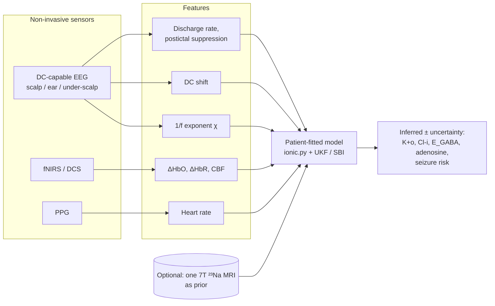

# Inferring Hidden Brain Variables from Non-Invasive Signals

### What "inferred" means, the formulas, their derivations, and a verification audit

*As of 2026-09-27. Companion to `Epilepsy_Overview.md`, `Seizure_Neurophysiology.md`, `Temple_Technical_Dossier.md` and `epilepsy_sim/SIMULATION.md`.*

> **Bottom line.** Only some seizure variables can be measured from outside the head: EEG activity, blood flow, heart rate. Others, such as intracellular chloride, extracellular potassium and adenosine, need probes inside brain tissue. The non-invasive way to get those is to **infer** them: measure what you can, then use a model plus Bayesian statistics to compute the most likely hidden value **with an uncertainty range**.
>
> Every formula below was checked against the literature. Three errors and oversimplifications in earlier drafts were found and are corrected here (§7).

---

## Contents

1. [Measured vs inferred](#1-measured-vs-inferred)
2. [Which seizure variables need inference](#2-which-seizure-variables-need-inference)
3. [The general framework](#3-the-general-framework)
4. [Formulas and derivations for each quantity](#4-formulas-and-derivations-for-each-quantity)
5. [Non-invasive routes from the research](#5-non-invasive-routes-from-the-research)
6. [A practical pipeline for a wearable](#6-a-practical-pipeline-for-a-wearable)
7. [Verification audit](#7-verification-audit)
8. [Limitations of inference](#8-limitations-of-inference)
9. [References](#9-references)

---

## 1. Measured vs inferred

**Inferred** means *calculated, not measured*. No sensor touches the quantity. It is worked out from other signals, using a model that explains how the hidden quantity produces those signals.

| | Measured | Inferred |
|---|---|---|
| How | A sensor detects the quantity directly | Computed from other signals plus a model |
| Example | An electrode in the brain reads K⁺ = 12 mM | "This EEG and blood-flow pattern implies K⁺ is most likely 10–13 mM" |
| Accuracy | As good as the sensor | As good as the model; always reported with uncertainty |
| Invasive? | Often, for brain ions | No, which is the point |

**Everyday analogies:**

- Weather radar infers rainfall from radio echoes.
- A doctor infers liver damage from blood enzymes.
- A phone infers steps from acceleration.

---

## 2. Which seizure variables need inference

These values come from the healthy vs epileptic simulation in `epilepsy_sim/`:

| Variable | Healthy | Epileptic | Gold-standard (invasive) hardware | Non-invasive today? |
|---|---|---|---|---|
| Intracellular Cl⁻ (rest) | 5.6 mM | 11.6 mM | 2-photon imaging of genetically encoded Cl⁻ sensors (SuperClomeleon) | **Infer** |
| E_GABA (rest) | −69.6 mV | −54.1 mV | Gramicidin perforated-patch clamp | **Infer** (TMS-EEG proxy) |
| Interictal discharges | Not epileptiform | 33/min | Intracranial EEG | ✅ Scalp, ear or under-scalp EEG |
| Peak extracellular K⁺ | 6.1 mM | 12.2 mM | K⁺-selective microelectrodes | Proxy (DC-EEG) → **infer** |
| Peak intracellular Cl⁻ | 7.4 mM | 15.2 mM | Fluorescent sensors | **Infer** |
| Adenosine surge | 0.12 | 0.68 | Microdialysis, voltammetry, enzyme biosensors | **Infer** |
| Postictal silence | ~5 s | 25 s | Any EEG | ✅ EEG |
| Blood flow (peak → dip) | +42% → −47% | +31% → −46% | Laser Doppler, SPECT, fMRI | ✅ fNIRS, DCS, PPG |

---

## 3. The general framework

### 3.1 Forward model (cause → effect)

$$
\mathbf{y} = f(\boldsymbol\theta) + \boldsymbol\varepsilon
$$

| Symbol | Meaning | In this project |
|---|---|---|
| $\boldsymbol\theta$ | Hidden quantities | KCC2 strength, [Cl]i, [K]o, adenosine |
| $f(\cdot)$ | Model turning causes into signals | Physics equations or `ionic.py` |
| $\mathbf{y}$ | Sensor measurements | EEG discharge rate, DC shift, 1/f slope, HbO/HbR |
| $\boldsymbol\varepsilon$ | Noise | Electrode noise, motion artefacts |

### 3.2 Inversion (effect → cause): Bayes' theorem

$$
P(\boldsymbol\theta\mid\mathbf{y}) \;=\; \frac{P(\mathbf{y}\mid\boldsymbol\theta)\;P(\boldsymbol\theta)}{P(\mathbf{y})}
$$

| Term | Name | Meaning |
|---|---|---|
| $P(\boldsymbol\theta\mid\mathbf{y})$ | **Posterior** | Probability of each hidden value, given the data. This is the answer |
| $P(\mathbf{y}\mid\boldsymbol\theta)$ | **Likelihood** | How likely the data are if θ were true |
| $P(\boldsymbol\theta)$ | **Prior** | What was known beforehand, e.g. healthy [Cl]i is 4–8 mM |
| $P(\mathbf{y})$ | **Evidence** | Normalising constant |

### 3.3 From Bayes to least squares (derivation)

Assume Gaussian noise, $y_i = f_i(\boldsymbol\theta) + \varepsilon_i$ with $\varepsilon_i \sim \mathcal N(0,\sigma_i^2)$:

$$
P(\mathbf{y}\mid\boldsymbol\theta) = \prod_i \frac{1}{\sqrt{2\pi\sigma_i^2}}\exp\!\left(-\frac{(y_i - f_i(\boldsymbol\theta))^2}{2\sigma_i^2}\right)
$$

$$
\ln P(\mathbf{y}\mid\boldsymbol\theta) = \text{const} - \frac12\sum_i \frac{(y_i - f_i(\boldsymbol\theta))^2}{\sigma_i^2}
$$

With a **flat prior**, maximising the posterior is the same as minimising the weighted squared error:

$$
\hat{\boldsymbol\theta} = \arg\min_{\boldsymbol\theta}\sum_i\left(\frac{y_i - f_i(\boldsymbol\theta)}{\sigma_i}\right)^2
$$

With an informative prior, add $-2\ln P(\boldsymbol\theta)$ to the sum. That is the MAP (maximum a posteriori) estimate.

### 3.4 Uncertainty

$$
\bar\theta = \int \theta\,P(\theta\mid\mathbf y)\,d\theta,\qquad
\sigma_\theta^2 = \int (\theta-\bar\theta)^2\,P(\theta\mid\mathbf y)\,d\theta,\qquad
\text{report } \bar\theta \pm 2\sigma_\theta \;(\approx 95\%)
$$

### 3.5 Tracking values that change in time: the Kalman filter

$$
\begin{aligned}
\text{Predict:}\quad & \hat x_t^- = F\hat x_{t-1}, && P_t^- = FP_{t-1}F^\top + Q\\
\text{Gain:}\quad & K_t = P_t^-H^\top\left(HP_t^-H^\top + R\right)^{-1}\\
\text{Update:}\quad & \hat x_t = \hat x_t^- + K_t\left(y_t - H\hat x_t^-\right), && P_t = (I - K_tH)P_t^-
\end{aligned}
$$

Here $F$ is the state transition, $H$ maps state to measurement, and $Q$ and $R$ are the process and measurement noise covariances.

- **Nonlinear models** such as `ionic.py` use the **unscented Kalman filter (UKF)** or particle filters.
- Ullah & Schiff (2010) used a UKF to reconstruct hidden extracellular K⁺ during seizures from voltage recordings.
- A 2025 study used a UKF on DC-coupled/infraslow recordings, treating the infraslow signal as a transform of extracellular K⁺.

### 3.6 Simulation-based inference: when the likelihood can't be written down

Approximate Bayesian Computation (ABC):

```
repeat many times:
    θ* ~ P(θ)                    # draw a candidate from the prior
    y* = f(θ*)                   # simulate (e.g. run ionic.py)
    if distance(y*, y_real) < ε: # keep candidates that reproduce the data
        accept θ*
accepted θ*  ≈  P(θ | y)         # the posterior
```

The Virtual Epileptic Patient uses this and related methods (MCMC, variational inference, neural posterior estimation) to infer hidden "epileptogenicity" from SEEG and MRI.

---

## 4. Formulas and derivations for each quantity

### 4.1 Nernst equation: the foundation

At equilibrium the electrochemical potential of an ion is equal on both sides of the membrane:

$$
\mu = \mu^0 + RT\ln[X] + zFV \quad\Rightarrow\quad RT\ln[X]_{in} + zFV_{in} = RT\ln[X]_{out} + zFV_{out}
$$

$$
\boxed{E_X = \frac{RT}{zF}\ln\frac{[X]_{out}}{[X]_{in}}}
$$

- For K⁺ ($z=+1$): $E_K = \frac{RT}{F}\ln\frac{[K]_o}{[K]_i}$.
- For Cl⁻ ($z=-1$): $E_{Cl} = \frac{RT}{F}\ln\frac{[Cl]_i}{[Cl]_o}$.

| Temperature | RT/F | × ln 10 (mV per tenfold change) |
|---|---|---|
| 36 °C | 26.64 mV (value used in Cressman's model and `ionic.py`) | 61.34 |
| 37 °C | 26.73 mV | **61.54** |

### 4.2 Extracellular K⁺

**(a) From an intracellular glial recording (invasive, derivable).** Glial membranes are dominated by K⁺ conductance, so they behave like K⁺ electrodes, but *not perfectly Nernstian*:

$$
\Delta V_{glia} = S\log_{10}\frac{[K]_{o,new}}{[K]_{o,rest}}
\quad\Longrightarrow\quad
\boxed{[K]_{o,new} = [K]_{o,rest}\cdot 10^{\,\Delta V_{glia}/S}}
$$

| Preparation | Measured slope S |
|---|---|
| Theory, 37 °C | 61.5 mV/decade |
| Amphibian glia (Kuffler 1966) | ≈ Nernstian |
| Mammalian primary glia | **51 mV/decade** |
| C6 glial line | 40 mV/decade |

**(b) From a scalp DC shift (non-invasive): no closed-form formula.**

- The scalp DC shift is a **field potential** produced by currents through the glial network (K⁺ spatial buffering), with *opposite polarity* to the glial membrane voltage.
- The skull, CSF and dura attenuate a cortical DC signal to roughly **7%** at the scalp.
- The relationship depends on geometry, the extent of tissue involved and conductivity, so a single constant cannot convert scalp µV to mM.
- **The correct approach is model-based tracking** (UKF / §3.5): treat [K]o as a hidden state whose dynamics generate the infraslow signal.

It remains a strong **qualitative** marker: DC shifts at seizure onset are consistently associated with a rise in extracellular K⁺ and can be recorded on the scalp with a time constant of 2 s or more.

### 4.3 Intracellular chloride from E_GABA

GABA-A channels pass Cl⁻ and HCO₃⁻, and two equivalent-looking formulas exist. **Use the one that matches the current model.**

**(a) Chord-conductance form (used by `ionic.py`).** With parallel conductances, the reversal is where the total current is zero:

$$
g_{Cl}(V-E_{Cl}) + g_{HCO_3}(V-E_{HCO_3}) = 0
\;\Rightarrow\;
E_{GABA} = \frac{g_{Cl}E_{Cl} + g_{HCO_3}E_{HCO_3}}{g_{Cl}+g_{HCO_3}} = 0.8\,E_{Cl} + 0.2\,E_{HCO_3}
$$

Inverse:

$$
E_{Cl} = \frac{E_{GABA} - 0.2\,E_{HCO_3}}{0.8},\qquad
\boxed{[Cl]_i = [Cl]_o\,\exp\!\left(\frac{E_{Cl}}{RT/F}\right)}
$$

**Worked check** (epileptic rest, $E_{GABA}=-54.1$ mV, $E_{HCO_3} = 26.64\ln(16/26) = -12.9$ mV):

$$
E_{Cl} = \frac{-54.1 + 2.58}{0.8} = -64.4\text{ mV},\qquad
[Cl]_i = 130\,e^{-64.4/26.64} = 130\times0.0892 = \mathbf{11.6\ mM}\ \checkmark
$$

**(b) GHK form (permeability-based; more physical for real channels).**

$$
E_{GABA} = \frac{RT}{F}\ln\frac{P_{Cl}[Cl]_i + P_{HCO_3}[HCO_3]_i}{P_{Cl}[Cl]_o + P_{HCO_3}[HCO_3]_o}
$$

Inverse, with $r = P_{HCO_3}/P_{Cl}$:

$$
\boxed{[Cl]_i = \left([Cl]_o + r[HCO_3]_o\right)e^{E_{GABA}/(RT/F)} - r[HCO_3]_i}
$$

Measured values of $r$ range from about **0.2 to 0.44**, so any inferred [Cl]i inherits this uncertainty.

**How much the two forms differ** (same [Cl]i values):

| State | [Cl]i (mM) | E_Cl | Chord E_GABA | GHK E_GABA (r = 0.25) |
|---|---|---|---|---|
| Healthy rest | 5.6 | −83.8 | **−69.6** | −70.7 |
| Healthy peak | 7.4 | −76.4 | **−63.7** | −66.1 |
| Epileptic rest | 11.6 | −64.4 | **−54.1** | −57.8 |
| Epileptic peak | 15.2 | −57.2 | **−48.3** | −52.3 |

**Where E_GABA comes from non-invasively:** it is not measured directly. TMS-EEG paired-pulse inhibition (SICI, LICI) indexes GABA-A efficacy, and model inversion converts it to an estimated E_GABA. That step carries its own uncertainty.

### 4.4 Excitation/inhibition balance from the EEG spectrum

This is an empirical model, not derived from first principles. The aperiodic part of the power spectrum is fitted with specparam (FOOOF):

$$
\text{knee mode: } L(f) = b - \log_{10}\!\left(k + f^{\chi}\right),\qquad
\text{fixed mode: } L(f) = b - \chi\log_{10} f
$$

| Symbol | Meaning |
|---|---|
| $b$ | Offset (broadband power) |
| $k$ | Knee (bend frequency) |
| $\chi$ | **Aperiodic exponent**: higher means more inhibition, lower means more excitation |

**Rationale:**

- Summed exponentially decaying synaptic currents have a Lorentzian power spectrum, $\propto 1/(k + f^\chi)$.
- Gao et al. (2017) showed in simulations that χ (roughly 30–50 Hz) tracks the E/I ratio, because slow GABA currents and fast AMPA currents shape the slope differently.
- A 2025 study with simultaneous EEG and MR spectroscopy linked EEG-based E/I to measured glutamate and GABA.

**Limit:** it gives relative E/I balance, not absolute concentrations.

### 4.5 Adenosine: no simple formula

An earlier draft proposed $A_{peak} = A_{th}\,e^{T_{silence}/\tau_A}$. **It fails the simulation's own data.** A single threshold $A_{th}$ would have to fit both tissues:

| Tissue | $A_{peak}$ | $T_{silence}$ | Implied $A_{th} = A_{peak}e^{-T/20}$ |
|---|---|---|---|
| Epileptic | 0.68 | 25 s | 0.195 |
| Healthy | 0.12 | ~5 s | 0.093 |

The two thresholds differ by 2×, so postictal silence is **not** set by adenosine alone; the Na⁺/K⁺ pump current also contributes. Adenosine can only be inferred by fitting the full model (§3.5–3.6) to EEG plus blood-flow data. PET with [¹⁸F]CPFPX images A1 *receptors* but has not been shown to detect endogenous adenosine release.

### 4.6 Blood flow and haemoglobin from optical sensors (fNIRS)

**Derivation of the modified Beer-Lambert law:**

$$
OD = -\log_{10}\frac{I}{I_0} = \varepsilon\,c\,L + G
\quad(\text{Beer-Lambert plus scattering loss } G)
$$

In tissue, the photon path is longer than the optode separation $d$: $L = d\cdot DPF$. $G$ is roughly constant, so it cancels in a change:

$$
\boxed{\Delta OD(\lambda) = \big(\varepsilon_{HbO}(\lambda)\,\Delta[HbO] + \varepsilon_{HbR}(\lambda)\,\Delta[HbR]\big)\cdot d\cdot DPF(\lambda)}
$$

Two wavelengths give two equations for two unknowns:

$$
\begin{bmatrix}\Delta[HbO]\\ \Delta[HbR]\end{bmatrix}
= \frac{1}{d}
\begin{bmatrix}\varepsilon_{HbO}(\lambda_1) & \varepsilon_{HbR}(\lambda_1)\\ \varepsilon_{HbO}(\lambda_2) & \varepsilon_{HbR}(\lambda_2)\end{bmatrix}^{-1}
\begin{bmatrix}\Delta OD(\lambda_1)/DPF(\lambda_1)\\ \Delta OD(\lambda_2)/DPF(\lambda_2)\end{bmatrix}
$$

**Differential pathlength factor** (Scholkmann & Wolf 2013, adult frontal head):

$$
DPF(\lambda, A) = 223.3 + 0.05624\,A^{0.8493} - 5.723\times10^{-7}\lambda^3 + 0.001245\,\lambda^2 - 0.9025\,\lambda
$$

Example: λ = 760 nm, age 30 → **DPF ≈ 6.3**.

**Limits:**

- *Partial volume:* the brain is only part of the light path, so cortical changes are underestimated.
- Two source–detector distances (short-channel regression) or time-domain NIRS reduce scalp contamination.
- A temple-worn PPG device samples mostly scalp and superficial artery flow.

### 4.7 Fitting all quantities together

Individual formulas cover one variable each. The strongest method fits **everything at once** with a biophysical model:

$$
\hat{\boldsymbol\theta} = \arg\min_{\boldsymbol\theta}\left[\sum_{\text{signals}}\sum_t\left(\frac{y_t - f_t(\boldsymbol\theta)}{\sigma}\right)^2 - 2\ln P(\boldsymbol\theta)\right]
$$

where $\boldsymbol\theta$ = (KCC2 strength, glial buffering, K⁺ clearance, adenosine gain, …) and $f$ = `ionic.py`. Once fitted, the model outputs the full time course of [K]o, [Cl]i, E_GABA and adenosine: *inferred*, with uncertainty.

---

## 5. Non-invasive routes from the research

### 5.1 Direct nuclear MRI (non-invasive, scanner only, static maps)

| Ion | Method | Human status | Limitation |
|---|---|---|---|
| Na⁺ | ²³Na MRI; triple-quantum-filtered (TQF) MRI separates intracellular from extracellular | Total sodium is raised in the epileptogenic zone; 7T sodium features are used as priors in personalised epilepsy models | 7T, low resolution, minutes per scan |
| K⁺ | ³⁹K MRI | Feasible at 7T: ~1 cm³ voxels in ~30 min | Mostly intracellular K⁺, very low signal |
| Cl⁻ | ³⁵Cl MRI | Feasible at 7T in 10–35 min | ~15× weaker than sodium; can't separate inside from outside |
| Glutamate / GABA | 7T MR spectroscopy, GluCEST | GluCEST lateralised non-lesional temporal lobe epilepsy | Measures amounts, not ion gradients |

### 5.2 Proxies (signals caused by the hidden variables)

| Hidden variable | Proxy | Wearable? |
|---|---|---|
| Extracellular K⁺ | DC shifts / infraslow EEG (glial K⁺ buffering) | Yes, with DC-stable electrodes |
| GABA-A inhibition | TMS-EEG SICI/LICI | Clinic (TMS coil) |
| E/I balance | Aperiodic EEG exponent χ | Yes |
| A1 receptors | [¹⁸F]CPFPX PET | No |
| Adenosine (indirect) | Postictal suppression + hypoperfusion, via a model | Yes (EEG + optics) |

### 5.3 Model-based inference (digital twins)

- **The Virtual Epileptic Patient** combines MRI connectivity with EEG/SEEG, then applies Bayesian inversion (HMC, variational, simulation-based) to estimate hidden epileptogenicity. It runs at high resolution with neural-field models and is used in surgery and stimulation planning.
- **Neural-mass models of TMS-EEG** estimate GABA-pool activity, validated pharmacologically.

### 5.4 Emerging (not yet usable in humans)

- **Photoacoustic chemical imaging** with K⁺-sensitive nanoparticles mapped extracellular K⁺ in mouse tumours, but needs an injected probe; the skull scatters light and attenuates sound heavily.
- **Transcranial photoacoustic** and **functional ultrasound** imaging give blood flow, not ions.
- **Implantable ion-selective K⁺ arrays** could ride on existing under-scalp or responsive-neurostimulation implants.

---

## 6. A practical pipeline for a wearable



| Sensor | Directly gives | Feeds inference of |
|---|---|---|
| DC-capable EEG | Discharges, postictal silence, DC shifts, χ | [K]o, E/I balance, [Cl]i (with model), adenosine (with model) |
| fNIRS / DCS | ΔHbO, ΔHbR, blood flow | Metabolic load, adenosine (with model) |
| PPG | Heart rate, pulse perfusion | Autonomic surge (ictal tachycardia) |
| 7T sodium MRI (once) | Resting Na⁺ map | Prior on pump function |

**Validation requirement:** before any clinical use, inferred values must be compared with invasive ground truth at least once. Patients undergoing intracranial EEG monitoring for surgery are the natural cohort.

---

## 7. Verification audit

Each formula from earlier drafts was checked against the literature:

| # | Formula | Verdict | Correction |
|---|---|---|---|
| 1 | Bayes' theorem, posterior, credible interval | ✅ Correct | – |
| 2 | Least squares = best estimate | ✅ Conditional | Only with Gaussian noise and a flat prior (derived in §3.3) |
| 3 | Kalman filter | ✅ Correct | UKF for nonlinear models (Ullah & Schiff 2010) |
| 4 | Nernst slope 61.5 mV/decade | ✅ at 37 °C | `ionic.py`'s RT/F = 26.64 mV corresponds to **36 °C**, not 37 °C (comment fixed) |
| 5 | $[K]_o = [K]_{o,rest}\cdot10^{\Delta V/61.5k}$ from scalp DC | ❌ Oversimplified | Mammalian glia slope is **51**, not 61.5; the scalp DC shift is a field potential, not the glial voltage; attenuation is not a constant. Replaced by §4.2(a) for invasive recordings and model tracking for scalp |
| 6 | GHK inverse for [Cl]i | ⚠️ Mismatch | The formula is valid, but `ionic.py`'s current uses the **chord** form. Recorded E_GABA values were 1–4 mV off; code and `SIMULATION.md` corrected (§4.3) |
| 7 | Aperiodic fit $b - \log_{10}(k + f^\chi)$ | ✅ Correct | Relative E/I only |
| 8 | $A_{peak} = A_{th}e^{T/\tau}$ | ❌ Withdrawn | The simulation's own data give inconsistent thresholds (§4.5) |
| 9 | Modified Beer-Lambert, DPF ≈ 6 | ✅ Correct | Scholkmann-Wolf gives 6.3 at 760 nm, age 30 |

**Numerical checks performed:**

```
RT/F:        36 °C → 26.64 mV (×ln10 = 61.34);  37 °C → 26.727 mV (×ln10 = 61.54)
E_HCO3:      26.64·ln(16/26) = −12.9 mV
[Cl]i check: E_GABA −54.1 → E_Cl −64.4 → [Cl]i = 11.6 mM  ✓
DPF:         Scholkmann-Wolf(760 nm, 30 y) = 6.3
Adenosine:   implied thresholds 0.195 vs 0.093 → formula rejected
```

---

## 8. Limitations of inference

1. **Model dependence.** An inferred value is only as good as the model. Missing mechanisms bias the estimate.
2. **Non-identifiability.** Different hidden causes can produce the same signal. Weak KCC2 and weak GABA receptors both reduce inhibition, so combining several signals is essential.
3. **Uncertainty must be reported.** A bare number without "±" is not a valid inference.
4. **Parameter uncertainty propagates.** For example, the HCO₃⁻/Cl⁻ permeability ratio (0.2–0.44) and the glial slope (40–59 mV/decade).
5. **Validation is mandatory.** Methods need at least one comparison with invasive measurements before being trusted.
6. **Not a diagnostic tool.** The formulas and pipeline here are research concepts, not clinically approved methods.

---

## 9. References

**Inference methods**

- Ullah G, Schiff SJ (2010). *Assimilating seizure dynamics.* PLoS Comput Biol. [link](https://journals.plos.org/ploscompbiol/article?id=10.1371%2Fjournal.pcbi.1000776)
- *Tracking neuronal dynamics during seizures.* BMC Neurosci (2010). [PMC](https://pmc.ncbi.nlm.nih.gov/articles/PMC3090797/)
- *Data driven multiscale modelling of paroxysmal brain transitions using DC-coupled electrophysiological data.* PLoS One (2025). [PMC](https://pmc.ncbi.nlm.nih.gov/articles/PMC13379037/)
- *Extracranial estimation of neural mass model parameters using the Unscented Kalman Filter.* Front Appl Math Stat (2018). [link](https://www.frontiersin.org/articles/10.3389/fams.2018.00046/full)
- Hashemi M et al. *The Bayesian Virtual Epileptic Patient.* NeuroImage (2020). [link](https://www.sciencedirect.com/science/article/pii/S1053811920303268)
- *High-resolution Bayesian Virtual Epileptic Patient using neural field models.* Netw Neurosci. [link](https://direct.mit.edu/netn/article/10/2/374/134727/High-resolution-Bayesian-Virtual-Epileptic-Patient)
- *Virtual brain twins for stimulation in epilepsy.* Nat Comput Sci (2025). [link](https://www.nature.com/articles/s43588-025-00841-6)

**Potassium, glia and DC shifts**

- *Glial membrane potential and extracellular potassium concentration in cultured glial cells.* Exp Neurol (1979). [link](https://www.sciencedirect.com/science/article/abs/pii/0014488679900906)
- Kofuji & Newman. *Regulation of potassium by glial cells in the CNS.* [PDF](http://www2.neuroscience.umn.edu/eanwebsite/PDF%20EAN%20pubs/Astrocytes%206%20151%202009.pdf)
- *Neuronal and glial activity during spreading depression in cerebral cortex of cat.* J Neurophysiol (1975). [link](https://journals.physiology.org/doi/abs/10.1152/jn.1975.38.4.822)
- *Numerical simulation of cortical spreading depolarization to optimize DC-EEG electrode spacing.* [PMC](https://pmc.ncbi.nlm.nih.gov/articles/PMC9262830/)
- *Ictal direct current shifts contribute to defining the core ictal focus.* Brain Commun (2022). [link](https://academic.oup.com/braincomms/article/4/5/fcac222/6678949)
- *Ictal DC shift recording on scalp EEG: proof of principle.* Neurology. [link](https://www.neurology.org/doi/10.1212/WNL.0000000000205645)

**Chloride and GABA**

- *Anion transport and GABA signaling.* Front Cell Neurosci (2013). [link](https://www.frontiersin.org/journals/cellular-neuroscience/articles/10.3389/fncel.2013.00177/full)
- *Bidirectional regulation of GABA-A reversal potential in the adult brain.* [PMC](https://www.ncbi.nlm.nih.gov/pmc/articles/PMC10817304/)
- *Tracking cortical excitability dynamics with TMS in focal epilepsy.* [PMC](https://pmc.ncbi.nlm.nih.gov/articles/PMC8994988/)
- *TMS as a pharmacodynamic indicator of XEN1101.* [PMC](https://www.ncbi.nlm.nih.gov/pmc/articles/PMC6856596/)

**E/I from the EEG spectrum**

- Donoghue T et al. (2020). *Parameterizing neural power spectra into periodic and aperiodic components.* Nat Neurosci 23:1655. [docs](https://fooof-tools.github.io/fooof/auto_tutorials/plot_05-AperiodicFitting.html)
- Gao R, Peterson EJ, Voytek B (2017). *Inferring synaptic excitation/inhibition balance from field potentials.* NeuroImage 158:70.
- *Aperiodic activity indexes neural hyperexcitability in generalized epilepsy.* eNeuro (2024). [PMC](https://pmc.ncbi.nlm.nih.gov/articles/PMC11376430/)
- *Dynamic E/I balance preceding seizure onset.* BMC Med (2025). [link](https://link.springer.com/article/10.1186/s12916-025-04447-7)
- *EEG-based E/I balance reflects glutamate and GABA concentrations.* bioRxiv (2025). [link](https://www.biorxiv.org/content/10.1101/2025.03.31.646339.full.pdf)

**Optics**

- *Modified Beer-Lambert Law.* Society for fNIRS. [link](https://fnirs.org/courses/introduction-to-fnirs/lessons/modified-beer-lambert-law-mbll/)
- Scholkmann F, Wolf M (2013). *General equation for the differential pathlength factor of the frontal human head depending on wavelength and age.* J Biomed Opt 18:105004.

**Non-invasive ion and chemical imaging**

- *Brain sodium MRI-derived priors support estimation of epileptogenic zones.* [PMC](https://pmc.ncbi.nlm.nih.gov/articles/PMC11340996/)
- *Volumetric ²³Na single and triple-quantum imaging at 7T.* [link](https://www.sciencedirect.com/science/article/pii/S0939388921000830)
- *In vivo ³⁹K MR imaging of human muscle and brain.* Radiology (2013). [PubMed](https://pubmed.ncbi.nlm.nih.gov/23878285/)
- *In vivo ³⁵Cl MR imaging in humans.* Radiology (2014). [link](https://doi.org/10.1148/radiol.13131725)
- *GluCEST at 7T lateralizes nonlesional TLE.* [PMC](https://www.ncbi.nlm.nih.gov/pmc/articles/PMC8413808/)
- *Noninvasive mapping of extracellular potassium via multi-wavelength photoacoustic imaging.* [PMC](https://pmc.ncbi.nlm.nih.gov/articles/PMC12349659/)

**Adenosine**

- *Quantification of cerebral A1 adenosine receptors in humans using [¹⁸F]CPFPX and PET.* [PubMed](https://pubmed.ncbi.nlm.nih.gov/15091113/)
- *A1 adenosine receptor PET using [¹⁸F]CPFPX: displacement studies in humans.* [link](https://www.researchgate.net/publication/6977688_A1_adenosine_receptor_PET_using_F-18CPFPX_Displacement_studies_in_humans)
- During MJ, Spencer DD (1992). *Adenosine: a potential mediator of seizure arrest and postictal refractoriness.* Ann Neurol 32:618.
