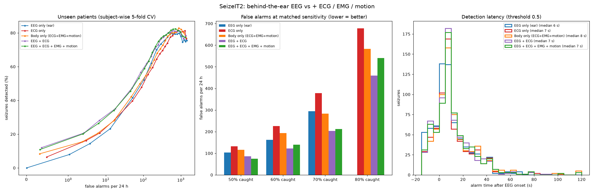

# Multimodal Seizure Detection on SeizeIT2

### Does adding body signals (heart, muscle, motion) to a behind-the-ear EEG cut false alarms?

> **Short answer: yes, the heart does.** On all 125 SeizeIT2 patients, adding a chest ECG to 2-channel behind-the-ear EEG cut false alarms by **18–31%** at the same share of seizures caught, and by **34%** at the default setting. It helped in **115 of 125 patients**. The cost was about 1 second of delay.
>
> Adding shoulder EMG and motion on top of ECG gave **no consistent further gain**. Most of these seizures are focal and don't involve large movements.
>
> False-alarm rates are still far too high for daily use. These are general models tested on patients they have never seen, with no personal tuning.

Code: [`epilepsy_sim/detect/seizeit2.py`](epilepsy_sim/detect/seizeit2.py) · Results: [`epilepsy_sim/detect/results_seizeit2/`](epilepsy_sim/detect/results_seizeit2/)

---

## Contents

1. [Why this experiment](#1-why-this-experiment)
2. [The dataset](#2-the-dataset)
3. [Streaming 126 GB without downloading it](#3-streaming-126-gb-without-downloading-it)
4. [Signals and features](#4-signals-and-features)
5. [Models and evaluation](#5-models-and-evaluation)
6. [Results](#6-results)
7. [Interim snapshots](#7-interim-snapshots)
8. [What it means for the ear-hook](#8-what-it-means-for-the-ear-hook)
9. [Limitations](#9-limitations)
10. [Next steps](#10-next-steps)
11. [Reproduce](#11-reproduce)
12. [References](#12-references)

---

## 1. Why this experiment

The CHB-MIT work showed that ear-position EEG catches as many seizures as a full cap, but with too many false alarms. For new users, those were hundreds per day (README §6.5).

The research in [`Seizure_Physiological_Signals.md`](Seizure_Physiological_Signals.md) pointed to the body as the fix:

- heart rate rises in **82%** of patients during seizures;
- motor seizures show clear EMG and motion patterns;
- walking, chewing and talking produce EEG artefacts that the body signals can explain away.

SeizeIT2 is the first large public dataset that records **all of these at once with a wearable**. It is almost exactly the sensor set of our proposed ear-hook.

## 2. The dataset

**SeizeIT2** (Bhagubai et al., 2025) is available on OpenNeuro as ds005873 v1.1.0 under a **CC0** licence. It was recorded with the Byteflies *Sensor Dot* in 5 European epilepsy monitoring units.

| | |
|---|---|
| Patients | **125** (focal epilepsy; adults, plus children from Leuven) |
| Seizures | **883** focal: aware, impaired-awareness, focal-to-bilateral tonic-clonic, and others |
| Recording | **11,626 h** in 2,850 runs; mean seizure 58 s (3 s – 16 min) |
| EEG | 2 channels **behind the ear** (mastoid), 256 Hz: a same-side channel + a cross-head channel |
| ECG | 1 channel, chest, 256 Hz |
| EMG | 1 channel, left deltoid, 256 Hz |
| Motion | accelerometer + gyroscope on 2 devices (upper back, chest), 25 Hz |
| Missing | ECG/EMG absent in 46 runs; motion absent in 299 runs |
| Labels | seizure onset/offset marked by clinicians from video-EEG |

## 3. Streaming 126 GB without downloading it

The full dataset is **126 GB** and the PC had 19 GB free. Each run is **streamed** from OpenNeuro's S3 bucket straight into RAM:

1. the 4 EDF files (EEG, ECG, EMG, motion) download in parallel into memory;
2. a small built-in EDF reader decodes them there;
3. features are computed from the full-resolution signal;
4. **only the features are saved** (1.8 GB in total).

No EDF file ever touches the disk. This loses **no quality**: the features are computed from exactly the same samples a download would give.

Three runs stream in parallel (12 connections), at about 18–25 MB/s. The job is resumable and atomic: a half-written feature file never counts as finished.

## 4. Signals and features

All signals are cut into **4 s windows every 2 s**. A window is labelled "seizure" if its centre lies inside a clinician-marked seizure.

| Signal | Features (per window) | Count |
|---|---|---|
| **Ear EEG** (2 ch) | The same 14 per channel as the CHB-MIT detector: line length, log variance, Hjorth mobility and complexity, log power and relative power in δ θ α β γ | 28 |
| **ECG** | R-peaks (Pan-Tompkins style, adaptive threshold, 270 ms refractory, outlier-beat rejection) → HR over 4 / 10 / 30 s, HR rise over 30 s, RMSSD and SDNN over 30 s, beat quality (beats found vs expected), ECG line length | 8 |
| **EMG** | 20–120 Hz with a 50 Hz notch → log RMS, line length, zero-crossing rate, fraction above 60 Hz, low-frequency (0.5–20 Hz) log power | 5 |
| **Motion** | For each device (back, chest): log std of acceleration magnitude, line length, fraction of power at 2–8 Hz (clonic jerking band), mean gyroscope magnitude | 8 |

**Per-person baseline normalisation.** Every feature is also z-scored against a causal ~10-minute moving average of that same recording. This was the step that added 43 detected seizures on CHB-MIT. Absolute heart rate and beat quality are kept as well, because an absolute tachycardia matters, not just a change.

Missing sensors stay missing: the gradient-boosted trees route missing values separately, so no patient is dropped.

## 5. Models and evaluation

- **Classifier:** HistGradientBoosting (150 trees, class-balanced), the same as the CHB-MIT work. Training uses all seizure windows plus 3% of the other windows.
- **New-user test:** patient-wise **5-fold cross-validation**, balanced by seizure count. Every patient is scored by a model that **never saw any of their data**.
- **Alarms:** probability smoothed over 3 windows (6 s), then a threshold, with a 60 s refractory period between alarms.
- **Scoring:**
  - a seizure is **caught** if an alarm fires between 15 s before onset and the seizure's end;
  - any other alarm counts as a **false alarm**, except within 60 s after a seizure;
  - thresholds are swept from 0.05 to 0.99.
- **Five setups:**
  - EEG only (ear)
  - ECG only
  - body only (ECG + EMG + motion)
  - EEG + ECG
  - EEG + ECG + EMG + motion

**How the setups are compared.** The fair comparison is false alarms at **matched sensitivity**: the fewest false alarms at any threshold that catches at least X% of seizures.

This is not interpolated from a curve. Sensitivity is *not* monotonic in the threshold: at low thresholds, a false alarm just before a seizure starts the 60 s refractory period and blocks the real alarm. An early version of the summary interpolated anyway and produced nonsense (EEG-only apparently 1,300 FA/day at 60%), so it was replaced with this minimum-over-thresholds rule.

## 6. Results

**All 125 patients, 883 seizures, 11,626 h.**

### 6.1 False alarms per 24 h at matched sensitivity (lower is better)

| Setup | 50% caught | 60% caught | 70% caught | 80% caught |
|---|---|---|---|---|
| EEG only (ear) | 103.7 | 161.7 | 294.4 | *not reached* |
| ECG only | 132.6 | 225.6 | 378.2 | 677.8 |
| Body only (ECG + EMG + motion) | 116.3 | 193.5 | 283.8 | 583.1 |
| **EEG + ECG** | **85.5 (−18%)** | **122.8 (−24%)** | **204.0 (−31%)** | **459.2** |
| EEG + ECG + EMG + motion | 75.4 (−27%) | 139.3 (−14%) | 211.7 (−28%) | 539.9 |

### 6.2 Seizures caught within a daily false-alarm budget (higher is better)

| Setup | ≤5 | ≤20 | ≤50 | ≤100 | ≤200 |
|---|---|---|---|---|---|
| EEG only (ear) | 14% | 23% | 23% | 42% | 62% |
| ECG only | 16% | 29% | 29% | 48% | 60% |
| Body only | 16% | 28% | 42% | 50% | 64% |
| **EEG + ECG** | **21%** | **35%** | 35% | **57%** | 66% |
| EEG + ECG + EMG + motion | 20% | 34% | **45%** | 53% | **68%** |

*Where two columns repeat (e.g. 23% at both ≤20 and ≤50), no tested threshold lands between the two budgets. A finer threshold sweep would smooth this out.*

### 6.3 At the default threshold (0.5)

| Setup | Seizures caught | False alarms / 24 h | Median delay (IQR) |
|---|---|---|---|
| EEG only (ear) | 79.4% (701/883) | 608 | 6 s (0–16) |
| ECG only | 74.0% | 438 | 7 s (2–18) |
| Body only | 75.4% | 386 | 8 s (2–19) |
| **EEG + ECG** | **78.7% (695/883)** | **399 (−34%)** | 7 s (2–16) |
| EEG + ECG + EMG + motion | 78.3% (691/883) | **348 (−43%)** | 7 s (2–17) |

### 6.4 Per patient

| | EEG only | EEG + ECG | All four |
|---|---|---|---|
| Median false alarms/day per patient (IQR) | 618 (533–686) | **373 (329–440)** | **342 (299–400)** |
| Patients with fewer false alarms than EEG-only | – | **115 / 125** | **120 / 125** |

Seizures caught per patient barely changed: EEG + ECG caught more in 16 patients and fewer in 21.



## 7. Interim snapshots

The analysis was run twice while the data was still streaming. The effect of ECG grew as more patients were added:

| Snapshot | Patients / seizures / hours | EEG + ECG vs EEG only, at matched sensitivity |
|---|---|---|
| 1 | 48 / 363 / 4,304 | −7% to −20% |
| 2 | 78 / 590 / 7,371 | −21% to −44% |
| **Final** | **125 / 883 / 11,626** | **−18% to −31%** (and −34% at the default threshold) |

## 8. What it means for the ear-hook

1. **Heart rate is the add-on that pays.** Adding ECG to 2-channel ear-EEG cut false alarms by 18–31% at the same sensitivity and helped 92% of patients. The ear-hook can measure heart rate with **in-ear PPG** instead of a chest ECG. Beat timing from PPG is noisier than ECG, so this should be re-tested with PPG.
2. **The body alone rivals the 2-channel ear EEG under strict false-alarm budgets.** At 20 or fewer false alarms a day, ECG alone (29%) and the body sensors (28%) beat EEG alone (23%). For focal seizures, the heart carries about as much seizure information as a behind-the-ear electrode pair.
3. **EMG and motion are not worth it for focal seizures overall.** On top of ECG they were mixed: slightly better in some columns, worse in others. They are expected to matter for **convulsive** seizures (tonic-clonic, hyperkinetic), which are a minority here. That should be tested on its own. For the ear-hook, the built-in IMU is still useful for **artefact rejection** (walking, chewing), which this experiment doesn't isolate.
4. **Delay:** fusion costs about 1 s (median 6 s → 7 s after EEG onset). That is acceptable for a warning device.
5. **The ceiling is sensitivity, not only false alarms.** No setup catches much more than about 80% of seizures. Some focal seizures show almost nothing at the mastoid and have no heart-rate change. The live lab's "no HR response" scenario shows exactly this case.

The live lab (`epilepsy_sim/viz/epilepsy_live.html`) illustrates the same trade-off on simulated body signals: requiring body confirmation removes movement false alarms but costs a few seconds and misses seizures with no body sign.

## 9. Limitations

- **General models only.** Absolute false-alarm rates (hundreds per day) come from models tested on never-seen patients, deciding every 2 s. Published systems reach ~0.25–1 FA/day with patient-specific tuning, longer decision windows and post-processing. The **relative** reductions are the point of this experiment.
- **Chest ECG, not ear PPG.** The ear-hook would measure heart rate optically at the ear, so the benefit may be smaller or larger with PPG.
- **Hospital recordings.** EMU patients move less than people in daily life. Real-world motion artefacts may make motion sensors more valuable than seen here.
- **Hand-crafted features + gradient boosting.** A sequence model over minutes of heart rate (pre-ictal HRV change was reported in 41% of patients) might extract more.
- **The threshold grid is coarse** at the high end (0.90, 0.95, 0.97, 0.98, 0.99), which makes the budget table step-like.
- **Features in `data/seizeit2/` are not redistributed.** They are regenerated by the fetch step.

## 10. Next steps

| Priority | Step | Why |
|---|---|---|
| ★★★ | **Personal fine-tuning** on SeizeIT2: add each patient's first 1–2 seizures, test on the rest | On CHB-MIT this cut false alarms by 40–65% |
| ★★★ | **Longer decision windows + event-level post-processing** (e.g. require ≥10 s of agreement) | Standard way published systems reach ≤1 FA/day |
| ★★ | **Split by seizure type** (non-motor vs motor vs tonic-clonic) | Tells whether EMG/motion earn their place for convulsive seizures |
| ★★ | **Degrade ECG to PPG-like beat timing** (jitter, dropouts) | Estimates what the ear-hook's optical heart rate would achieve |
| ★ | **Sequence model** over 5–10 min of HR/HRV + EEG | Captures slow pre-ictal autonomic change |

## 11. Reproduce

From `epilepsy_sim/`:

```bash
uv run detect/seizeit2.py test               # smoke test on 2 small runs
uv run detect/seizeit2.py fetch              # stream all 2,850 runs (~126 GB through RAM, ~1.8 GB of features), resumable
uv run detect/seizeit2.py run                # 5 setups x 5-fold CV (~1 h); results -> detect/results_seizeit2/
uv run detect/seizeit2.py run --snapshot     # interim results on fully streamed patients while fetch is running
uv run detect/seizeit2.py report             # recompute tables + figure from saved metrics (no retraining)
```

If `detect/ntfy_topic.txt` exists, your phone gets a notification when fetch or run finishes, or crashes.

## 12. References

- Bhagubai M, Chatzichristos C, Swinnen L, et al. (2025). SeizeIT2 dataset paper, *Scientific Data* ([link](https://www.nature.com/articles/s41597-025-05580-x)). Dataset: OpenNeuro ds005873 v1.1.0, doi:10.18112/openneuro.ds005873.v1.1.0 (CC0).
- Jeppesen J et al. (2024). EEG + ECG wearable seizure detection, *Epileptic Disorders*: 84.8% sensitivity at 0.25 FA/day ([link](https://onlinelibrary.wiley.com/doi/10.1002/epd2.20196)).
- Pan J, Tompkins WJ (1985). *A real-time QRS detection algorithm.* IEEE Trans Biomed Eng 32:230.
- Project background: [`Seizure_Physiological_Signals.md`](Seizure_Physiological_Signals.md) (heart rate ↑ in 82% of patients; ictal tachycardia +53% in focal seizures).
