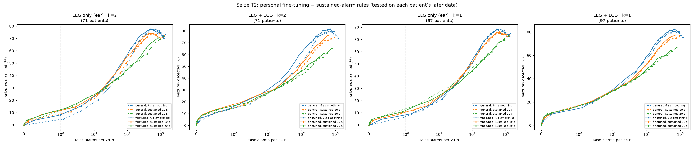
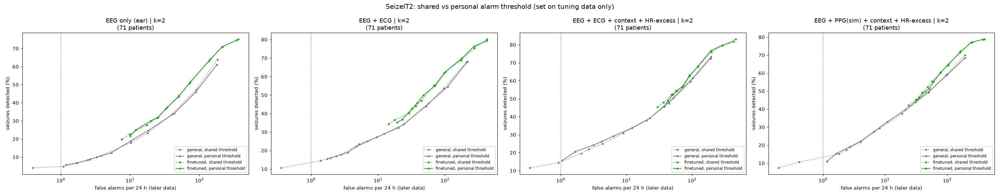

# Multimodal Seizure Detection on SeizeIT2

### Does adding body signals (heart, muscle, motion) to a behind-the-ear EEG cut false alarms?

> **Short answer.** Yes. **The heart matters most, then personalisation.** Every step below was measured on real wearable data from 125 patients (883 seizures, 11,626 h). Each patient is scored by models that never saw them, on data recorded *after* the first days used for tuning.
>
> | Step (71 patients with ≥3 seizures; later data only) | Caught at ≤1 false alarm/day | ≤5/day | ≤20/day |
> |---|---|---|---|
> | Behind-the-ear EEG only (general model) | 4% | 11% | 23% |
> | + chest ECG | 12% | 19% | 31% |
> | + 15 s / 1 min / 5 min context + "heart rate not explained by movement" | 14% | 25% | 36% |
> | + fine-tuning on the user's first 2 seizures | 15% | 27% | 41% |
> | Two-stage: general model + **personal alarm verifier** | **19%** | **30%** | **45%** |
> | **… for heart "responders"** (HR rose >50 bpm in one of their first 2 seizures; 23 of 69) | **39%** | **64%** | **77%** |
>
> **Key findings:**
> - **The heart is the add-on that pays.** ECG cut false alarms by 18–44% at matched sensitivity and helped 115 of 125 patients.
> - **The accelerometer pays too**, not as a detector but by explaining away exercise heart rate.
> - **Minute-scale context** and **personalisation** each add a further gain.
> - **What didn't help:** sustained-alarm rules, personal alarm thresholds, and a bigger model.
> - **False alarms are patient-specific.** A quarter of users produce 59–77% of them. The one trait linked to them is an unstable ear-EEG signal, which points to electrode fit.
> - **At matched false-alarm rates, the results are on par with or above every published SeizeIT2 detector** we found (§6.9).
> - **Target not yet reached.** The goal of ≥50% of seizures at ≤1 false alarm/day is not reached overall. The best result is **39–40% for heart responders**, and 47% at ≤2/day.
> - **Why it plateaus (§6.16).** A quarter of all seizures never raise the detector above 0.5, and only 30% ever reach 0.95. The remaining gap is a **signal** problem (two behind-the-ear electrodes + chest ECG), not an alarm-logic problem. Signal-quality features, bigger models and alarm rules no longer move the numbers.

Code: [`epilepsy_sim/detect/seizeit2.py`](epilepsy_sim/detect/seizeit2.py) · Results: [`epilepsy_sim/detect/results_seizeit2/`](epilepsy_sim/detect/results_seizeit2/)

---

## Contents

1. [Why this experiment](#1-why-this-experiment)
2. [The dataset](#2-the-dataset)
3. [Streaming 126 GB without downloading it](#3-streaming-126-gb-without-downloading-it)
4. [Signals and features](#4-signals-and-features)
5. [Models and evaluation](#5-models-and-evaluation)
   - [5.1 How to read the numbers](#51-how-to-read-the-numbers-important)
6. [Results](#6-results)
   - [6.5 Personal fine-tuning and sustained-alarm rules](#65-personal-fine-tuning-and-sustained-alarm-rules)
   - [6.6 Personal alarm threshold](#66-personal-alarm-threshold)
   - [6.7 Why do the false alarms happen?](#67-why-do-the-false-alarms-happen)
   - [6.8 Long context: 15 s / 1 min / 5 min trends](#68-long-context-15-s--1-min--5-min-trends)
   - [6.9 How do we compare with published results on SeizeIT2?](#69-how-do-we-compare-with-published-results-on-seizeit2)
   - [6.10 Heart "responders"](#610-heart-responders-the-patients-the-device-can-serve-today)
   - [6.11 Heart rate not explained by movement](#611-heart-rate-not-explained-by-movement-hr-excess)
   - [6.12 More training data and a bigger model](#612-more-training-data-and-a-bigger-model)
   - [6.13 Two-stage detection: an alarm verifier](#613-two-stage-detection-an-alarm-verifier)
   - [6.14 A personal alarm verifier](#614-a-personal-alarm-verifier)
   - [6.15 Ear-EEG signal-quality features in the verifier](#615-ear-eeg-signal-quality-features-in-the-verifier)
   - [6.16 The ceiling: seizures the detector never sees](#616-the-ceiling-seizures-the-detector-never-sees)
   - [6.17 Which seizures are caught?](#617-which-seizures-are-caught-type-duration-lobe-and-electrode-side)
   - [6.18 What would the ear-hook's optical heart rate (PPG) give?](#618-what-would-the-ear-hooks-optical-heart-rate-ppg-give)
7. [Interim snapshots](#7-interim-snapshots)
8. [What it means for the ear-hook](#8-what-it-means-for-the-ear-hook)
9. [Limitations](#9-limitations)
10. [Next steps](#10-next-steps)
11. [Reproduce](#11-reproduce)
12. [References](#12-references)
- [Appendix A. Experiment log](#appendix-a-experiment-log-chronological)

---

## 1. Why this experiment

The CHB-MIT work showed that ear-position EEG catches as many seizures as a full cap, but with too many false alarms. For new users, those were hundreds per day (README §6.5).

The research in [`Seizure_Physiological_Signals.md`](Seizure_Physiological_Signals.md) pointed to the body as the fix:

- heart rate rises in **82%** of patients during seizures;
- motor seizures show clear EMG and motion patterns;
- walking, chewing and talking produce EEG artefacts that the body signals can explain away.

SeizeIT2 is the first large public dataset that records **all of these at once with a wearable**. It is almost exactly the sensor set of our proposed ear-hook.

## 2. The dataset

**SeizeIT2** (Bhagubai et al., 2025) is available on OpenNeuro as ds005873 v1.1.0 under a **CC0** licence. It was recorded with the Byteflies *Sensor Dot* in 5 European epilepsy monitoring units.

| | |
|---|---|
| Patients | **125** (focal epilepsy; adults, plus children from Leuven) |
| Seizures | **883** focal: aware, impaired-awareness, focal-to-bilateral tonic-clonic, and others |
| Recording | **11,626 h** in 2,850 runs; mean seizure 58 s (3 s – 16 min) |
| EEG | 2 channels **behind the ear** (mastoid), 256 Hz: a same-side channel + a cross-head channel |
| ECG | 1 channel, chest, 256 Hz |
| EMG | 1 channel, left deltoid, 256 Hz |
| Motion | accelerometer + gyroscope on 2 devices (upper back, chest), 25 Hz |
| Missing | ECG/EMG absent in 46 runs; motion absent in 299 runs |
| Labels | seizure onset/offset marked by clinicians from video-EEG |

## 3. Streaming 126 GB without downloading it

The full dataset is **126 GB** and the PC had 19 GB free. Each run is **streamed** from OpenNeuro's S3 bucket straight into RAM:

1. the 4 EDF files (EEG, ECG, EMG, motion) download in parallel into memory;
2. a small built-in EDF reader decodes them there;
3. features are computed from the full-resolution signal;
4. **only the features are saved** (1.8 GB in total).

No EDF file ever touches the disk. This loses **no quality**: the features are computed from exactly the same samples a download would give.

Three runs stream in parallel (12 connections), at about 18–25 MB/s. The job is resumable and atomic: a half-written feature file never counts as finished.

## 4. Signals and features

All signals are cut into **4 s windows every 2 s**. A window is labelled "seizure" if its centre lies inside a clinician-marked seizure.

| Signal | Features (per window) | Count |
|---|---|---|
| **Ear EEG** (2 ch) | The same 14 per channel as the CHB-MIT detector: line length, log variance, Hjorth mobility and complexity, log power and relative power in δ θ α β γ | 28 |
| **ECG** | R-peaks (Pan-Tompkins style, adaptive threshold, 270 ms refractory, outlier-beat rejection) → HR over 4 / 10 / 30 s, HR rise over 30 s, RMSSD and SDNN over 30 s, beat quality (beats found vs expected), ECG line length | 8 |
| **EMG** | 20–120 Hz with a 50 Hz notch → log RMS, line length, zero-crossing rate, fraction above 60 Hz, low-frequency (0.5–20 Hz) log power | 5 |
| **Motion** | For each device (back, chest): log std of acceleration magnitude, line length, fraction of power at 2–8 Hz (clonic jerking band), mean gyroscope magnitude | 8 |

**Per-person baseline normalisation.** Every feature is also z-scored against a causal ~10-minute moving average of that same recording. This was the step that added 43 detected seizures on CHB-MIT. Absolute heart rate and beat quality are kept as well, because an absolute tachycardia matters, not just a change.

Missing sensors stay missing: the gradient-boosted trees route missing values separately, so no patient is dropped.

## 5. Models and evaluation

- **Classifier:** HistGradientBoosting (150 trees, class-balanced), the same as the CHB-MIT work. Training uses all seizure windows plus 3% of the other windows.
- **New-user test:** patient-wise **5-fold cross-validation**, balanced by seizure count. Every patient is scored by a model that **never saw any of their data**.
- **Alarms:** probability smoothed over 3 windows (6 s), then a threshold, with a 60 s refractory period between alarms.
- **Scoring:**
  - a seizure is **caught** if an alarm fires between 15 s before onset and the seizure's end;
  - any other alarm counts as a **false alarm**, except within 60 s after a seizure;
  - thresholds are swept from 0.05 to 0.99.
- **Five setups:**
  - EEG only (ear)
  - ECG only
  - body only (ECG + EMG + motion)
  - EEG + ECG
  - EEG + ECG + EMG + motion

**How the setups are compared.** The fair comparison is false alarms at **matched sensitivity**: the fewest false alarms at any threshold that catches at least X% of seizures.

This is not interpolated from a curve. Sensitivity is *not* monotonic in the threshold: at low thresholds, a false alarm just before a seizure starts the 60 s refractory period and blocks the real alarm. An early version of the summary interpolated anyway and produced nonsense (EEG-only apparently 1,300 FA/day at 60%), so it was replaced with this minimum-over-thresholds rule.

### 5.1 How to read the numbers (important)

Two kinds of numbers appear in this document.

1. **Calibrated (fully honest).** The alarm threshold is fixed *in advance* on each patient's tuning data (or the pooled tuning data), then scored on later data (§6.6, and job 3 in the experiment log). This is what a device would experience. For the best general model, budgets of 1 / 5 / 20 false alarms/day on tuning data gave **1.0 / 4.3 / 20.2 per day** later, catching **14% / 25% / 38%** of seizures.
2. **Best achievable along the curve** ("caught at ≤X false alarms/day", "false alarms at 50% caught"). The threshold is swept over the *test* data, and the best point within the budget is reported. This compares setups fairly, since all get the same treatment. But it is **slightly optimistic** as a deployment estimate, because the threshold is chosen with hindsight.

For the one-stage general model the two agree closely: 14% / 25% at ≤1 / ≤5 per day both ways. The two-stage and responder tables are of the second kind.

## 6. Results

**All 125 patients, 883 seizures, 11,626 h.**

### 6.1 False alarms per 24 h at matched sensitivity (lower is better)

| Setup | 50% caught | 60% caught | 70% caught | 80% caught |
|---|---|---|---|---|
| EEG only (ear) | 103.7 | 161.7 | 294.4 | *not reached* |
| ECG only | 132.6 | 225.6 | 378.2 | 677.8 |
| Body only (ECG + EMG + motion) | 116.3 | 193.5 | 283.8 | 583.1 |
| **EEG + ECG** | **85.5 (−18%)** | **122.8 (−24%)** | **204.0 (−31%)** | **459.2** |
| EEG + ECG + EMG + motion | 75.4 (−27%) | 139.3 (−14%) | 211.7 (−28%) | 539.9 |

### 6.2 Seizures caught within a daily false-alarm budget (higher is better)

| Setup | ≤5 | ≤20 | ≤50 | ≤100 | ≤200 |
|---|---|---|---|---|---|
| EEG only (ear) | 14% | 23% | 23% | 42% | 62% |
| ECG only | 16% | 29% | 29% | 48% | 60% |
| Body only | 16% | 28% | 42% | 50% | 64% |
| **EEG + ECG** | **21%** | **35%** | 35% | **57%** | 66% |
| EEG + ECG + EMG + motion | 20% | 34% | **45%** | 53% | **68%** |

*Where two columns repeat (e.g. 23% at both ≤20 and ≤50), no tested threshold lands between the two budgets. A finer threshold sweep would smooth this out.*

### 6.3 At the default threshold (0.5)

| Setup | Seizures caught | False alarms / 24 h | Median delay (IQR) |
|---|---|---|---|
| EEG only (ear) | 79.4% (701/883) | 608 | 6 s (0–16) |
| ECG only | 74.0% | 438 | 7 s (2–18) |
| Body only | 75.4% | 386 | 8 s (2–19) |
| **EEG + ECG** | **78.7% (695/883)** | **399 (−34%)** | 7 s (2–16) |
| EEG + ECG + EMG + motion | 78.3% (691/883) | **348 (−43%)** | 7 s (2–17) |

### 6.4 Per patient

| | EEG only | EEG + ECG | All four |
|---|---|---|---|
| Median false alarms/day per patient (IQR) | 618 (533–686) | **373 (329–440)** | **342 (299–400)** |
| Patients with fewer false alarms than EEG-only | – | **115 / 125** | **120 / 125** |

Seizures caught per patient barely changed: EEG + ECG caught more in 16 patients and fewer in 21.


### 6.5 Personal fine-tuning and sustained-alarm rules

**Question.** How much does learning the user's own seizures help, on top of ECG? And does requiring the alarm to be *sustained* remove more false alarms?

**Protocol** (`seizeit2.py finetune`):
- **Chronological split per patient.** Tune on everything up to 10 min after their k-th seizure (k = 1 or 2); test only on what comes after. Nothing from the future leaks into tuning.
- **Two models, same test data:**
  - the general model, which never saw the patient;
  - the same training data **plus the patient's tuning windows, weighted ×10**.
- **Three alarm rules:**
  - 6 s smoothing (as in §6.1–6.4);
  - probability above threshold for **10 s** in a row;
  - **20 s** in a row.

A vectorised event scorer was checked to give identical results to the reference scorer before use.

**False alarms per 24 h at matched sensitivity, 6 s smoothing rule, tuned on 2 own seizures (71 patients, 649 test seizures):**

| Setup | 40% caught | 50% | 60% | 70% | Caught at ≤1 FA/day | at ≤5 | at ≤20 | Delay |
|---|---|---|---|---|---|---|---|---|
| EEG, general | 100.8 | 157.9 | 221.3 | 289.0 | 0% | 11% | 20% | 8 s |
| EEG, fine-tuned | 61.5 | 91.6 | 127.9 | 217.1 | 8% | 15% | 28% | 8 s |
| EEG + ECG, general | 52.4 | 88.7 | 168.0 | 254.7 | 10% | 18% | 32% | 9 s |
| **EEG + ECG, fine-tuned** | **40.5 (−60%)** | **60.5 (−62%)** | **107.2 (−52%)** | **192.5 (−33%)** | **14%** | **21%** | 27% | 9 s |

*Percentages are relative to EEG, general, on the same test data.*

**Tuned on just 1 own seizure (97 patients, 751 test seizures):**

| Setup | 40% | 50% | 60% | 70% | ≤1/day | ≤5 | ≤20 |
|---|---|---|---|---|---|---|---|
| EEG, general | 100.8 | 100.8 | 158.4 | 291.8 | 6% | 12% | 21% |
| EEG, fine-tuned | 53.8 | 87.9 | 175.4 (worse) | 286.8 | 5% | 9% (worse) | 17% (worse) |
| EEG + ECG, general | 48.8 | 83.2 | 158.7 | 243.7 | 11% | 19% | 34% |
| **EEG + ECG, fine-tuned** | **26.9** | **70.1** | **121.4** | **181.8** | 9% | **23%** | 30% |

*Where two columns show the same value (e.g. 100.8 at 40% and 50%), a single threshold is the cheapest way to reach both targets.*



**Findings:**

1. **The heart and personal tuning add up.** At 50% caught with 2 tuning seizures:
   - ECG alone: −44%;
   - fine-tuning alone: −42%;
   - **both: −62%**, close to what fully independent effects would give (−67%).
   The delay stays 8–9 s.
2. **Two seizures are the minimum for EEG.** With one, EEG-only tuning is inconsistent: better at 40% caught, worse at 60% and under strict budgets. That is classic overfitting to a single event. With ECG in the model, even one seizure helps (−16% to −45%). **Device rule: switch on personal tuning after about 2 confirmed seizures.**
3. **Sustained-alarm rules don't pay off.** Requiring 10 s or 20 s above threshold only helps at low sensitivity (e.g. EEG fine-tuned at 40%: 62 → 44). It is worse at 60–70% caught and adds 3–7 s of delay. It rejects brief false alarms but also misses short or flickering seizures. **Keep the 6 s smoothing rule.**
4. **Still far from the ≤1 false alarm/day target.** The best setup catches **14%** of seizures at ≤1 FA/day and **21–23%** at ≤5. Tuning plus ECG closes about 60% of the gap in false alarms; the rest needs a better signal or model (§10).

### 6.6 Personal alarm threshold

**Question.** People's detector outputs may sit at different baseline levels, so one shared alarm threshold may be too strict for some and too loose for others. Does giving each person their own threshold help?

**Protocol** (`seizeit2.py personal`; same 71 patients, same split and models as §6.5, k = 2):
- **Personal threshold:** for each target budget (0.5–200 false alarms/day), the lowest threshold whose false alarms on **that person's tuning data** stay within the budget. Patients with less than 6 h of tuning data use the shared threshold (12 of 71; median tuning data 23 h).
- **Shared threshold:** the same rule on **everyone's tuning data pooled**.
- **Scoring:** both are calibrated on tuning data only and scored only on later data. No seizure examples are needed to set a threshold.

**Seizures caught on later data within a false-alarm budget** (best setting whose *measured* later false-alarm rate fits the budget):

| Model | Threshold | ≤1/day | ≤5/day | ≤20/day |
|---|---|---|---|---|
| EEG, general | shared | 4% | 11% | 23% |
| EEG, general | personal | – | 10% | 25% |
| **EEG + ECG, general** | **shared** | **11%** | 18% | 27% |
| EEG + ECG, general | personal | – | 22% | 29% |

*"–": no setting got the later false-alarm rate that low.*



**Findings:**

1. **Personal thresholds give no meaningful gain.** They catch at most 2–4% more seizures at loose budgets, tend to overshoot their false-alarm budget (1/day became 1.7–2.4/day), and never reach the strictest budget.
2. **Why: the baseline normalisation already calibrates everyone.** Every feature is compared with the person's own last ~10 minutes (§4), so outputs are already on a common scale. At a budget of 5/day the personal thresholds sit within ~0.01 of the shared one (interquartile range 0.956–0.971 vs shared 0.971 for EEG). That normalisation step was the right design choice.
3. **The general model's alarm rate is predictable.** With EEG + ECG and a shared threshold, budgets of 1 / 5 / 20 per day on tuning data gave **1.4 / 5.2 / 20.2** per day on later data. An app could honestly tell a user what false-alarm rate to expect after a few days of wear.
4. **Never calibrate the fine-tuned model on its own training data.** Its tuning-data false alarms look far too clean, so budgets of 0.5–1/day became **10–18/day** later. Calibration for a personalised model needs held-out data, e.g. the last hours of the tuning period.

### 6.7 Why do the false alarms happen?

Everything below comes from the cached model outputs of §6.5–6.6 (71 patients, each patient's later data, **general** model, shared threshold). Nothing was retrained.

**1. Not annotated artefacts.** SeizeIT2 marks "impd" epochs, when staff checked electrode impedance (an artefact source). They explain **under 1%** of false alarms: 2–5× more than chance, but they cover only 0.19% of the time.

**2. Not hidden seizures.** Only 7–10% of false alarms fall 1–30 min before or after a real seizure, which matches the 8.9% of time those windows cover. They are not unmarked seizure clusters or post-seizure effects.

**3. A minority of patients produce most of them.** At a budget of 5/day, with the general model:

| | Ear EEG | Ear EEG + ECG |
|---|---|---|
| Worst 10% of patients produce | 47% of false alarms | 32% |
| Worst 25% produce | 77% | 59% |
| Typical patient (median) | 1.4/day | 4.0/day |
| Patients with zero | 16 / 71 | 5 / 71 |

**4. What makes those patients different: an unstable ear-EEG signal.** Of 22 traits tested against each patient's false-alarm rate, only one survives correction for multiple testing:

| Trait | Spearman ρ | Worst 25% | Others |
|---|---|---|---|
| **EEG amplitude instability** (interquartile range of log-variance over the recording) | **0.49** (p = 1×10⁻⁵) | 2.10 | 1.18 |
| EEG artefact bursts (weak) | 0.25 (p = 0.03) | 4.6% of windows | 3.3% |

*Values are for the EEG-only model at a budget of 20/day. With EEG + ECG the link is weaker (ρ = 0.29).*

No relationship was found with:
- missing sensors;
- seizure type (motor, temporal, sleep);
- number of seizures;
- electrode side;
- sex;
- recording fragmentation;
- ECG quality.

Age is not in the dataset.

**Interpretation:** the noisiest users are those whose behind-the-ear electrodes don't hold a stable signal (contact, sweat, cable or pillow movement). That is a **fit and hardware** problem, not a patient type.

**5. What the signals show at the moment of a false alarm** (medians; 3,655 false alarms vs 267 true detections, EEG + ECG at a budget of 20/day):

| Signal | Normal | **False alarm** | **True seizure** |
|---|---|---|---|
| Heart rate | 73 bpm | **103** | 110 |
| Heart-rate rise over 30 s | 0 | **+20** | +22 |
| Movement (back accelerometer, log-std) | −7.7 | **−5.6** | −6.1 |
| EEG log-variance | 4.6 | **6.8** | 6.9 |
| Shoulder EMG | 1.9 | **3.3** | 3.0 |

**The remaining EEG + ECG false alarms are physiological look-alikes: sudden tachycardia + movement + an EEG power burst**, the same signature as many real seizures. Examples are getting up, arousals and bursts of activity.

The EEG-only false alarms look different: muscle and movement in the EEG (gamma share 0.06 → 0.13) with a calm heart (80 bpm). That is why ECG removes so many of them.

On its own, a "heart rate not explained by movement" feature barely separates false alarms from seizures (AUC 0.62 vs 0.61 for raw heart rate). **Inside the full model, however, it cut false alarms substantially (§6.11).** A weak single-feature pre-check is not a reliable predictor of a feature's value in combination.

**6. Noisy users can be spotted early.** Each patient's false-alarm rate in the **tuning period** predicts their later rate (Spearman ρ = 0.56–0.83). The worst-quartile patients are flagged from tuning data alone in **73–81%** of cases.

**What it suggests for the ear-hook:**
- **Electrode fit and a signal-quality gate:** detect unstable contact, down-weight the EEG and prompt the user to reseat. Integrated artefact + seizure detection is known to cut wearable-EEG false alarms ([Scientific Reports 2024](https://www.nature.com/articles/s41598-024-52551-0)).
- **Early noisy-user flag** after a few days, leading to log-only mode, a stricter threshold or a fit check.
- **Let the wearer cancel alarms:** a phase-3 wearable-ECG study cancelled all its false alarms with a quick behavioural test on the phone ([PubMed](https://pubmed.ncbi.nlm.nih.gov/41027311/)).
- **Heart-rate detection works best in "autonomic responders":** the validated HRV method is applied only to patients whose ictal heart-rate change exceeds 50 bpm ([Jeppesen 2019](https://onlinelibrary.wiley.com/doi/abs/10.1111/epi.16343)).

### 6.8 Long context: 15 s / 1 min / 5 min trends

**What was added** (`EEG + context`, `EEG + ECG + context`). On top of the 4-second snapshot features, the model gets the **recent history** of key signals:
- EEG line length, power, and delta and theta share;
- heart rate, RMSSD, SDNN and beat quality.

The history is summarised as:
- causal moving averages over **15 s, 1 min and 5 min**;
- fast-minus-slow differences (is a change building up or fading?);
- the **1-min running maximum**;
- heart features against a slow **30-min baseline**.

Everything is computed from the stored features; each context setup trains on exactly the same windows as its no-context twin.

**All 125 patients, general model, false alarms per 24 h at matched sensitivity:**

| Setup | 50% caught | 60% | 70% | 80% | Caught at ≤5 FA/day | ≤50 | ≤200 | Delay |
|---|---|---|---|---|---|---|---|---|
| Ear EEG only | 103.7 | 161.7 | 294.4 | not reached | 14% | 23% | 62% | 6 s |
| EEG + context | 72.2 | 148.2 | 287.7 | 770.6 | 21% | 48% | 65% | 8 s |
| EEG + ECG | 85.5 | 122.8 | 204.0 | 459.2 | 21% | 35% | 66% | 7 s |
| **EEG + ECG + context** | **59.5** | **98.5** | **194.6** | **401.8** | **25%** | **48%** | **72%** | 8 s |

**Findings:**
- **Minute-scale history adds a real gain on top of ECG.** It gives a further −30% false alarms at 50% caught and −20% at 60%, fading to −5% to −12% at 70–80%.
- **Against ear EEG alone, EEG + ECG + context cuts false alarms by 34–43%.**
- **The strict-budget end improves most:** 25% of seizures caught at ≤5 false alarms/day (vs 21% and 14%), and 48% at ≤50/day (vs 35%).
- **Even EEG alone benefits** (14% → 21% at ≤5/day). The cost is about 1 s of extra delay.
- The ≤20/day column is flat (33% vs 35%); with 22 tested thresholds the budget columns are step-like.


### 6.9 How do we compare with published results on SeizeIT2?

Every published detector on this dataset has false-alarm rates in the tens to hundreds per day. Our numbers are not unusual. At matched false-alarm rates they are **on par with or better than** everything published that we could find. We found no published result on SeizeIT2 near 1 false alarm/day.

| Published on SeizeIT2 | Test set | Seizures caught | False alarms / 24 h | Ours at a similar false-alarm rate (general model, 125 patients, CV) |
|---|---|---|---|---|
| Dataset paper, **SVM**, behind-the-ear EEG (Bhagubai et al. 2025, Table 2) | 29 held-out patients, 182 seizures | 71.1% | **264** (11.0/h) | EEG only: 62% at ≤200; **EEG + ECG + context: 72% at ≤200** |
| Dataset paper, **ChronoNet** (deep learning) | same | 84.2% | 2,412 (100.5/h) | EEG + ECG + context: 80% at 402 |
| ECG anomaly detection, **Matrix Profile**, FAR-optimised (Reintjes et al. 2025, *Sensors*) | all patients | 19.6% | <48 (<2/h) | ECG only: **29% at ≤20** |
| same, **TimeVQVAE-AD**, FAR-optimised | all patients | 36.9% | 206 (8.58/h) | ECG only: **60% at ≤200** |
| same, TimeVQVAE-AD, sensitivity-optimised | all patients | 82.8% | 627 (26.1/h) | EEG + ECG + context: 80% at 402 |
| same, Matrix Profile, **responders only** (ictal HR change >50 bpm) | responders | 70.7% | ~46 (1.9/h) | EEG + ECG fine-tuned, responders: **81% at ≤50** (§6.10) |

**Caveats.** The protocols differ: different test sets, scoring rules (any-overlap vs our onset window), and post-processing. Treat these comparisons as order-of-magnitude, not exact rankings.

The much better **69% at 0.49 FA/day** (Vandecasteele et al. 2020) used the earlier **SeizeIT1** hospital dataset, a **3-channel** behind-the-ear setup, patient-specific models, and training **only on seizures clearly visible on the behind-the-ear EEG**. The SeizeIT2 paper itself calls its own wearable results "sub par" compared with those hospital-equipment studies, and attributes this to wearable noise and less reliable measurements.

**Two lessons from the literature that match our own findings (§6.5–6.7):**
1. Heart-based detection works far better in **autonomic responders**: 70.7% vs 38.0% at the same ~1.9 FA/h.
2. **Personalisation** (patient-specific thresholds or adaptive retraining) is repeatedly named as the key next step.

### 6.10 Heart "responders": the patients the device can serve today

**Definition, usable by a device.** A patient is an **autonomic responder** if their heart rate rose by **more than 50 bpm** in at least one of their **first two seizures** (the tuning seizures). Rise = maximum 10-s heart rate from onset to 60 s after the seizure end, minus the median over the 5 min before onset. The 50 bpm cut-off is the one used in the literature ([Jeppesen 2019](https://onlinelibrary.wiley.com/doi/abs/10.1111/epi.16343); Reintjes 2025).

Scoring uses each patient's later data (k = 2 split, cached outputs; `detect/analysis_responders.py`). 23 of 69 patients with ECG are responders.

**Seizures caught within a daily false-alarm budget:**

| Model | Group | ≤1/day | ≤5/day | ≤20/day | ≤50/day |
|---|---|---|---|---|---|
| EEG + ECG, general | responders (23 pts, 177 sz) | 25% | 46% | 68% | 79% |
| EEG + ECG, general | non-responders (46 pts, 452 sz) | 6% | 10% | 18% | 27% |
| **EEG + ECG, fine-tuned** | **responders** | **30%** | **50%** | **72%** | **81%** |
| EEG + ECG, fine-tuned | non-responders | 7% | 15% | 24% | 35% |
| EEG only, fine-tuned | responders | 18% | 29% | 39% | 60% |
| EEG only, fine-tuned | non-responders | 4% | 12% | 23% | 35% |

**Findings:**
- **For responders (about 1 in 3 patients), the detector approaches a usable operating point:** half of their seizures caught at ≤5 false alarms/day, and about 72% at ≤20/day.
- **For non-responders, ECG adds little and the 2-channel ear EEG alone is weak.**
- Responder status is known after the user's first two seizures, so the device can switch strategy per user:
  - **responders:** alarm mode;
  - **non-responders:** log-only seizure diary, or a push for better EEG contact.
- Even the EEG-only model does better on responders (29% vs 12% at ≤5/day). Their seizures tend to be more intense overall.

### 6.11 Heart rate not explained by movement ("HR-excess")

**What was added** (`+ HR-excess`). For each recording, a **causal running linear fit** of heart rate against activity (30-min memory, past windows only) predicts the heart rate that the current movement explains. Four features come from it:
- **HR excess:** heart rate minus that prediction;
- its 1-min average;
- the 15-s activity level;
- the **30-s heart-rate rise not explained by the change in activity**.

The rationale: exercise tachycardia follows movement, while seizure tachycardia is abrupt and out of proportion. The features need ECG plus motion, and are missing (NaN) otherwise.

**All 125 patients, general model, false alarms per 24 h at matched sensitivity:**

| Setup | 50% caught | 60% | 70% | 80% | Caught at ≤5/day | ≤50 | ≤200 |
|---|---|---|---|---|---|---|---|
| Ear EEG only | 103.7 | 161.7 | 294.4 | not reached | 14% | 23% | 62% |
| EEG + ECG | 85.5 | 122.8 | 204.0 | 459.2 | 21% | 35% | 66% |
| EEG + ECG + context | 59.5 | 98.5 | 194.6 | 401.8 | 25% | 48% | 72% |
| EEG + ECG + HR-excess | 49.2 | 111.7 | 177.7 | 385.8 | 20% | 50% | 72% |
| **EEG + ECG + context + HR-excess** | **39.6** | **92.5** | **154.9** | **368.0** | **28%** | **50%** | **73%** |

**Findings:**
- **HR-excess helps even though the single-feature pre-check did not predict it.** Added to EEG + ECG, it cut false alarms by −42% at 50% caught and −13% at 70%.
- **It stacks with context.** The combination is the best general model so far: **−62% / −43% / −47% false alarms at 50 / 60 / 70% caught, vs ear EEG alone**. It catches 28% of seizures at ≤5 false alarms/day, twice ear EEG alone.
- For the ear-hook, this means the **IMU is worth having**. It isn't a seizure detector on its own; its value is in **explaining away exercise heart rate**.

### 6.12 More training data and a bigger model

**Question.** Is the model too small, or does it see too few examples of normal life to learn the rare look-alike events?

**Test** (`EEG + ECG + context + HR-excess (big)`): the same inputs, but
- 8% of non-seizure windows instead of 3% (same random seed, so the 3% pool is a subset);
- 400 trees instead of 150, learning rate 0.05 instead of 0.1;
- 63 leaves instead of 31.

Compute cost: about 3× (38 min vs 14 min for all 125 patients).

| Setup (general, 125 patients) | 50% caught | 60% | 70% | 80% | ≤5/day | ≤20/day | ≤50/day |
|---|---|---|---|---|---|---|---|
| EEG + ECG + context + HR-excess | **39.6** | 92.5 | **154.9** | **368.0** | **28%** | 34% | 50% |
| same, big | 48.2 | **82.8** | 165.0 | 500.6 | 25% | **41%** | **54%** |

**Finding: no consistent gain**, better at some operating points and worse at others. **Model capacity and training-set size are not the bottleneck; the information in the signals is.** Further progress needs new information (better signals, longer history, personalisation), not a bigger model.

### 6.13 Two-stage detection: an alarm verifier

**Idea** (`detect/stage2.py`). Stage 1 is the best general model (EEG + ECG + context + HR-excess). It raises **candidates** at a loose threshold (0.5 or 0.7). A second model then **verifies** each candidate with event-level evidence, available 0 or 10 s after the trigger (causal):
- the probability's shape (peak, mean, time above 0.8 and 0.95);
- the patient's recent "noisiness" (candidates in the last 10 min and hour, mean probability over 5 min);
- the change vs the 5 min before in heart rate, HR-excess, activity, EEG power, line length, gamma and delta share, shoulder EMG and beat quality.

The 60 s refractory applies only to **accepted** alarms, so a rejected false candidate never blocks a later true one. A published two-stage wearable-EEG detector with a gradient-boosting second stage raised sensitivity from 61% to 75% while cutting false alarms ([doi:10.1109/TBME.2026.3660806](https://doi.org/10.1109/tbme.2026.3660806)).

**Protocol.** Same 71 patients and k = 2 split. Stage-1 outputs are out-of-fold. The verifier uses patient-wise 5-fold CV and is scored on each held-out patient's later data.

**Results** (best variant: candidates at 0.5, decision 10 s after the trigger):

| Caught at … | ≤1/day | ≤5/day | ≤20/day | ≤50/day |
|---|---|---|---|---|
| One stage (general), all 71 | 14% | 25% | 36% | 47% |
| **Two stage**, all 71 | **15%** | 25% | **38%** | **54%** |
| One stage, responders | 31% | 55% | 74% | 81% |
| **Two stage**, responders | **33%** | **56%** | **75%** | **84%** |

**Finding.** A real but small gain, mainly at looser budgets (+7 points at ≤50/day), and almost none at ≤1–5/day.

**Bug found and fixed.** The first stage-2 run looked disastrous (5% at ≤5/day). A debug check showed that even ranking candidates by stage 1's *own* peak probability lost half the seizures, which pointed to the scoring rather than the model. Cause: alarms were grouped **per patient**, but each recording's clock starts at 0. An alarm at 5,000 s in one recording was therefore also counted in every other recording of that patient. The fix scores per recording. After it, "accept every candidate" reproduces stage 1 (49% at 79 false alarms/day on the debug subset), as it must.

### 6.14 A personal alarm verifier

**Idea.** §6.7 showed that false alarms are **patient-specific**: a minority of users produce most of them, each with their own look-alike events. So the verifier of §6.13 is personalised. For each patient, it is trained on:
- the other patients' candidates;
- **plus this patient's own tuning-period candidates, weighted ×20** ("this is what *your* false alarms, and your first seizures, look like").

The stage-1 model never saw the patient, so its tuning-period candidates are genuinely out-of-sample. That avoids the over-optimism problem of §6.6. The verifier is scored on the patient's later data only (`uv run detect/stage2.py --personal --w 20`).

**Results** (candidates at 0.5, decision 10 s after the trigger):

| Caught at … | ≤1/day | ≤2/day | ≤5/day | ≤20/day | ≤50/day |
|---|---|---|---|---|---|
| One stage (general), all 71 | 14% | – | 25% | 36% | 47% |
| Two stage, general verifier, all | 15% | 18% | 25% | 38% | 54% |
| **Two stage, personal verifier, all** | **19%** | **22%** | **30%** | **45%** | **60%** |
| **Personal verifier, responders (23)** | **39%** | **47%** | **64%** | **77%** | **85%** |
| Personal verifier, non-responders (46) | 11% | 14% | 17% | 32% | 51% |

**Finding.** Personalising the *alarm-verification* step gives the largest gain at the strict end of anything tried so far:
- **everyone:** +5 points at ≤1/day and ≤5/day, +9 at ≤20/day;
- **responders:** 39% of seizures caught at ≤1 false alarm/day, 47% at ≤2 and 64% at ≤5.

**How much weight on the user's own data?** (sweep; the ×20 above was chosen a priori)

| Weight | All: ≤1/day | ≤5 | ≤20 | Responders: ≤1/day | ≤5 | ≤20 |
|---|---|---|---|---|---|---|
| ×5 | 18% | 29% | 43% | 36% | 63% | 76% |
| ×20 | 19% | 30% | 45% | 39% | 64% | 77% |
| ×50 | 19% | 30% | 46% | 40% | 64% | 78% |

More weight helps a little and saturates around ×20–50. The result does not hinge on a lucky choice.

### 6.15 Ear-EEG signal-quality features in the verifier

**Idea.** Unstable ear-EEG amplitude is the one patient trait linked to false alarms (§6.7). So the verifier gets **signal-quality evidence** at each candidate (`stage2.py --quality`):
- per channel, the log-variance standard deviation over the previous 5 min (amplitude instability);
- per channel, the fraction of those windows more than 3 above the channel's 30-min median (artefact bursts);
- the shift in inter-channel balance vs the last 30 min (one electrode losing contact).

**Results** (candidates at 0.5, decision 10 s after the trigger):

| Verifier | All: ≤1/day | ≤5 | ≤20 | Responders: ≤1/day | ≤5 | ≤20 |
|---|---|---|---|---|---|---|
| General | 15% | 25% | 38% | 33% | 56% | 75% |
| General + quality | 14% | 26% | 39% | 32% | 54% | 72% |
| Personal ×20 | 19% | 30% | 45% | 39% | 64% | 77% |
| Personal ×20 + quality | 19% | 31% | 45% | 38% | 64% | 78% |

**Finding: no gain** (±1–3 points, within noise). Electrode instability is a **per-patient, hardware-level** property, not something visible in individual alarms, and personalisation already absorbs most of the per-patient effect. The fix belongs in the device: better electrode fit, a contact-quality gate and a "reseat" prompt, not in the alarm logic.

### 6.16 The ceiling: seizures the detector never sees

**Diagnostic.** The highest smoothed stage-1 probability during each test seizure (from 15 s before onset to the end), best setup, 71 patients, 649 later seizures:

| Model | Group | Never above 0.5 | Never above 0.7 | Above 0.95 | Above 0.99 |
|---|---|---|---|---|---|
| General | all | **25%** | 38% | 30% | 10% |
| General | non-responders (472) | **31%** | 48% | 17% | 5% |
| General | responders (177) | 10% | 12% | **65%** | 24% |
| Fine-tuned | all | 35% | 48% | 26% | 8% |

**What it means:**
- **A quarter of all seizures, and nearly a third of non-responders' seizures, never raise the detector above 0.5.** No alarm verifier, threshold or post-processing can recover these. They leave almost no trace in two behind-the-ear electrodes plus a chest ECG.
- **Only 30% of seizures ever reach 0.95**, and at ≤1 false alarm/day only such strongly visible seizures can be caught. This is why every alarm-level method plateaus at about 15–19% overall.
- **Responders are the exception:** 65% of their seizures exceed 0.95, which is why alarm mode works for them.
- **Conclusion: the remaining gap is a signal problem.** Closing it needs more information about the brain: more or better-placed electrodes, dry in-ear EEG contact quality, or a different modality. Better alarm logic on the same signals won't close it.

### 6.17 Which seizures are caught? Type, duration, lobe and electrode side

**Method** (`detect/analysis_seizure_types.py`):
- The dataset's own annotations give each seizure's **type**, **vigilance**, **lateralization** and **localization**. Each patient's `eeg.json` gives the **montage side**.
- Every later seizure of the 71 patients is scored at the **shared thresholds calibrated in advance** on tuning data for 5 and 20 false alarms/day (honest operating points, §5.1).
- **Never above 0.5** means the detector's smoothed probability stayed ≤0.5 throughout the seizure, i.e. invisible.

**Best setup (EEG + ECG + context + HR-excess), general model, 649 later seizures:**

| Group | n | Caught at 5 FA/day | at 20 FA/day | Never above 0.5 |
|---|---|---|---|---|
| **Focal to bilateral tonic-clonic** | 22 | **100%** | **100%** | 0% |
| Focal motor (automatisms, hyperkinetic, tonic, clonic) | 283 | 30% | 44% | 24% |
| Focal aware, non-motor | 76 | 17% | 29% | 18% |
| Focal impaired awareness, non-motor | 136 | 14% | 26% | 38% |
| Other / unclassified | 132 | 17% | 32% | 23% |
| **Shorter than 30 s** | 349 | **4%** | 13% | **40%** |
| 30–90 s | 174 | 40% | 59% | 12% |
| **Longer than 90 s** | 126 | **62%** | **78%** | 2% |
| **Temporal lobe** | 153 | **43%** | 54% | 16% |
| Extratemporal / unknown | 496 | 19% | 33% | 28% |
| Electrodes on **both** sides (generalized montage) | 73 | **42%** | 55% | 23% |
| Electrodes on the **same** side as onset | 251 | 33% | 51% | 20% |
| Electrodes on the **opposite** side | 29 | 66% | 76% | 17% |
| Onset side unknown / bilateral | 296 | 9% | 19% | 31% |
| Awake | 279 | 28% | 41% | 27% |
| Asleep | 309 | 22% | 36% | 26% |

**Findings:**
1. **The most dangerous seizures are caught: 100% of focal-to-bilateral tonic-clonic seizures at ≤5 false alarms/day** (95% even with ear EEG alone). These carry the SUDEP risk and are what an alarm device must not miss.
2. **Duration dominates.**
   - Seizures shorter than 30 s are **more than half of all seizures** and almost invisible: 4% caught, 40% never above 0.5.
   - Seizures longer than 90 s are caught 62–78% of the time.
   - Much of §6.16's ceiling is short focal seizures.
3. **Temporal-lobe seizures are detected about twice as well** as extratemporal ones (43% vs 19%), as expected for electrodes behind the ear, over the temporal lobe.
4. **Both-ear electrodes do well** (42% / 55%), which supports the ear-hook's both-ears design. The opposite-side group is too small (29 seizures) to interpret.
5. **Motor seizures are caught about twice as often as non-motor ones**, helped by ECG and HR-excess. EEG alone catches 12% / 31% of motor seizures vs 30% / 44% with the full setup.
6. Awake vs asleep makes little difference.

**For the device:**
- **Alarm** for long, motor and especially tonic-clonic seizures.
- **Log** (seizure diary) for short focal ones, which a 2-channel ear EEG cannot reliably see.

### 6.18 What would the ear-hook's optical heart rate (PPG) give?

**Why.** SeizeIT2 measures the heart with a **chest ECG**. The ear-hook would use **in-ear PPG**, which is noisier. It has no ECG waveform, beat timing jitters, and data is lost during movement.

**Simulation** (`degrade_to_ppg()` in `seizeit2.py`, setup `EEG + PPG(sim) + context + HR-excess`). The chest-ECG features are degraded with literature-based errors:

| Aspect | Model | Source |
|---|---|---|
| Heart rate at rest | slowly varying (30 s) error, bias **+0.78 bpm**, SD **2.54 bpm** | In-ear PPG vs ECG, 97 patients, 2,048 h ([Frontiers in Digital Health 2022](https://www.frontiersin.org/journals/digital-health/articles/10.3389/fdgth.2022.909519/full)) |
| Heart rate during movement | **±15%** relative error | Accuracy drops sharply with motion; errors up to ~30% reported ([in-ear PPG review, PMC](https://pmc.ncbi.nlm.nih.gov/articles/PMC10384007/)) |
| Data loss | **10%** of resting and **50%** of moving windows dropped (quality filtering) | Motion artefacts dominate PPG loss |
| Beat-to-beat variability | RMSSD **±30%**, SDNN **±9%** relative error | PPG pulse-rate variability vs ECG HRV: relative MAE RMSSD 34%, SDNN 9% ([Sci Rep 2021](https://www.nature.com/articles/s41598-021-87489-0)) |
| ECG waveform features | removed | PPG has no ECG waveform |
| Beat quality | lowered (−0.1 at rest, −0.3 moving) | – |

On a sample recording the simulated PPG heart rate differs from ECG by **2.7 bpm** on average (bias +0.9), with 16% of windows lost.

**Results (all 125 patients, general model):**

| Setup | 50% caught | 60% | 70% | 80% | Caught at ≤5/day | ≤20/day | ≤50/day |
|---|---|---|---|---|---|---|---|
| EEG + **ECG** + context + HR-excess | 39.6 | 92.5 | 154.9 | 368.0 | 28% | 34% | 50% |
| EEG + **PPG (sim)** + context + HR-excess | 44.8 | **83.5** | 175.2 | 376.5 | 26% | 35% | **53%** |

**Finding: PPG-quality heart signals lose almost nothing.** The two setups are within noise of each other, better at some operating points and worse at others. The detector relies on **heart-rate changes** (tachycardia and its timing relative to movement), which PPG measures well. It relies much less on fine beat-to-beat variability, which PPG measures poorly.

**For the device:** an in-ear PPG sensor should deliver essentially the full benefit measured with chest ECG. A chest strap is not needed.

**Caveat.** This is a feature-level simulation, not real PPG. Real in-ear PPG during seizures, with jaw clenching and head movement, may lose more data than modelled.

## 7. Interim snapshots

The analysis was run twice while the data was still streaming. The effect of ECG grew as more patients were added:

| Snapshot | Patients / seizures / hours | EEG + ECG vs EEG only, at matched sensitivity |
|---|---|---|
| 1 | 48 / 363 / 4,304 | −7% to −20% |
| 2 | 78 / 590 / 7,371 | −21% to −44% |
| **Final** | **125 / 883 / 11,626** | **−18% to −31%** (and −34% at the default threshold) |

## 8. What it means for the ear-hook

1. **Heart rate is the add-on that pays.**
   - Adding ECG to 2-channel ear EEG cut false alarms by 18–44% at the same sensitivity and helped 92% of patients.
   - The ear-hook would use **in-ear PPG** instead of a chest ECG. PPG beat timing is noisier, so this must be re-tested with PPG-quality heartbeats.
2. **The IMU earns its place by explaining heart rate, not by detecting seizures.**
   - As direct features, EMG and motion gave no consistent gain for these mostly focal seizures (§6.1).
   - Used to compute "heart rate not explained by movement" (§6.11), the accelerometer cut false alarms by up to 42% on top of EEG + ECG.
3. **Look at minutes, not seconds.** 15 s / 1 min / 5 min trends of the EEG and heart features gave a further 20–30% fewer false alarms (§6.8). The device should keep a rolling few-minute history.
4. **Personalise in two places:**
   - retrain the detector after about **2 confirmed seizures** (§6.5; one is not enough for EEG-only);
   - learn **this user's false alarms** in the alarm verifier (§6.14). That gave the largest gain at the strict end of the curve.
5. **Two user modes, decided after the first two seizures:**
   - **heart responders** (about 1 in 3): **alarm mode**, with 39% caught at ≤1 false alarm/day, 47% at ≤2 and 64% at ≤5;
   - **non-responders:** **log-only seizure diary** for the doctor, plus a push for better electrode contact.
6. **Electrode fit is a hardware priority.** Unstable ear-EEG amplitude is the only patient trait linked to false alarms (§6.7). The device needs a signal-quality gate and a "reseat the ear-hook" prompt.
7. **Let the user cancel.** A quick "are you OK?" response on the phone cancels false alarms before they reach a caregiver; a phase-3 ECG study cancelled all of its false alarms this way.
8. **Delay:** about 7–10 s after EEG onset (up to 10 s more with the verifier). That is acceptable for a warning device.
9. **The ceiling is sensitivity.** Some focal seizures show almost nothing at the mastoid and no heart-rate change. The live lab's "no HR response" scenario shows exactly this case.

The live lab (`epilepsy_sim/viz/epilepsy_live.html`) illustrates the same trade-off on simulated body signals: requiring body confirmation removes movement false alarms but costs a few seconds and misses seizures with no body sign.

## 9. Limitations

- **Absolute false-alarm rates are high for general models** (tens to hundreds per day), but in line with every published result on SeizeIT2 (§6.9). Hospital-equipment studies with patient-specific models, and only seizures visible on the ear EEG, report ~0.5 FA/day. The **relative** reductions, and the personalised results, are the point of this study.
- **Chest ECG, not ear PPG.** The ear-hook would measure heart rate optically at the ear, so the benefit may be smaller or larger with PPG.
- **Hospital recordings.** EMU patients move less than people in daily life. Real-world motion artefacts may make motion sensors more valuable than seen here.
- **Hand-crafted features + gradient boosting.** A sequence model over minutes of heart rate (pre-ictal HRV change was reported in 41% of patients) might extract more.
- **The threshold grid is coarse** at the high end (0.90, 0.95, 0.97, 0.98, 0.99), which makes the budget table step-like.
- **Features in `data/seizeit2/` are not redistributed.** They are regenerated by the fetch step.
- **Best-along-the-curve numbers are slightly optimistic** (§5.1). The calibrated numbers are the deployment estimate.
- **Fine-tuned models cannot be calibrated on their own tuning data**: that data looks far too clean, and budgets of 0.5–1/day became 10–37/day later. A held-out slice of the tuning period is needed.
- **The personal verifier's weight** was swept over ×5 / ×20 / ×50 (§6.14). The results are stable, ±1–3 points.
- **Responder status needs ECG and two seizures.** 2 of 71 patients could not be classified (no ECG).
- **71 patients** have ≥3 seizures and enough later data for the personalised experiments. The general-model numbers use all 125.

## 10. Next steps

| Status | Step | Result / why |
|---|---|---|
| ✅ | Personal fine-tuning (§6.5) | −42% false alarms alone, −62% with ECG; needs ≥2 seizures |
| ✅ | Sustained-alarm post-processing (§6.5) | Does not help |
| ✅ | Personal alarm threshold (§6.6) | No meaningful gain; the baseline normalisation already calibrates |
| ✅ | Why false alarms happen (§6.7) | Patient-specific; linked to unstable ear-EEG signal; real look-alike events |
| ✅ | Long context (§6.8) | −20% to −30% more at 50–60% caught |
| ✅ | Published benchmarks (§6.9) | On par with or above all published SeizeIT2 detectors |
| ✅ | Heart responders (§6.10) | About 1/3 of patients; much better detection |
| ✅ | HR not explained by movement (§6.11) | −42% at 50% caught on top of EEG + ECG |
| ✅ | Bigger model / more data (§6.12) | No consistent gain; information-limited |
| ✅ | Two-stage verifier (§6.13) | Small gain |
| ✅ | Personal verifier (§6.14) | Largest strict-budget gain: 19% / 30% at ≤1 / ≤5 per day (all), 39% / 64% (responders) |
| ✅ | Personal verifier weight sweep (§6.14) | Stable; best ×20–50 |
| ✅ | Signal-quality features in the verifier (§6.15) | No gain; electrode quality is a per-patient hardware issue |
| ✅ | Sensitivity ceiling (§6.16) | 25% of seizures never exceed 0.5, so the gap is a signal problem |
| ★★★ | **Hardware: electrode contact / more EEG channels** | The remaining gap is information, not alarm logic (§6.16) |
| ★★★ | **Personal verifier on top of the fine-tuned detector**, with calibration on a held-out slice | Combines the two strongest levers; gives calibrated numbers |
| ✅ | PPG-quality heart signals (§6.18) | Lose almost nothing vs chest ECG |
| ✅ | Split by seizure type, duration, lobe and side (§6.17) | Tonic-clonic 100%; seizures <30 s nearly invisible; temporal 2× better |
| ⏳ | **CNN on the raw ear EEG** (`detect/cnn.py`), alone and stacked into the best feature model | In progress: raw EEG streaming (47.6 GB at ~1.7 MB/s on Wi-Fi, ~7 h), then ~1–2 h of CPU training |
| ⏳ | PPG results for heart responders | Fine-tuning + responder split running |
| ★ | **Sequence model** over 5–10 min of HR/HRV + EEG | Slow pre-ictal autonomic change |

## 11. Reproduce

From `epilepsy_sim/`:

```bash
uv run detect/seizeit2.py test               # smoke test on 2 small runs
uv run detect/seizeit2.py fetch              # stream all 2,850 runs (~126 GB through RAM, ~1.8 GB of features), resumable
uv run detect/seizeit2.py run                # 5 setups x 5-fold CV (~1 h); results -> detect/results_seizeit2/
uv run detect/seizeit2.py run --snapshot     # interim results on fully streamed patients while fetch is running
uv run detect/seizeit2.py report             # recompute tables + figure from saved metrics (no retraining)
uv run detect/seizeit2.py finetune --k 2     # personal fine-tuning on 2 own seizures (~35 min); then --k 1 (~45 min)
uv run detect/seizeit2.py personal          # shared vs personal alarm threshold (~35 min; model outputs cached)
uv run detect/seizeit2.py run --configs context HR-excess              # context / HR-excess setups, general models (~15 min each)
uv run detect/seizeit2.py personal --configs "EEG + ECG + context + HR-excess"   # best setup: fine-tune + cache outputs (~40 min)
uv run detect/analysis_responders.py        # responders vs non-responders for every cached model (~3 min)
uv run detect/analysis_seizure_types.py     # caught by seizure type / duration / lobe / electrode side (~3 min)
uv run detect/stage2.py                     # two-stage: general alarm verifier (~15 min; candidate cache reused)
uv run detect/stage2.py --personal --w 20   # two-stage: personal alarm verifier (~20 min)
```

Every long command asks Windows not to idle-sleep while it runs (`keep_awake()`). No system setting is changed.

If `detect/ntfy_topic.txt` exists, your phone gets a notification when fetch or run finishes, or crashes.

---

## Appendix A. Experiment log (chronological)

*Status (29 Sep 2026): experiments 1–21 are complete. Experiment 22 (raw-EEG CNN) and the PPG responder split are running.*

Every experiment run on SeizeIT2, what it tested, and what came out, including mistakes and how they were caught.

| # | Experiment | Command / script | Outcome |
|---|---|---|---|
| 1 | Stream 126 GB into RAM; extract ear-EEG, ECG, EMG and motion features | `seizeit2.py fetch` | 2,850 runs, 1.8 GB of features, no EDF on disk |
| 2 | Snapshot 1 (48 patients) | `run --snapshot` | ECG −7% to −20%. First summary table **wrong**: FA/day was interpolated along a non-monotonic sensitivity curve. Fixed: min over thresholds reaching the target (§5) |
| 3 | Snapshot 2 (78 patients) | `run --snapshot` | ECG −21% to −44% |
| 4 | All 125 patients, 5 setups | `run` | ECG −18% to −31%; helps 115/125; EMG/motion no consistent gain (§6.1–6.4) |
| 5 | Personal fine-tuning, k = 1 and 2; sustained-alarm rules | `finetune` | k = 2: −42%, with ECG −62%. k = 1 unreliable for EEG. Sustained rules don't help (§6.5). Fast scorer verified identical to the reference |
| 6 | Personal alarm threshold | `personal` | No meaningful gain; shared threshold honest (1 / 5 / 20 → 1.4 / 5.2 / 20.2 per day); in-sample calibration of fine-tuned models ~10× optimistic (§6.6) |
| 7 | "impd" check | analysis script | **Mistake caught:** "impd" was first assumed to mean epileptic discharges. The dataset's `events.json` says **impedance check**. Such epochs explain <1% of false alarms (§6.7) |
| 8 | Where false alarms come from | analysis scripts | Not hidden seizures; concentrated in few patients; linked to unstable ear-EEG amplitude (ρ = 0.49); physiological look-alikes; predictable from tuning data (§6.7) |
| 9 | Long context features | `run --configs context` | EEG + ECG + context: −30% more at 50% caught (§6.8) |
| 10 | Literature benchmarks on SeizeIT2 | web research | On par with or above published results (§6.9) |
| 11 | Heart responders | `analysis_responders.py` | Responders 30% / 50% / 72% at ≤1 / 5 / 20 per day (fine-tuned EEG + ECG) (§6.10) |
| 12 | HR not explained by movement | `run --configs HR-excess` | Pre-check AUC 0.62 predicted little, but the model gained −42% at 50% caught. With context: best general model (§6.11) |
| 13 | Fine-tune + cache the best setup | `personal --configs "EEG + ECG + context + HR-excess"` | Responders 33% / 60% / 75% at ≤1 / 5 / 20 per day; calibrated general 14% / 25% / 38% at 1.0 / 4.3 / 20.2 per day |
| 14 | Bigger model, more negatives | `run --configs "(big)"` | No consistent gain; 3× compute (§6.12) |
| 15 | Two-stage alarm verifier | `stage2.py` | **Bug caught:** the first run scored alarms per *patient* although each recording's clock starts at 0, which multiplied false alarms. A debug check (ranking by stage-1 peak lost half the seizures) exposed it. Fixed: per-recording scoring. Result: small gain (§6.13) |
| 16 | Personal alarm verifier (×20) | `stage2.py --personal` | Largest strict-budget gain: 19% / 30% / 45% (all), 39% / 64% / 77% (responders) at ≤1 / 5 / 20 per day (§6.14) |
| 17 | Personal verifier weight sweep (×5, ×50) | `stage2.py --personal --w …` | ×5: 18% / 29% / 43%; ×50: 19% / 30% / 46% at ≤1 / 5 / 20 per day. Saturates at ×20–50 |
| 18 | Signal-quality features in the verifier (general and personal) | `stage2.py --quality [--personal]` | No gain, ±1–3 points (§6.15) |
| 19 | Sensitivity ceiling | analysis of cached outputs | 25% of seizures never exceed 0.5; only 30% reach 0.95, so the detector has plateaued (§6.16) |
| 20 | Seizure type / duration / lobe / side split | `analysis_seizure_types.py` | Tonic-clonic 100% at ≤5/day; <30 s seizures 4%; temporal 43% vs 19% (§6.17) |
| 21 | PPG-quality heart signals | `run --configs "EEG + PPG(sim) + context + HR-excess"` | ≈ ECG (§6.18). **Crash caught:** the all-NaN ECG-waveform column broke histogram binning; fixed by dropping the column. **Queue mistake caught:** a failed step didn't stop its queue, so two copies ran; the stale one was stopped |

| 22 | CNN on raw behind-the-ear EEG (32 Hz, 16 s context, same patient folds), alone and stacked | `cnn.py fetch / train / eval` | **In progress.** Raw EEG streaming, ~7 h at current Wi-Fi speed. The first attempt ran at 2 workers and competed with a CPU job; restarted with 6 workers (resumable). Profiling showed the download (0.3–0.7 MB/s per stream today), not filtering (0.4 s/run), is the bottleneck |

**Operational notes:**
- Long jobs ran as detached background processes with log files (`epilepsy_sim/detect/logs/`, gitignored). An earlier attempt to run them inside the assistant session was killed by memory pressure.
- One job was paused for ~5 h because the laptop entered Modern Standby overnight. The scripts now request "stay awake" from Windows while running.

## 12. References

- Reintjes C, Hagenbeck JF, Ballo M, et al. (2025). ECG-based detection of epileptic seizures in real-world wearable settings: insights from the SeizeIT2 dataset. *Sensors* 25(24):7687, doi:10.3390/s25247687.
- Vandecasteele K, et al. (2020). Visual seizure annotation and automated seizure detection using behind-the-ear electroencephalographic channels. *Epilepsia* 61:766–775.

- Bhagubai M, Chatzichristos C, Swinnen L, et al. (2025). SeizeIT2 dataset paper, *Scientific Data* ([link](https://www.nature.com/articles/s41597-025-05580-x)). Dataset: OpenNeuro ds005873 v1.1.0, doi:10.18112/openneuro.ds005873.v1.1.0 (CC0).
- Jeppesen J et al. (2024). EEG + ECG wearable seizure detection, *Epileptic Disorders*: 84.8% sensitivity at 0.25 FA/day ([link](https://onlinelibrary.wiley.com/doi/10.1002/epd2.20196)).
- Pan J, Tompkins WJ (1985). *A real-time QRS detection algorithm.* IEEE Trans Biomed Eng 32:230.
- Two-stage wearable-EEG detection with a gradient-boosting second stage: IEEE TBME (2026), [doi:10.1109/TBME.2026.3660806](https://doi.org/10.1109/tbme.2026.3660806).
- Minimizing artifact-induced false alarms for seizure detection in wearable EEG devices with gradient-boosted tree classifiers. *Scientific Reports* (2024), [link](https://www.nature.com/articles/s41598-024-52551-0).
- Jeppesen J, et al. (2019). Seizure detection based on heart rate variability using a wearable ECG device. *Epilepsia*, [link](https://onlinelibrary.wiley.com/doi/abs/10.1111/epi.16343).
- Project background: [`Seizure_Physiological_Signals.md`](Seizure_Physiological_Signals.md) (heart rate ↑ in 82% of patients; ictal tachycardia +53% in focal seizures).
