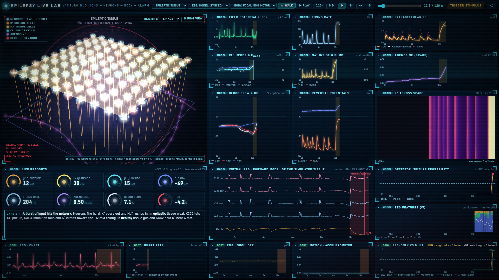
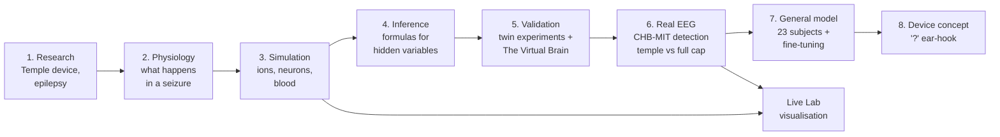
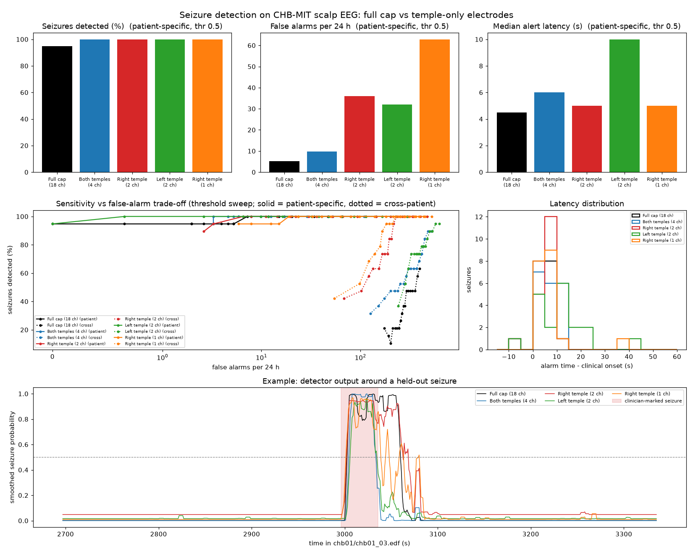
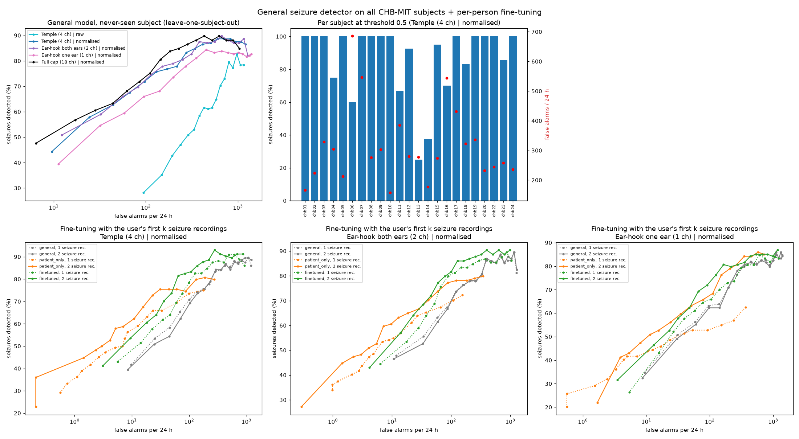
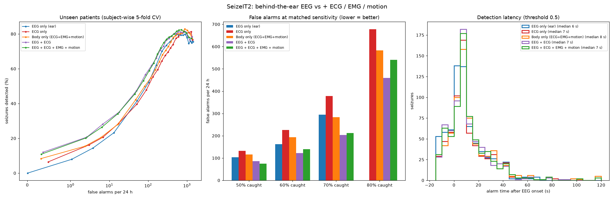

# Epilepsy Temple

### Toward an ear-worn seizure monitor: from research, to physics-based simulation, to detection on real patient EEG

> **What this is.** A research project exploring whether a small wearable (inspired by Deepinder Goyal's temple-worn *Temple* device, redesigned as a **"?"-shaped ear-hook**) could detect epileptic seizures.
>
> It covers:
>
> - a technical teardown of Temple;
> - epilepsy and seizure physiology;
> - a validated biophysical seizure simulator with potassium, sodium, chloride, adenosine and blood-flow dynamics;
> - mathematics for inferring hidden brain chemistry from non-invasive sensors;
> - a cross-check against **The Virtual Brain**;
> - seizure detectors trained and tested on **real hospital EEG** (CHB-MIT, 23 subjects, 185 seizures);
> - a **multimodal** detector (behind-the-ear EEG + heart + muscle + motion) on **SeizeIT2** (125 patients, 883 seizures, 11,626 h), streamed straight from the cloud, plus a raw-EEG CNN;
> - an electrode-quality test and an **adult validation on Siena** (14 patients, 47 seizures, full cap + ECG);
> - a live, single-screen visual lab of the whole thing;
> - a full **research paper** (`paper/main.pdf`).
>
> ⚠️ **Research prototype, not a medical device.** Nothing here is validated for clinical use.


<sub>The live lab (`epilepsy_sim/viz/epilepsy_live.html`, Stark-lab style HUD) at the seizure peak. The 100 simulated neurons rise off a 3D plane as K⁺ floods out, and the targeting reticle turns red at the ictal threshold. Around it: arc-reactor gauges for the hidden variables, nine live charts, the virtual ear-hook EEG with its detector, and the body sensors (ECG, heart rate, EMG, motion) with EEG-only vs multimodal detection.</sub>

---

## Contents

1. [Key findings](#1-key-findings)
2. [Project journey](#2-project-journey)
3. [Repository map](#3-repository-map)
4. [Quick start](#4-quick-start)
5. [The device concept: a "?" ear-hook](#5-the-device-concept-a--ear-hook)
6. [Results](#6-results)
7. [Handling false alarms](#7-handling-false-alarms)
8. [Honest limitations](#8-honest-limitations)
9. [Roadmap](#9-roadmap)
10. [Documents index](#10-documents-index)
11. [Data, licences and disclaimer](#11-data-licences-and-disclaimer)
12. [Key references](#12-key-references)

---

## 1. Key findings

| # | Finding | Evidence |
|---|---|---|
| 1 | **A temple-worn optical sensor alone cannot detect seizures.** Temple measures scalp blood flow (PPG), not brain electrical activity. | `Temple_Technical_Dossier.md` |
| 2 | **Hidden seizure chemistry can be *inferred*, not measured, from outside the head.** Formulas were derived and audited; 3 errors in early drafts were caught and fixed. | `Inference_Formulas.md` |
| 3 | **A physics-based simulator reproduces real seizure hallmarks.** It shows K⁺ reaching the ~12 mM ceiling, chloride loading, depolarising GABA, an adenosine surge, postictal silence, a K⁺ undershoot and postictal hypoperfusion. It is validated against Cressman et al. 2009. | `epilepsy_sim/SIMULATION.md` |
| 4 | **The derived inference methods recover hidden values in twin experiments.** KCC2 strength was inferred as 0.36 ± 0.09 (true 0.30). Naive formulas fail exactly where theory predicts (e.g. 2.4× K⁺ error from scalp DC). | `epilepsy_sim/COMPARISON.md` |
| 5 | **Our Epileptor matches The Virtual Brain's official implementation.** First seizure onset is identical (886.2), and differences vanish as the time step shrinks. | `epilepsy_sim/COMPARISON.md` |
| 6 | **On real EEG, temple and ear electrodes catch seizures as well as a full cap, but with more false alarms.** Patient-specific (3 patients, 19 seizures): both temples caught 100% with 9.8 false alarms/day; the full cap caught 95% with 5.2/day. | `epilepsy_sim/detect/` |
| 7 | **The ear-hook (2 channels) catches as many seizures as a full 18-channel cap, but with ~2× the false alarms.** On 23 subjects and 185 seizures: new user 88% vs 85%; after fine-tuning on 2 own seizures 86% (162 FA/day) vs 89% (88 FA/day). Both ears beat one ear on every measure. | `epilepsy_sim/detect/general.py` |
| 8 | **False alarms are the real problem.** EEG-only models give 90–600 false alarms/day for new users. Per-person normalisation and fine-tuning cut them by 40–60%, but reaching ≤1/day needs multimodal fusion plus personal tuning. | §7 |
| 9 | **The heart is the body signal that pays off.** On SeizeIT2 (125 patients, 883 seizures), adding ECG to 2-channel behind-the-ear EEG cut false alarms by **18–31% at the same sensitivity** (−34% at the default setting) and helped **115/125 patients**, for about 1 s more delay. Shoulder EMG and motion added no consistent gain for these mostly focal seizures. **With personal fine-tuning on 2 own seizures, the cut reaches 52–62%**, but at ≤1 false alarm/day only 14% of seizures are caught. | `Multimodal_Detection_SeizeIT2.md` |
| 10 | **Deep learning on the raw ear EEG does not break the ceiling at this data size.** On 33 patients, a CNN was weaker than hand-made features (AUROC 0.72 vs 0.83); averaged with them it doubled the seizures caught at ≤1 false alarm/day (19% → 37%), but added little on top of heart + context features. | `Multimodal_Detection_SeizeIT2.md` §6.19 |
| 11 | **Electrode contact drives false alarms, not missed seizures.** SeizeIT2 patients with stable ear-EEG contact had up to 2× fewer false alarms, but their seizures were no more visible (20–21% reach 0.95 in both groups). | `Electrodes_and_Siena_Validation.md` |
| 12 | **The ear-hook holds up in adults.** On Siena (14 adults, 47 focal seizures, never-seen patients), two ear-level channels caught **96%** of seizures vs 91% for an 18-channel cap; the cap had 2–3× fewer false alarms, and **ECG cut the ear-hook's false alarms by 27–48%** (it did not help the cap). | `Electrodes_and_Siena_Validation.md` |

---

## 2. Project journey



| Phase | Question | Output |
|---|---|---|
| 1 | What exactly is Temple, technically? | `Temple_Technical_Dossier.md` |
| 2 | What is epilepsy, and what happens in the brain during a seizure? | `Epilepsy_Overview.md`, `Seizure_Neurophysiology.md` |
| 3 | Can we simulate seizures realistically, including ion concentrations? | `epilepsy_sim/ionic.py`, `SIMULATION.md` |
| 4 | Which hidden variables can a wearable infer, and with what formulas? | `Inference_Formulas.md` |
| 5 | Do the formulas work? Does our code match an established simulator? | `infer.py`, `tvb_compare.py`, `COMPARISON.md` |
| 6 | How well do temple or ear electrodes detect seizures on real EEG? | `detect/detect.py` |
| 7 | Can one model work for new users? How much does personal fine-tuning help? | `detect/general.py` |
| 8 | What should the device look like? | §5 |
| 9 | Which physiological signals change during seizures? | `Seizure_Physiological_Signals.md` |
| 10 | Do heart, muscle and motion signals cut false alarms on real wearable data? | `detect/seizeit2.py`, `Multimodal_Detection_SeizeIT2.md` |
| 11 | Does a CNN on the raw ear EEG find what features miss? | `detect/cnn.py`, `Multimodal_Detection_SeizeIT2.md` §6.19 |
| 12 | Are the datasets' electrodes the problem? Does the ear-hook hold up in adults? | `detect/analysis_electrodes.py`, `detect/siena.py`, `Electrodes_and_Siena_Validation.md` |
| 13 | Everything, written up as a research paper | `paper/main.pdf` (LaTeX source in `paper/`) |

---

## 3. Repository map

```
epilepsy_temple/
├── README.md                        ← you are here
├── Temple_Technical_Dossier.md      Temple wearable: hardware, software, validation, gaps
├── Epilepsy_Overview.md             causes, seizure types, diagnosis, treatment, wearables
├── Seizure_Neurophysiology.md       second-by-second: ions, cells, networks, blood
├── Seizure_Physiological_Signals.md body signals during seizures (heart, breathing, SpO₂, sweat, motion…) and ear sensing
├── Inference_Formulas.md            derivations + verification audit for inferring hidden variables
├── Multimodal_Detection_SeizeIT2.md SeizeIT2 multimodal study (125 patients), incl. the raw-EEG CNN
├── Electrodes_and_Siena_Validation.md  electrode-stability test + adult validation on Siena
├── paper/                           research paper (LaTeX source + main.pdf)
├── docs/images/                     README figures
└── epilepsy_sim/                    all code (Python 3.13, uv)
    ├── main.py                      Model 1: Izhikevich network · Model 2: Epileptor
    ├── ionic.py                     Model 3: biophysical K⁺/Na⁺/Cl⁻/adenosine network (numba)
    ├── infer.py                     twin experiments for the derived inference formulas (E1–E7)
    ├── tvb_compare.py               cross-validation + VEP-style inference with The Virtual Brain
    ├── SIMULATION.md                full model documentation (equations, parameters, calibration log)
    ├── COMPARISON.md                inference + TVB results
    ├── output/                      figures and metrics from the simulations
    ├── detect/
    │   ├── fetch_chbmit.py          download a CHB-MIT subset (PhysioNet AWS mirror)
    │   ├── detect.py                patient-specific detection: full cap vs temple/ear channels
    │   ├── general.py               general model on all CHB-MIT subjects + per-person fine-tuning
    │   ├── notify_watch.sh          optional: ring your phone (ntfy) when a long run finishes
    │   ├── notify_final.sh          optional: ring your phone when general.py finishes / crashes / stops
    │   ├── seizeit2.py              multimodal detector on SeizeIT2: ear-EEG + ECG + EMG + motion (streamed);
    │   │                            fine-tuning, personal thresholds, context + HR-excess features
    │   ├── stage2.py                two-stage detection: general / personal alarm verifier
    │   ├── analysis_responders.py   heart responders vs non-responders
    │   ├── analysis_seizure_types.py  caught by seizure type / duration / lobe / side
    │   ├── analysis_electrodes.py   stable vs unstable ear-EEG contact (SeizeIT2)
    │   ├── cnn.py                   1D CNN on the raw ear EEG (streamed; fetch / train / eval / compare)
    │   ├── siena.py                 adult validation on Siena: ear-hook vs full cap, ± ECG (streamed)
    │   ├── results/                 3-patient detection metrics + figure
    │   ├── results_general/         23-subject general-model metrics
    │   ├── results_seizeit2/        125-patient multimodal metrics + figure, CNN and electrode results
    │   └── results_siena/           14-patient Siena metrics
    └── viz/
        ├── epilepsy_live.html       Epilepsy Live Lab (open in a browser, works offline)
        ├── data.js                  data for the lab (regenerate with export_data.py)
        └── export_data.py           packs simulation + EEG data for the lab
```

---

## 4. Quick start

Requirements: [uv](https://docs.astral.sh/uv/) and Python 3.13 (uv installs it). All commands run from `epilepsy_sim/`.

```bash
cd epilepsy_sim
uv sync                                    # numpy, scipy, matplotlib, numba, mne, scikit-learn, fooof
```

| What | Command | Time |
|---|---|---|
| **Open the live lab** | double-click `viz/epilepsy_live.html` | instant |
| Classic models (spiking network + Epileptor) | `uv run main.py` | ~10 s |
| Validate the ionic model (Cressman 2009 Fig. 1) | `uv run ionic.py validate` | ~7 s |
| Healthy / epileptic tissue | `uv run ionic.py healthy --t 90 --save` / `uv run ionic.py epileptic --t 120 --save` | ~6 / 7 min |
| Inference twin experiments | `uv run infer.py --abc` | ~12 min |
| The Virtual Brain comparison | `uv run --extra tvb tvb_compare.py` | ~12 min |
| Download CHB-MIT subset (3 patients) | `uv run detect/fetch_chbmit.py` | ~4 min, 1.4 GB |
| Temple vs full-cap detection | `uv run detect/detect.py --configs 4` (then 2, 3, 1, 0) | ~2–40 min each |
| General model, all subjects (streaming, ~1 GB disk) | `uv run detect/general.py fetch` then `run` (add `--configs "Full cap"` to re-run one setup; progress bars show time left) | ~1 h + 2–3 h |
| Multimodal detector, SeizeIT2 (125 patients; streamed from OpenNeuro into RAM, only 1.8 GB of features stored) | `uv run detect/seizeit2.py fetch` then `run` (`run --snapshot` gives interim results while fetch runs; `report` redraws tables) | ~2–4 h (126 GB streamed) + ~1 h |
| SeizeIT2 personalisation + two-stage (see `Multimodal_Detection_SeizeIT2.md` §11) | `finetune`, `personal`, `analysis_responders.py`, `stage2.py [--personal]` | ~20–45 min each |
| Raw-EEG CNN (needs `--extra dl`) | `uv run --extra dl detect/cnn.py fetch`, then `train`, `eval`, `compare` | fetch network-bound; ~30 min for 293 runs |
| Electrode-stability test (SeizeIT2) | `uv run detect/analysis_electrodes.py` | ~3 min |
| Siena adult validation (streamed from PhysioNet, features only) | `uv run detect/siena.py fetch --workers 2` then `run` | ~46 min + ~3 min |
| Rebuild live-lab data | `uv run viz/export_data.py` | ~2 min |

> **Memory:** network simulations use ~1–2 GB. On machines with little free RAM, run one long job at a time.

---

## 5. The device concept: a "?" ear-hook

Temple sits on the temple and measures blood flow optically. Our research points to an **ear-hook, worn on both ears**, carrying several sensors:

```
        ___
      /     \   ← top curve: dry EEG electrodes above/behind the ear (≈ T7/T8, P7/P8)
     |       |
      \      |  ← back stem: reference electrode on the mastoid bone
       ?     |
       |    /   ← ear-canal tip: in-ear EEG + PPG (heart rate, blood flow) + temperature
       •   /    ← optional earlobe PPG
   + accelerometer/gyroscope · jaw-muscle EMG · Bluetooth to phone
```

| Why the ear | Evidence |
|---|---|
| Sits over the temporal lobe, the most common seizure origin in adults | Ear-EEG matched scalp EEG for temporal-lobe seizures ([Zibrandtsen 2017](https://www.sciencedirect.com/science/article/pii/S1388245717310763)) |
| Proven for seizure detection | Behind-the-ear 2-channel wearable caught 98% of absence seizures ([Swinnen 2021](https://onlinelibrary.wiley.com/doi/10.1111/epi.17061)) |
| Best PPG site | Earlobe PPG up to 6.3× better signal than the wrist ([source](https://pmc.ncbi.nlm.nih.gov/articles/PMC13210545/)) |
| Discreet and stable | Looks like a hearing aid or earphone; held in place by the ear |
| **Both ears > one ear** | Our 3-patient test: one-sided setups gave 3–6× more false alarms |

---

## 6. Results

### 6.1 Simulation: healthy vs epileptic tissue (`ionic.py`)

The two tissues share the same neurons, wiring and 2 s trigger. Only the pathology differs: KCC2 ×0.3, glial K⁺ buffering ×0.3 and K⁺ clearance ×0.35, modelled on hippocampal sclerosis.

| Measure | Healthy | Epileptic |
|---|---|---|
| Resting [Cl]i / E_GABA | 5.6 mM / −69.6 mV | **11.6 mM / −54.1 mV** |
| Spontaneous activity | Asynchronous ~6 Hz | Interictal discharges (~35/min) |
| Peak [K]o after trigger | 6.1 mM | **12.2 mM** (physiological ceiling) |
| Peak [Cl]i / E_GABA | 7.4 mM / −63.7 mV | **15.2 mM / −48.3 mV** |
| Adenosine surge | 0.12 | **0.68** |
| Postictal silence | 13.7 s | **25 s**, with a K⁺ undershoot to 3.66 mM |
| Blood flow (peak → dip) | +42% → −47% | +31% → −46% |

Validation: the model reproduces Cressman et al. 2009 Fig. 1 (events every ~30 s, [K]o 6.7–10.7 mM). Full details: [`epilepsy_sim/SIMULATION.md`](epilepsy_sim/SIMULATION.md).

### 6.2 Inference: can hidden variables be recovered? (`infer.py`)

| Test | Naive / wrong approach | Derived method | Truth |
|---|---|---|---|
| K⁺ from glial electrode | Peak 10.3 mM (textbook slope) | **12.3 mM** (measured 51 mV/decade) | 12.2 mM |
| K⁺ from scalp DC-EEG | Peak 29.2 mM (2.4× high) | **0.50 mM RMSE** (Kalman filter) | – |
| Cl⁻ from E_GABA | +2.7 mM bias (wrong formula) | **1.1 mM RMSE** | – |
| HbO from fNIRS | Amplitude 22% of true | **1.4 µM RMSE**, r = 0.996 | – |
| KCC2 strength (Bayesian) | – | **0.36 ± 0.09** | 0.30 |

### 6.3 Cross-check with The Virtual Brain (`tvb_compare.py`)

| | TVB official | Ours, dt 0.01 |
|---|---|---|
| First seizure onset | 886.2 | **886.2** |
| Seizure duration | 968.7 | 976.2 |
| z RMSE vs TVB | – | 0.018 |

On a 76-region connectome, a right-amygdala seizure spread to 36/38 right-hemisphere regions. Onset-time inference located the focus correctly. That result is optimistic, because the same model generated and fitted the data. Details: [`COMPARISON.md`](epilepsy_sim/COMPARISON.md).

### 6.4 Real EEG, patient-specific: 3 patients, 19 seizures, 36.6 h (`detect/detect.py`)

| Electrodes | Seizures caught | False alarms / 24 h | Median delay |
|---|---|---|---|
| Full cap (18 ch) | 95% | **5.2** | 4.5 s |
| **Both temples (4 ch)** | **100%** | 9.8 | 6 s |
| Right temple (2 ch) | 100% | 36.0 | 5 s |
| Left temple (2 ch) | 100% | 32.1 | 10 s |
| Right temple (1 ch) | 100% | 62.9 | 5 s |



### 6.5 Real EEG, general model: 23 subjects, 185 seizures, 207 recordings (`detect/general.py`)

**New user, day one** (leave-one-subject-out; each subject tested by a model that never saw them):

| Electrodes | Seizures caught | False alarms / 24 h | Median delay |
|---|---|---|---|
| Temple (4 ch), raw features | 62% | 524 | 6.5 s |
| Temple (4 ch), **per-person normalised** | 85% | 342 | 6.0 s |
| **Ear-hook both ears (2 ch)**, normalised | **88%** | 382 | **5.0 s** |
| Ear-hook one ear (1 ch), normalised | 83% | 556 | 6.0 s |
| Full cap (18 ch), normalised | 85% | **228** | 5.0 s |

**After learning the user's own seizures** (fine-tuning on their first 2 seizure recordings, tested on later ones):

| Electrodes | General only | Patient-only model | **General + fine-tuned** |
|---|---|---|---|
| Temple (4 ch) | 84% · 361 FA/day | 68% · 16 FA/day | **86% · 138 FA/day** |
| **Ear-hook both ears (2 ch)** | 87% · 397 FA/day | 65% · 19 FA/day | **86% · 162 FA/day** |
| Ear-hook one ear (1 ch) | 81% · 550 FA/day | 66% · 79 FA/day | 80% · 216 FA/day |
| Full cap (18 ch) | 84% · 247 FA/day | 68% · 6 FA/day | **89% · 88 FA/day** |

At a stricter alarm threshold (chosen after seeing results, so optimistic), fine-tuned detectors reach ~18–23 false alarms/day while catching 64% (ear-hook both ears) to 75% (full cap) of seizures.



Takeaways:

1. **Per-person normalisation** (comparing each person with their own recent baseline) adds 43 detected seizures to the temple setup.
2. **Fine-tuning** cuts false alarms by 40–65% without losing seizures.
3. **The ear-hook is worth it:** with 2 electrodes it matches the temple setup (4) and catches as many seizures as the full cap (18). What the extra channels mainly buy is **false-alarm rejection**, which the ear-hook can recover with its own heart-rate and motion sensors (§7).
4. **Both ears > one ear:** about 6% more seizures caught and 25–30% fewer false alarms.
5. **Patient-only models** have few false alarms but miss a third of seizures. Two examples are too few to learn from alone.

### 6.6 Multimodal detection on wearable data: SeizeIT2, 125 patients, 883 seizures, 11,626 h (`detect/seizeit2.py`)

The SeizeIT2 wearable carries almost exactly the proposed ear-hook's sensors: **2-channel behind-the-ear EEG, chest ECG, shoulder EMG and motion**. All 126 GB were streamed from OpenNeuro into RAM, and only features were kept. Each patient was tested by a model that never saw them (patient-wise 5-fold CV).

**False alarms per 24 h with the same share of seizures caught (lower is better):**

| Setup | 50% caught | 60% | 70% | 80% |
|---|---|---|---|---|
| Ear EEG only | 104 | 162 | 294 | not reached |
| ECG only | 133 | 226 | 378 | 678 |
| Body only (ECG + EMG + motion) | 116 | 194 | 284 | 583 |
| **Ear EEG + ECG** | **86 (−18%)** | **123 (−24%)** | **204 (−31%)** | **459** |
| Ear EEG + ECG + EMG + motion | 75 (−27%) | 139 (−14%) | 212 (−28%) | 540 |

At the default threshold, EEG + ECG catches the same seizures as EEG alone (78.7% vs 79.4%) with **34% fewer false alarms** (399 vs 608 a day). It is better for **115 of 125 patients**, at a cost of about 1 s of delay (median 7 s vs 6 s). Full write-up: [`Multimodal_Detection_SeizeIT2.md`](Multimodal_Detection_SeizeIT2.md).



Takeaways:

1. **Heart rate is worth adding to the ear-hook** (in-ear PPG in the device).
2. **For focal seizures the heart carries about as much information as a behind-the-ear electrode pair.** Under a strict budget of 20 or fewer false alarms a day, ECG alone catches 29% of seizures vs 23% for the ear EEG.
3. **EMG and motion don't pay off overall for focal seizures.** They should matter for convulsive seizures and for artefact rejection in daily life, which remain to be tested separately.
4. **Personal fine-tuning adds to the ECG gain.** Tested on each patient's later data (71 patients):

| At 50% of seizures caught | False alarms / 24 h |
|---|---|
| Ear EEG, general | 158 |
| Ear EEG, fine-tuned on 2 own seizures | 92 (−42%) |
| Ear EEG + ECG, general | 89 (−44%) |
| **Ear EEG + ECG, fine-tuned** | **61 (−62%)** |

   One seizure is not enough for EEG-only tuning. Requiring a sustained 10–20 s alarm does not help. A **personal alarm threshold** also gives no meaningful gain, because the per-person baseline normalisation already calibrates everyone. A useful side result: the shared threshold's false-alarm rate is **predictable** (budget 1 / 5 / 20 per day on tuning data gave 1.4 / 5.2 / 20.2 later). At ≤1 false alarm/day the best setup still catches only 11–14% of seizures, so absolute rates remain far from usable.

   **Why the false alarms happen** (details in the SeizeIT2 write-up, §6.7):
   - they are not annotated artefacts (<1%) and not hidden seizures;
   - the worst 25% of patients produce 59–77% of them;
   - the one patient trait linked to them is an **unstable ear-EEG signal** (ρ = 0.49), which points to electrode fit;
   - at the moment of a false alarm, EEG + ECG sees a **real seizure look-alike**: sudden tachycardia + movement + an EEG burst;
   - noisy users are identifiable from their first days of wear (ρ = 0.56–0.83).

   **The whole ladder** (71 patients, each scored on data recorded after their tuning period; details and caveats in the SeizeIT2 write-up):

   | Step | Caught at ≤1 false alarm/day | ≤5/day | ≤20/day |
   |---|---|---|---|
   | Ear EEG only | 4% | 11% | 23% |
   | + ECG | 12% | 19% | 31% |
   | + minute-scale context + "HR not explained by movement" | 14% | 25% | 36% |
   | + fine-tuning on 2 own seizures | 15% | 27% | 41% |
   | two-stage with a **personal alarm verifier** | **19%** | **30%** | **45%** |
   | … for **heart responders** (≈1 in 3 users) | **39%** | **64%** | **77%** |

   **It has plateaued, and the reason is known:** a quarter of all seizures never push the detector above 0.5, and only 30% ever reach 0.95. The remaining gap is a *signal* problem (too little brain information from two behind-the-ear electrodes), not an alarm-logic problem. Signal-quality features, a bigger model and alarm rules no longer help. The next gains must come from hardware: better electrode contact and more or better-placed EEG channels.

   **Good news for the ear-hook:**
   - simulated **in-ear PPG** heart signals, with literature-based noise and motion dropouts, perform nearly as well as a chest ECG: about 2–4 points lower overall, and 5–6 points lower for heart responders at strict budgets;
   - **100% of focal-to-bilateral tonic-clonic seizures** (the SUDEP-risk ones) are caught at ≤5 false alarms/day;
   - temporal-lobe seizures are caught about twice as often as others.
   - The blind spot is **short focal seizures under 30 s**, over half of all seizures and nearly invisible to two ear electrodes.

   **Long context helps.** Adding 15 s / 1 min / 5 min trends of EEG and heart features (**EEG + ECG + context**) cuts false alarms by **34–43%** vs ear EEG alone at matched sensitivity, and catches **25%** of seizures at ≤5 false alarms/day (vs 14%). Adding a **"heart rate not explained by movement"** feature (a running fit of heart rate vs accelerometer activity) pushes this to **−62% / −43% / −47%** false alarms at 50 / 60 / 70% caught, and **28%** caught at ≤5/day. The accelerometer earns its place by explaining away exercise heart rate.

   **Raw-EEG deep learning.** A 1D CNN on the raw ear EEG (33 patients, same folds) was weaker than the hand-made features (window AUROC 0.72 vs 0.83). Averaged with the ear-EEG features, it raised seizures caught at ≤1 false alarm/day from 19% to 37%; on top of the best model the gain was mixed. Details: `Multimodal_Detection_SeizeIT2.md` §6.19.

### 6.7 Are the electrodes the problem? Electrode stability and Siena (`analysis_electrodes.py`, `siena.py`)

**Stable vs unstable contact (SeizeIT2, 71 patients).** Contact stability was measured from each patient's first days only (how much the ear-EEG amplitude jumps around), and detection was scored on later data:

| Ear EEG, general model | Stable contact (36) | Unstable contact (35) |
|---|---|---|
| FA/day at 50 / 70% caught | **95 / 183** | 150 / 374 |
| Seizures the detector sees clearly (> 0.95) | 21% | 20% |

Good contact halves false alarms but does **not** make seizures more visible. The ceiling comes from electrode **position**, not quality.

**Siena: 14 adults with focal epilepsy, 47 seizures, 141 h, full 10-20 cap + ECG** (streamed from PhysioNet; each patient scored by a model trained on the other 13):

| Setup | Caught @0.5 | FA/day @0.5 | FA/day at 50 / 70% caught |
|---|---|---|---|
| Ear-hook, both ears (T7–P7, T8–P8) | **96%** | 310 | 27 / 60 |
| **Ear-hook + ECG** | 91% | **172** | **14** / 44 |
| Ear-hook, one ear | 94% | 398 | 32 / 82 |
| Full cap (18 ch) | 91% | 132 | **10 / 23** |
| Full cap + ECG | 89% | 113 | 14 / 34 |

The ear-hook catches as many adult seizures as the full cap; the cap has 2–3× fewer false alarms; ECG closes much of that gap for the ear-hook (and adds nothing to the cap). Full write-up, including three typos found in the dataset's seizure lists and a scikit-learn 1.9 slowdown that was found and fixed: [`Electrodes_and_Siena_Validation.md`](Electrodes_and_Siena_Validation.md).

### 6.8 Epilepsy Live Lab (`viz/epilepsy_live.html`)

A single-screen, offline dashboard:

- a **3D neuron plane** (default): the 100 simulated neurons on a 10×10 grid. Each neuron keeps its x, y and rises on z from its **own** data: local K⁺, spikes, or both. It has a K⁺-coloured landscape, spike ripples, rising K⁺ vapour, Cl⁻ satellites and blood vessels underneath. Drag to rotate and scroll to zoom. The original glowing ring is one click away;
- 9 live charts of hidden variables, including **true vs device-inferred** K⁺ and Cl⁻;
- a **virtual ear-hook EEG** computed from the simulated neurons by a forward model (synaptic currents, glial K⁺ DC shift, 1/f noise), with a live detector;
- a switch to the **real CHB-MIT patient EEG** and its trained detector;
- **body sensors**, the SeizeIT2 modalities, driven by the simulated seizure: chest **ECG** (beat-by-beat, with heart-rate variability), a **heart-rate** trend against "what movement explains", shoulder **EMG** and an **accelerometer**. There are four seizure types: focal non-motor, focal motor (hyperkinetic), tonic-clonic, and no heart-rate response (about 18% of patients);
- a **🚶 Walk** episode whose electrode motion fools the ear-EEG detector;
- **EEG-only vs multimodal** detectors side by side, with a live score (caught / latency / false alarms).

| Body setting (walk on) | EEG-only | Multimodal (EEG confirmed by body) |
|---|---|---|
| Focal non-motor | caught +1 s · **1 false alarm** (walk) | caught +9 s · **0 false** |
| Focal motor | caught +1 s · 1 false | caught +5 s · 0 false |
| Tonic-clonic | caught +1 s · 1 false | caught +6 s · 0 false |
| No heart-rate response | caught +1 s · 1 false | **missed** · 0 false |
| Healthy tissue | 1 false | 0 false |

The same trade-off shows up on real data in §6.6: requiring body confirmation removes movement false alarms, but costs a few seconds of delay and misses seizures without a body sign. The body module uses literature timings (ictal HR +53%, tonic → clonic 4 → 1 Hz), because the 100-neuron patch models only the onset zone. The fusion rule is hand-set for illustration.

The interface is a JARVIS-style HUD, with a boot sequence, holographic panels, arc-reactor gauges and a targeting reticle. It needs no internet and no libraries.

Deep links: `?scen=healthy&t=9&speed=0.5&paused=1&type=fbtc&walk=0&view=ring&h=k&boot=0` (`type` = nonmotor / motor / fbtc / nohr; `h` = both / k / spk).

---

## 7. Handling false alarms

EEG alone gives far too many false alarms (§6.5). The planned fixes:

| Layer | How it helps |
|---|---|
| **Multimodal agreement** | Alarm only if EEG **and** a body signal agree (heart-rate surge, which occurs in 82% of patients; motion pattern; blood-flow change) |
| **Artefact sensors** | Jaw-muscle EMG flags chewing and talking; the accelerometer flags walking; impedance checks flag loose electrodes |
| **Tiered alerts** | Log silently → "Are you OK?" vibration → caregiver alert |
| **Personal learning** | Every confirmed false alarm teaches that person's model |
| **Risk forecasting** | Multi-day seizure cycles adjust sensitivity |

**Measured on SeizeIT2 (§6.6):** adding heart rate to behind-the-ear EEG removes 18–31% of false alarms at the same sensitivity, for 115 of 125 patients. That is the first layer working on real wearable data. A published EEG + ECG detector reached 84.8% sensitivity at **0.25 false alarms/day** ([Jeppesen 2024](https://onlinelibrary.wiley.com/doi/10.1002/epd2.20196)). Closing the gap between our general model and that result is the job of the remaining layers (personal learning, longer decision windows, tiered alerts) must close.

---

## 8. Honest limitations

- **The model's seizures are tonic, not rhythmic, and not self-sustaining at default settings.** The triggered event ends with the trigger. Calibrating the pump current fixes this, but costs the healthy tissue's normal low-level firing (`SIMULATION.md` §11–12).
- **The ear-hook results are approximated with standard scalp electrodes** (T7-P7, T8-P8) from a hospital gel cap, not real dry ear electrodes.
- **CHB-MIT is paediatric, recorded in hospital, mostly at rest.** Real-world false alarms will be higher.
- **The small-sample figures are coarse.** With 36.6 h of data, one false alarm counts as 0.66 per day, and the tuned thresholds in the 3-patient study were picked after seeing results.
- **The inference results are simulation-only.** The "perfect" TVB localisation is an inverse crime.
- **Virtual EEG detector threshold:** tuned on the model itself, not independently validated.
- **SeizeIT2 uses chest ECG, not ear PPG,** and hospital patients move less than people in daily life. The live lab's body signals are generated from literature timings, not from the neuron model.

---

## 9. Roadmap

| Priority | Next step |
|---|---|
| ✅ | ~~Multimodal detection on SeizeIT2: measure the false-alarm reduction~~ (done, §6.6: ECG −18–31%) |
| ✅ | ~~Personal fine-tuning + sustained-alarm rules on SeizeIT2~~ (done: −62% with ECG; sustained rules don't help) |
| ✅ | ~~Personal alarm thresholds~~ (no meaningful gain) |
| ✅ | ~~Context features, HR-excess, bigger model, two-stage + personal alarm verifier~~ (done: best 19% of seizures at ≤1 false alarm/day, 39% for heart responders) |
| ✅ | ~~PPG-quality heart rate, seizure-type split~~ (simulated in-ear PPG ≈ chest ECG; tonic-clonic 100% at ≤5 false alarms/day) |
| ✅ | ~~CNN on the raw ear EEG~~ (33-patient subset: weaker alone, helps strict budgets when fused; §6.6) |
| ✅ | ~~Are the electrodes the problem? Adult validation~~ (contact drives false alarms, not misses; Siena confirms ear-hook ≈ cap in catches, ECG helps; §6.7) |
| ★★★ | **Hardware Prototype 1**: bilateral ear-hook with dry electrodes placed high around the ear (towards T7/T8, P7/P8), contact-quality sensing, in-ear PPG, IMU, phone recording |
| ★★ | TUSZ (675 patients, requires registration) for a larger general model and the CNN |
| ✅ | ~~Finish the general-model comparison: one ear vs both ears vs full cap~~ (done, §6.5) |
| ★★ | Recalibrate the model for self-sustained, rhythmic seizures (pump-current scale 0.25–0.5) |
| ★★ | Deep-learning detector and a larger training set (e.g. TUH EEG, requires registration) |
| ★★ | Hardware prototype: dry ear electrodes + in-ear PPG + IMU, recording on a phone |
| ★ | Seizure forecasting from multi-day cycles |

---

## 10. Documents index

| Document | What's inside |
|---|---|
| [`Temple_Technical_Dossier.md`](Temple_Technical_Dossier.md) | Temple wearable: company, hardware (multi-wavelength PPG), software (Brain Flow index, Entropy), 3 validation preprints, engineering inference, epilepsy relevance |
| [`Epilepsy_Overview.md`](Epilepsy_Overview.md) | Definition (ILAE 2014), prevalence, causes (6 aetiologies), 2025 seizure classification, diagnosis, drugs, surgery, SUDEP, wearables |
| [`Seizure_Neurophysiology.md`](Seizure_Neurophysiology.md) | Seizure life cycle; second-by-second ions, synapses, spread, energy, termination; what each sensor can see |
| [`Seizure_Physiological_Signals.md`](Seizure_Physiological_Signals.md) | Heart rate (↑ in 82% of patients), HRV (pre-ictal in 41%), apnea (36.5% of focal seizures, often **before** EEG), SpO₂, blood pressure, sweat, temperature, EMG/motion, blood markers; which are measurable from the ear; multimodal ear-hook design and benchmarks |
| [`Multimodal_Detection_SeizeIT2.md`](Multimodal_Detection_SeizeIT2.md) | SeizeIT2 multimodal detector: streaming 126 GB through RAM, features for ear-EEG / ECG / EMG / motion, patient-wise CV, matched-sensitivity results, snapshots, limitations |
| [`Electrodes_and_Siena_Validation.md`](Electrodes_and_Siena_Validation.md) | Is electrode quality the limit? Stable vs unstable contact on SeizeIT2; adult validation on Siena (ear-hook vs full cap, ± ECG); dataset typos; scikit-learn binning slowdown and fix |
| [`paper/main.pdf`](paper/main.pdf) | The whole project as a research paper (IMRaD, LaTeX source in `paper/`) |
| [`Inference_Formulas.md`](Inference_Formulas.md) | Measured vs inferred; Bayes, least squares, Kalman, ABC; derivations for K⁺, Cl⁻, E/I, fNIRS; verification audit |
| [`epilepsy_sim/SIMULATION.md`](epilepsy_sim/SIMULATION.md) | Full model documentation: equations, parameters with sources, validation, results, 14-step calibration log |
| [`epilepsy_sim/COMPARISON.md`](epilepsy_sim/COMPARISON.md) | Twin experiments E1–E7, TVB cross-validation and whole-brain inference, head-to-head comparison |

---

## 11. Data, licences and disclaimer

- **The full patient dataset is not in this repository.** The scripts download it from PhysioNet: the **CHB-MIT Scalp EEG Database** ([PhysioNet](https://physionet.org/content/chbmit/1.0.0/), Open Data Commons Attribution licence v1.0; cite Shoeb 2009 and Goldberger et al. 2000).
- **The one exception** is `epilepsy_sim/viz/data.js`. It includes a 3-minute, 5-channel excerpt of CHB-MIT recording `chb01_03.edf` (2926–3106 s, band-passed, 128 Hz) so the live lab works out of the box. It is redistributed under that licence, with attribution to the source above.
- **SeizeIT2** (OpenNeuro [ds005873](https://openneuro.org/datasets/ds005873), v1.1.0, **CC0**; Bhagubai et al. 2025) is streamed by `detect/seizeit2.py`. Neither raw data nor extracted features are stored in this repository.
- **Siena Scalp EEG Database** ([PhysioNet](https://physionet.org/content/siena-scalp-eeg/1.0.0/), **CC BY 4.0**; Detti et al. 2020) is streamed by `detect/siena.py`. Neither raw data nor extracted features are stored in this repository.
- **The Virtual Brain** (`tvb-library`, `tvb-data`) is an optional dependency under its own licence.
- **No licence has been chosen for this code yet.** Until one is added, default copyright applies.
- **Medical disclaimer:** this is a research and educational project. It is **not** a medical device, has not been clinically validated, and must not be used to diagnose, monitor or treat epilepsy.
- **Temple** is a product of Temple Wearables / Continue Research. This project is independent and not affiliated with it.

---

## 12. Key references

- Cressman JR et al. (2009). *The influence of sodium and potassium dynamics on excitability, seizures, and the stability of persistent states.* J Comput Neurosci. (+ 2011 erratum)
- Krishnan GP, Bazhenov M (2011). *Ionic dynamics mediate spontaneous termination of seizures and postictal depression state.* J Neurosci 31:8870.
- Jirsa VK et al. (2014). *On the nature of seizure dynamics.* Brain 137:2210.
- Sanz-Leon P et al. (2013). *The Virtual Brain.* Front Neuroinform 7:10.
- Shoeb AH (2009). *Application of machine learning to epileptic seizure onset detection and treatment.* MIT PhD thesis (CHB-MIT).
- Zibrandtsen I et al. (2017). *Ear-EEG detects ictal and interictal abnormalities in focal and generalized epilepsy.* Clin Neurophysiol.
- Swinnen L et al. (2021). *Accurate detection of typical absence seizures using a two-channel EEG wearable behind the ears.* Epilepsia.
- Friston KJ et al. (2000). *Nonlinear responses in fMRI: the Balloon model.* NeuroImage 12:466.
- Donoghue T et al. (2020). *Parameterizing neural power spectra.* Nat Neurosci 23:1655.
- Jeppesen J et al. (2024). *Seizure detection with ictal tachycardia using HRV and patient-adaptive ML.* Epileptic Disord.

Full reference lists are in each document.
