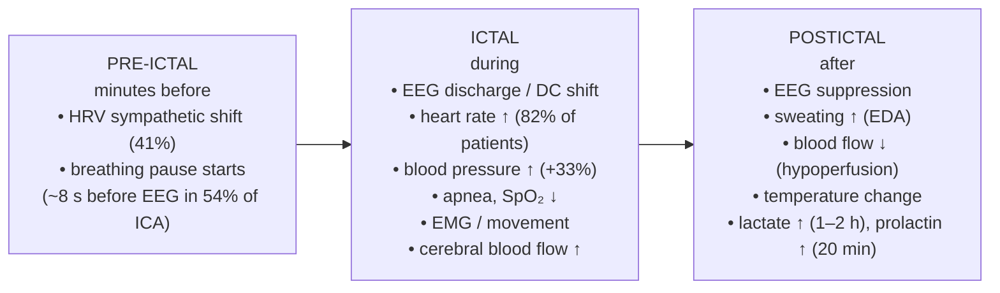

# What Changes in the Body During a Seizure

### Physiological signals beyond EEG, and which ones an ear-worn device can sense

*As of 2026-09-27. Companion to `Seizure_Neurophysiology.md` (what happens in the brain) and `Inference_Formulas.md` (how hidden variables are inferred).*

> **Bottom line.** A seizure is a **whole-body event**. Heart rate, blood pressure, breathing, blood oxygen, sweating, temperature and movement all change, some of them **before** the seizure is visible on EEG. Most of these signals can be measured **from the ear**. That makes a multimodal "?" ear-hook (EEG + in-ear PPG/SpO₂ + motion + EMG + temperature) a plausible way to catch more seizures, cut false alarms, and flag SUDEP warning signs.

---

## Contents

1. [Signal-by-signal overview](#1-signal-by-signal-overview)
2. [Each system in detail](#2-each-system-in-detail)
3. [Timing: before, during and after the seizure](#3-timing-before-during-and-after-the-seizure)
4. [Four discoveries that matter for the device](#4-four-discoveries-that-matter-for-the-device)
5. [The multimodal ear-hook](#5-the-multimodal-ear-hook)
6. [Benchmarks from existing wearables](#6-benchmarks-from-existing-wearables)
7. [Caveats](#7-caveats)
8. [How this feeds the next step](#8-how-this-feeds-the-next-step)
9. [References](#9-references)

---

## 1. Signal-by-signal overview

| System | Change during a seizure | How often | Timing | Sensor | From the ear? |
|---|---|---|---|---|---|
| **Brain (electrical)** | Rhythmic discharge, spikes, DC shift, postictal suppression | Nearly all seizures; scalp EEG misses some deep ones | During; suppression after | EEG | ✅ Ear / behind-ear electrodes |
| **Heart rate** | Rises (ictal tachycardia) | **82% of patients**; **71%** of focal, **64%** of generalised seizures | Can start **before** EEG onset | PPG, ECG | ✅ In-ear PPG |
| **Heart-rate variability (HRV)** | Sympathetic shift | Pre-ictal change in **41%** of seizures | **~5 min before** onset | PPG, ECG | ✅ |
| **Bradycardia / asystole** | Heart slows or pauses | **<6%** of seizures; asystole ~0.3%; ~80% of cases are temporal-lobe | During | PPG, ECG | ✅ Critical safety alarm |
| **Blood pressure** | Usually rises, sometimes falls | Focal: **mean arterial pressure +33%**, heart rate **+53%** | During | Cuff, arterial line | ⚠️ Only estimated (pulse-wave timing) |
| **Breathing** | Ictal central apnea | **47%** of focal-epilepsy patients, **36.5%** of seizures | **Before** EEG onset in 54% (~8 s) | Respiration from PPG, chest band | ✅ Breathing rate from in-ear PPG |
| **Blood oxygen (SpO₂)** | Drops, sometimes below 75% | Common with apnea; mainly temporal-lobe | During → after | Pulse oximetry | ✅ In-ear SpO₂ validated from 70–100% |
| **Sweating (EDA)** | Skin conductance rises (purely sympathetic) | Strongest in tonic-clonic seizures | During → after | EDA electrodes | ⚠️ Weak at the ear (few sweat glands) |
| **Temperature** | Peri-ictal hyperthermia, postictal fever, or low temperature | Variable | After | Thermometer | ✅ Ear canal ≈ core temperature |
| **Muscles** | Tonic stiffening, clonic jerks | Tonic-clonic seizures | During | Surface EMG | ✅ Jaw and temple muscles |
| **Movement** | Jerks, falls, automatisms, or stillness | Convulsive and hypermotor seizures | During | Accelerometer, gyroscope | ✅ Head IMU |
| **Brain blood flow** | Rises at the focus, then drops after | NIRS detects the rise in **96%** of cases | During → after | fNIRS, DCS | ⚠️ Needs forehead or temple optics |
| **Blood chemistry** | Lactate, prolactin, creatine kinase rise | Lactate >2.45 mmol/L: **94% sensitive, 93% specific** for tonic-clonic seizures | Minutes to days after | Blood test | ❌ Lab confirmation only |

---

## 2. Each system in detail

### 2.1 Heart

**Heart rate rises in most seizures.**
- A systematic review of simultaneous EEG and ECG studies found significant heart-rate increases in a weighted **82% of patients**.
- The increase appears in **71% of partial-onset** and **64% of generalised** seizures.
- A common definition of an "ictal tachycardia seizure": heart rate ≥100 bpm **and** either a ≥55% rise or a ≥35 bpm rise from baseline.

**Heart-rate variability shifts before seizures.** HRV changes in the ~5 minutes before onset, mostly towards more sympathetic activity. Two findings:
- Evidence of a pre-ictal interval in **41%** of seizures, with length varying between and within patients.
- One patient-specific HRV classifier reached **89.1% sensitivity at 0.41 false positives per hour**.

**Bradycardia and asystole are rare but dangerous.**
- Bradycardia occurs in **<6% of seizures**.
- Asystole occurs in about **0.27–0.4% of monitored patients** and up to **0.32% of seizures**.
- About **80%** of these cases are temporal-lobe epilepsy.
- These are syncope and SUDEP risks, and they justify a dedicated "slow heart" alarm.

### 2.2 Blood pressure

- In focal seizures (Hampel 2016, 45 seizures, 37 patients), **mean arterial pressure rose 33 ± 35%** and **heart rate 53 ± 44%**, while SpO₂ stayed unchanged on average.
- The rises were larger when consciousness was altered.
- Pressure can also **fall**, because different autonomic regions can be stimulated or inhibited.
- A wearable can only **estimate** blood pressure, from pulse-wave timing (PPG + ECG, or two PPG sites). It's a trend, not a measurement.

### 2.3 Breathing and oxygen

**Ictal central apnea (ICA)** was found in **47% of focal-epilepsy patients** and **36.5% of their seizures** (Lacuey et al.):
- It was the **only clinical sign** in **16.5%** of those seizures.
- It **preceded EEG onset by 8 ± 4.9 s** in **54%**.

**Postictal central apnea** is longer and slower to recover, a SUDEP-relevant pattern.

**Oxygen desaturation:**
- It is most frequent in **temporal-lobe** seizures, and longer seizures desaturate more.
- Severe drops **below 75%** have been recorded.

**It can be measured from the ear:**
- In-ear pulse oximetry has been validated against arterial blood from **70% to 100% SpO₂** (ISO 80601-2-61).
- Ear-canal PPG captures breathing better than earlobe or finger PPG.
- It may respond faster than finger oximetry, because the ear canal's blood supply comes from the carotid artery, like the brain's.

### 2.4 Sweat (electrodermal activity)

- EDA reflects **purely sympathetic** control of eccrine sweat glands.
- Skin conductance rises during seizures, most strongly in **tonic-clonic** seizures.
- The size of the post-seizure EDA rise correlates with **postictal EEG suppression**, itself a SUDEP marker (Poh, Picard et al.).
- The ear has few sweat glands, so EDA is better measured at the wrist or palm. A companion wristband is optional.

### 2.5 Temperature

- Thermoregulation is disturbed in several epilepsies: **peri-ictal hyperthermia**, **postictal fever**, sweating or shivering.
- In experimental temporal-lobe epilepsy, the hypothalamic temperature-sensing regions are damaged.
- The **ear canal** is a near-core temperature site, which makes it better suited than the wrist.

### 2.6 Muscles and movement

- **Surface EMG** catches the tonic phase of tonic-clonic seizures early. A wearable EMG device detected **93.8%** of them, with a **9 s** median delay and **0.67 false alarms per day** (Beniczky 2018).
- **Accelerometry** catches convulsions, falls and hypermotor automatisms. **Stillness** during a focal seizure with impaired awareness is also informative.
- At the ear, the **temporalis muscle** gives an EMG signal. That same signal lets the device **reject chewing and talking artefacts**.

### 2.7 Brain blood flow and metabolism

- Blood flow **rises at the seizure focus** during the seizure and **falls afterwards** (postictal hypoperfusion). Our ionic simulation reproduces this.
- NIRS detected the rise on the seizure side in **96%** of cases, versus 69% for ictal SPECT.
- Measuring it needs light to reach the cortex, from **forehead or temple** optics, not the ear canal.

### 2.8 Blood chemistry (confirmation only)

| Marker | Window | Performance |
|---|---|---|
| **Lactate** | Within 1–2 h | >2.45 mmol/L in the first hour: **94% sensitive, 93% specific** for tonic-clonic seizures |
| **Prolactin** | Within 20 min (peak 15–25 min) | High specificity, moderate sensitivity; also raised after syncope |
| **Creatine kinase** | Peaks 24–48(–72) h | Specific after tonic-clonic seizures; too late for acute decisions |

None of these is wearable today. They are useful for **clinical confirmation** of a detected event.

---

## 3. Timing: before, during and after the seizure



| Phase | Best signals | What they enable |
|---|---|---|
| Minutes before | HRV, breathing pattern | **Seizure forecasting** / early warning |
| Seconds before EEG | Breathing pause (ICA), heart-rate rise | **Earlier alarm** than EEG alone |
| During | EEG + heart rate + SpO₂ + motion/EMG | **Detection with cross-confirmation** (fewer false alarms) |
| After | EEG suppression, SpO₂, heart rhythm, temperature | **SUDEP risk monitoring**, event confirmation |

---

## 4. Four discoveries that matter for the device

1. **Some body signals change before the EEG does.** Breathing pauses begin about 8 s before EEG onset in half of apnea seizures, and HRV shifts in the minutes before 41% of seizures. A multimodal device can alert **earlier** than EEG alone.
2. **Some seizures show only in the body.** In 16.5% of apnea seizures, stopping breathing was the only sign. EEG-only devices can miss these.
3. **The ear is an unusually good sensing site:**
    - Validated in-ear SpO₂ (70–100%).
    - Better breathing signal from ear-canal PPG.
    - A carotid-fed blood supply, like the brain's.
    - Near-core temperature.
    - The temporalis muscle for EMG.
4. **These signals also save lives.** Apnea, oxygen drops, bradycardia and asystole are **SUDEP warning signs**. Watching for them turns a seizure counter into a **safety monitor**.

---

## 5. The multimodal ear-hook

```
        ___
      /     \   ← dry EEG electrodes above/behind the ear (≈ T7/T8, P7/P8)
     |       |
      \      |  ← mastoid reference electrode · temporalis EMG
       ?     |
       |    /   ← ear-canal tip: PPG + SpO₂ + temperature (+ in-ear EEG)
       •   /    ← optional earlobe PPG
   + 6-axis IMU (accelerometer, gyroscope) · Bluetooth to phone · worn on BOTH ears
```

| Sensor | Signals it provides | Seizure role | Safety role |
|---|---|---|---|
| EEG (both ears) | Discharges, DC shift, postictal suppression | **Primary detection** | Postictal suppression (SUDEP marker) |
| In-ear PPG | Heart rate, HRV, breathing rate, blood-flow pulse | Confirmation; **early warning** | Bradycardia or asystole alarm |
| In-ear SpO₂ | Oxygen saturation | Confirmation (apnea seizures) | **Hypoxemia alarm** |
| IMU | Convulsions, falls, automatisms, stillness | Detects tonic-clonic seizures; rejects walking artefacts | **Fall** alarm; prone position after a seizure |
| Temporalis EMG | Tonic muscle activation | Tonic-clonic detection | Rejects **chewing and talking** artefacts |
| Ear-canal thermometer | Core-like temperature | Postictal confirmation | Fever and hyperthermia |

**Decision logic:**
- **Seizure alarm:** EEG event **and** at least one body signal (heart-rate surge, SpO₂ drop, apnea, motion/EMG pattern) within about 30 s.
- **Independent safety alarms** that don't need EEG agreement: SpO₂ below 85%, a breathing pause over 20 s, a heart rate below 40 bpm or a pause, and a fall followed by prolonged stillness.

---

## 6. Benchmarks from existing wearables

| System | Signals | Seizure type | Sensitivity | False alarms |
|---|---|---|---|---|
| Wearable EMG (Beniczky 2018) | Surface EMG | Tonic-clonic | **93.8%** | **0.67 / day** (latency 9 s) |
| Meta-analysis of wearables (pooled) | Various | Tonic-clonic | 89.9% | 1.43 / day |
| Wrist devices (same meta-analysis) | ACC, EDA, HR | Tonic-clonic | 90.3% | 1.7 / day |
| Patient-adaptive HRV + EEG (Jeppesen 2024) | ECG + EEG | Seizures with ictal tachycardia | 84.8% | **0.25 / day** |
| Behind-the-ear EEG (Swinnen 2021) | 2-channel EEG | Absence | 98% | 0.91 / hour |
| **This project, EEG-only ear-hook (CHB-MIT)** | 2-channel EEG | All types | 86% (fine-tuned) | 162 / day |

The gap between this project's EEG-only result and multimodal systems (**~160 vs ~0.25–1.4 false alarms per day**) is the strongest argument for adding body signals.

---

## 7. Caveats

- **No body signal is universal.** About 18% of patients show no heart-rate rise, and even those who do don't show it in every seizure. Apnea occurs in about a third of focal seizures.
- **Body signals change for normal reasons too.** Exercise raises heart rate, stress causes sweating, and sleep brings breathing pauses (including sleep apnea). They work best as **confirmation** of an EEG event, or as **safety** alarms with conservative thresholds.
- **Focal seizures are the hard case.** Most wearable successes are for **tonic-clonic** seizures. Focal seizures without convulsions are subtler, which is where EEG plus PPG/SpO₂ at the ear would add the most.
- **Ear sensing has limits:**
    - Motion artefacts during convulsions.
    - Fit and contact varies between people.
    - EDA is weak at the ear.
    - Brain blood flow needs forehead or temple optics.
- **Blood chemistry isn't wearable.** Lactate, prolactin and creatine kinase are for hospital confirmation only.

---

## 8. How this feeds the next step

The detectors in `epilepsy_sim/detect/` are **EEG-only**, because CHB-MIT has almost no other signals. The next planned experiment uses **SeizeIT2**, a public dataset recorded with a **behind-the-ear** device (2-channel EEG + ECG + EMG + accelerometer + gyroscope) from patients with focal epilepsy, to measure:

1. **EEG-only** vs **EEG + heart rate** vs **EEG + heart rate + motion/EMG** detection.
2. The reduction in false alarms from requiring agreement between signals.
3. Earlier detection from heart-rate or breathing changes.

---

## 9. References

**Heart and blood pressure**

- *Ictal tachycardia: the head–heart connection.* Seizure (2014). [link](https://www.sciencedirect.com/science/article/pii/S1059131114000636)
- Jeppesen J et al. (2024). *Detection of seizures with ictal tachycardia using HRV and patient-adaptive logistic regression.* Epileptic Disord. [link](https://onlinelibrary.wiley.com/doi/10.1002/epd2.20196)
- *Heart rate variability analysis for the identification of the preictal interval in patients with drug-resistant epilepsy.* Sci Rep (2021). [PMC](https://pmc.ncbi.nlm.nih.gov/articles/PMC7966782/)
- *Patient-specific seizure prediction based on heart rate variability and recurrence quantification analysis.* PLoS One (2018). [link](https://journals.plos.org/plosone/article?id=10.1371%2Fjournal.pone.0204339)
- *Ictal bradycardia.* [overview](https://en.wikipedia.org/wiki/Ictal_bradycardia)
- *Potentially life-threatening ictal bradycardia in intractable epilepsy.* [PubMed](https://pubmed.ncbi.nlm.nih.gov/19294885/)
- Hampel KG et al. (2016). *Seizure-related modulation of systemic arterial blood pressure in focal epilepsy.* Epilepsia. [link](https://onlinelibrary.wiley.com/doi/10.1111/epi.13504)
- *Blood pressure in seizures and epilepsy.* [PMC](https://www.ncbi.nlm.nih.gov/pmc/articles/PMC6527757/)

**Breathing and oxygen**

- Lacuey N et al. (2018). *The incidence and significance of periictal apnea in epileptic seizures.* Epilepsia. [PubMed](https://pubmed.ncbi.nlm.nih.gov/29336036)
- *Persistent postictal central apnea in focal seizures.* Neurology. [PMC](https://pmc.ncbi.nlm.nih.gov/articles/PMC12288844/)
- *Oxygen desaturations triggered by partial seizures.* [link](https://www.researchgate.net/publication/228054313_Oxygen_Desaturations_Triggered_by_Partial_Seizures_Implications_for_Cardiopulmonary_Instability_in_Epilepsy)
- *Ictal central apnea as a predictor for SUDEP.* [PubMed](https://pubmed.ncbi.nlm.nih.gov/21816679)
- Bubb C et al. (2023). *Wearable in-ear pulse oximetry validly measures oxygen saturation between 70% and 100%.* Digit Health. [PMC](https://pmc.ncbi.nlm.nih.gov/articles/PMC10631342/)
- *In-ear SpO₂: a tool for wearable, unobtrusive monitoring of core blood oxygen saturation.* [PMC](https://www.ncbi.nlm.nih.gov/pmc/articles/PMC7506719/)

**Autonomic, temperature and blood chemistry**

- *Electrodermal activity response during seizures: systematic review and meta-analysis.* Epilepsy Behav (2022). [link](https://www.sciencedirect.com/science/article/pii/S1525505022003134)
- Poh MZ et al. (2012). *Autonomic changes with seizures correlate with postictal EEG suppression.* Neurology. [link](https://www.neurology.org/doi/10.1212/WNL.0b013e318258f7f1)
- *Temperature homeostasis disruption and hypothalamic alterations in experimental drug-resistant epilepsy.* Epilepsia. [link](https://onlinelibrary.wiley.com/doi/10.1002/epi.70453)
- *The role of postictal laboratory blood analyses in the diagnosis and prognosis of seizures.* Seizure (2017). [PubMed](https://pubmed.ncbi.nlm.nih.gov/28288363/)
- *Early postictal serum lactate is superior to creatine kinase in distinguishing GTCS from syncope.* [PubMed](https://pubmed.ncbi.nlm.nih.gov/28900842/)

**Wearable detection**

- Beniczky S et al. (2018). *Automated real-time detection of tonic-clonic seizures using a wearable EMG device.* Neurology. [link](https://www.neurology.org/doi/10.1212/WNL.0000000000004893)
- *Automated seizure detection using wearable devices: updated systematic review and meta-analysis.* [PubMed](https://pubmed.ncbi.nlm.nih.gov/42434397/)
- Swinnen L et al. (2021). *Accurate detection of typical absence seizures using a two-channel EEG wearable behind the ears.* Epilepsia. [link](https://onlinelibrary.wiley.com/doi/10.1111/epi.17061)
- *The power of ECG in semi-automated seizure detection in addition to two-channel behind-the-ear EEG.* [PMC](https://www.ncbi.nlm.nih.gov/pmc/articles/PMC10136326/)
- *SeizeIT2: wearable dataset of patients with focal epilepsy.* Sci Data (2025). [link](https://www.nature.com/articles/s41597-025-05580-x)
