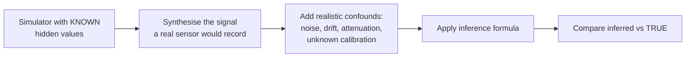
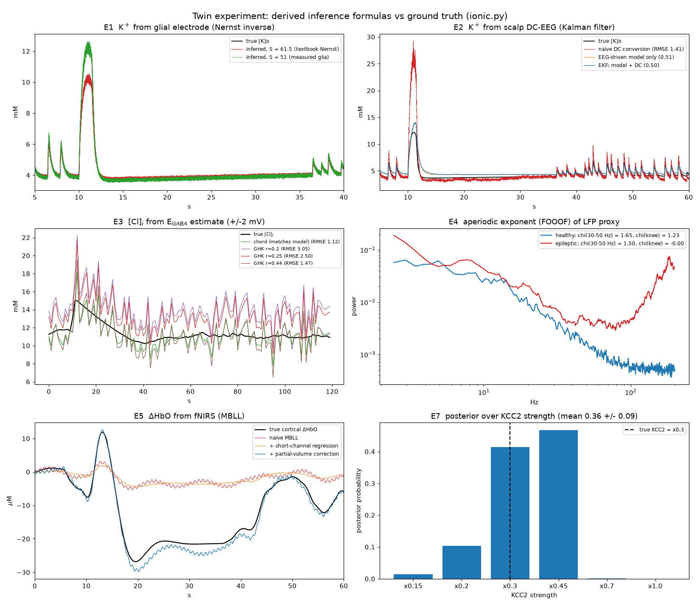
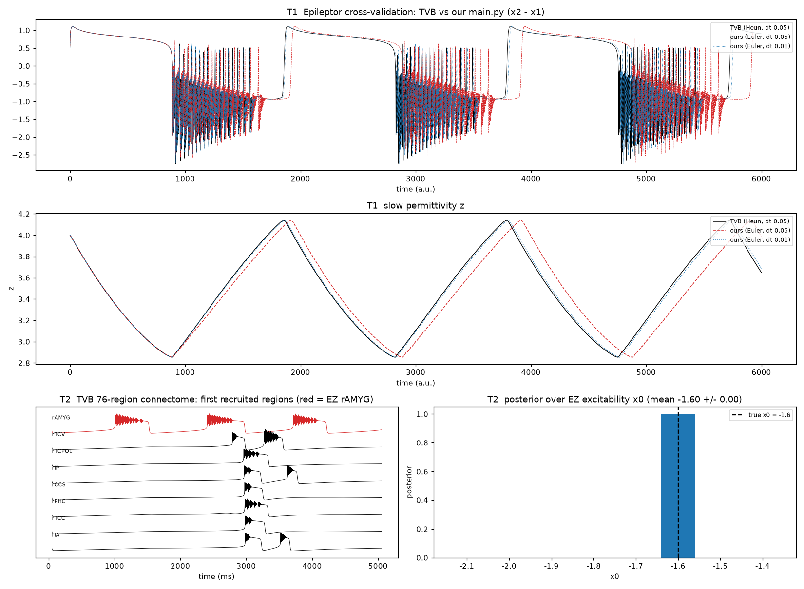
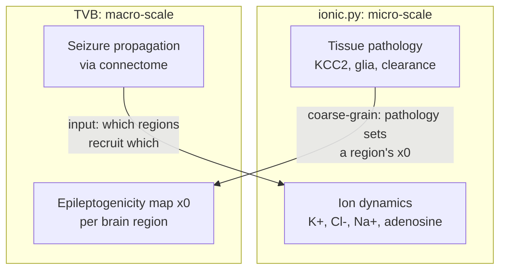

# Inference Simulations: Derived Formulas vs an Established Simulator (TVB)

*As of 2026-09-27. Scripts: `infer.py`, `tvb_compare.py`. Theory: `../Inference_Formulas.md`. Model: `SIMULATION.md`.*

> **Question tested.** Can hidden seizure variables (K⁺, Cl⁻, adenosine, tissue pathology, excitability) be recovered from signals that non-invasive sensors can record? And how does our custom approach compare with **The Virtual Brain (TVB)**, the established simulator behind the Virtual Epileptic Patient?
>
> **Short answer:**
>
> - The derived formulas **work when their assumptions match reality** and fail in exactly the ways the derivations predict when they don't.
> - Our Epileptor is **numerically cross-validated** against TVB's official implementation.
> - TVB's whole-brain inference **localised the seizure focus and recovered its excitability**. That result is optimistic, because the same model generated and fitted the data (an "inverse crime", §4.3).

---

## Contents

1. [How to run](#1-how-to-run)
2. [Method: twin experiments](#2-method-twin-experiments)
3. [Part A — Derived formulas on the ionic model (`infer.py`)](#3-part-a--derived-formulas-on-the-ionic-model-inferpy)
4. [Part B — The Virtual Brain (`tvb_compare.py`)](#4-part-b--the-virtual-brain-tvb_comparepy)
5. [Head-to-head comparison](#5-head-to-head-comparison)
6. [Conclusions](#6-conclusions)
7. [Limitations and next steps](#7-limitations-and-next-steps)

---

## 1. How to run

```bash
cd epilepsy_sim
# ground truth (ionic model), ~6 + 7 min
uv run ionic.py healthy   --t 90  --save
uv run ionic.py epileptic --t 120 --save

# Part A: derived formulas
uv run infer.py --abc     # E7 grid: 6 short ionic runs (~12 min), then E1-E7
uv run infer.py           # re-score E1-E7 only (seconds), uses the cached grid

# Part B: TVB (optional extra: tvb-library + tvb-data)
uv run --extra tvb tvb_compare.py   # T1 ~1 min, T2 ~11 min (9 x 76-region runs)
```

| Output | Contents |
|---|---|
| `output/infer_results.png`, `infer_metrics.json` | Part A figure and all metrics |
| `output/tvb_compare.png`, `tvb_metrics.json` | Part B figure and all metrics |
| `output/abc_grid.npz` | Cached E7 simulation grid |
| `output/ionic_{healthy,epileptic}.npz` | Ground-truth arrays |

---

## 2. Method: twin experiments

A **twin experiment** is the standard way to test an inference method before trusting it on patients:



**Confounds are deliberate.** Without them, an inversion of the same equation is circular and trivially perfect. Each experiment injects the uncertainty a real measurement would carry:

| Confound | Used in | Value | Source of realism |
|---|---|---|---|
| Glial slope unknown | E1 | True 51 mV/decade vs textbook 61.5 | Measured mammalian glia |
| Skull attenuation unknown | E2 | True α = 0.01, guessed 0.005 | Cortex-to-scalp gain is not constant |
| Electrode drift | E2 | Random walk, 0.4 µV/step | DC-EEG's main practical problem |
| E_GABA estimation error | E3 | ±2 mV | TMS-EEG-derived estimates are indirect |
| HCO₃⁻/Cl⁻ permeability unknown | E3 | r = 0.2–0.44 | Literature range |
| Scalp haemodynamics | E5 | Mayer waves 0.1 Hz + cardiac 1.2 Hz | Dominant fNIRS contaminant |
| Partial volume | E5 | Only 15% of photon path in cortex | Layered head |
| Individual DPF | E5 | True DPF 10% above formula | Inter-subject variation |
| Onset-picking noise | T2 | ±20 ms | SEEG onset annotation |

---

## 3. Part A — Derived formulas on the ionic model (`infer.py`)



### E1 — K⁺ from an intracellular glial electrode (Nernst inverse)

$[K]_o = [K]_{o,rest}\cdot 10^{\Delta V/S}$

| Assumed slope S | RMSE | Peak inferred (true 12.21 mM) |
|---|---|---|
| 61.54 (textbook Nernst) | 0.239 mM | **10.29 mM** (−16%) |
| **51 (measured glia)** | **0.062 mM** | **12.32 mM** (+1%) |

**Lesson:** the inverse formula is exact, but only with the *measured* slope. The textbook Nernst value hides a 16% error at seizure peak. This confirms the correction in the verification audit.

### E2 — K⁺ from scalp DC-EEG (Kalman filter)

The K⁺ process model $d[K]_o/dt = a\cdot\text{rate} - ([K]_o - K_0)/\tau$ was calibrated on the **healthy** dataset (a = 0.093, τ = 0.51 s), then applied to the **epileptic** dataset, whose clearance is actually 3× slower. That tests transfer across tissues.

| Method | RMSE | Peak (true 12.21 mM) |
|---|---|---|
| Naive constant-gain DC conversion | 1.41 mM | **29.2 mM** (2.4× too high) |
| EEG-activity-driven process model only | 0.51 mM | 14.1 mM |
| **EKF: process model + DC** | **0.50 mM** | 14.0 mM |

The EKF's estimate of the unknown skull gain α was 0.015 (true 0.010).

**Lessons:**

1. A single conversion factor from scalp µV to mM is **badly wrong** (2.4× peak error), as the verification audit predicted.
2. Model-based tracking cuts the error ~3×.
3. **Honest finding:** in this setup the DC channel added almost nothing beyond the EEG-driven model (0.50 vs 0.51 mM). With unknown gain *and* drift, the DC signal mostly informs timing, which the activity index already supplies. DC-EEG would add real value only with a calibrated gain, e.g. learned from patients with intracranial electrodes.

### E3 — [Cl]i from an E_GABA estimate

| Inverse used | RMSE | Mean bias |
|---|---|---|
| **Chord (matches the model's current)** | **1.12 mM** | −0.13 mM |
| GHK, r = 0.20 | 3.05 mM | **+2.72 mM** |
| GHK, r = 0.25 | 2.50 mM | +2.09 mM |
| GHK, r = 0.44 | 1.47 mM | −0.32 mM |

**Lessons:**

- With the *right* formula, ±2 mV of E_GABA error becomes about ±1.1 mM of [Cl]i. That's enough to tell healthy tissue (5.6 mM) from epileptic tissue (11.6 mM).
- Using the wrong formula family adds a **systematic bias of up to 2.7 mM**. Formula choice matters as much as measurement precision.
- GHK with r = 0.44 happens to land close. Its log-shaped curve crosses the chord line near this chloride range, which is coincidence, not correctness.

### E4 — E/I balance from the EEG spectrum (FOOOF)

| Tissue | Exponent χ (30–50 Hz, fixed) | R² | Exponent χ (2–200 Hz, knee) | R² |
|---|---|---|---|---|
| Healthy | **1.65** | 0.87 | 1.23 | 0.96 |
| Epileptic | **1.50** | 0.75 | ≈ 0 (fit failed) | 0.74 |

**Lessons:**

- In the 30–50 Hz band, epileptic tissue has a **flatter spectrum (lower χ)**, the direction Gao et al. (2017) associate with *more excitation*. ✅
- The broadband knee fit **fails** in epileptic tissue. Interictal spikes inject high-frequency power (the rising tail above 100 Hz), which violates the aperiodic model's assumptions.
- So χ is a usable **relative** marker, but only in a narrow band and outside epileptiform bursts.

### E5 — HbO/HbR from fNIRS (modified Beer-Lambert)

| Pipeline stage | RMSE | Correlation with truth | Amplitude ratio |
|---|---|---|---|
| Naive MBLL | 10.3 µM | 0.873 | 0.22 |
| + short-channel regression | 10.3 µM | **0.996** | 0.16 |
| + partial-volume correction | **1.40 µM** | 0.996 | **1.10** |
| HbR, full pipeline | 0.49 µM | 0.999 | 1.11 |

**Lessons:**

- Naive MBLL captures the *shape* poorly (scalp Mayer waves and cardiac pulsation leak in) and the *size* at only 22%.
- Short-channel regression removes the scalp signal (correlation 0.87 → 0.996).
- Partial-volume correction restores amplitude.
- The residual +10% amplitude error is exactly the individual-DPF error injected. Formula-based DPF is good but not perfect.
- **For a Temple-style device:** without a short channel and depth information, cortical blood flow is underestimated about 5× and contaminated by scalp physiology.

### E6 — Adenosine from postictal silence

| Tissue | A_peak | Silence (s) | $A_{peak}e^{-T/20}$ | True A at recovery |
|---|---|---|---|---|
| Healthy | 0.119 | 13.7 | 0.060 | 0.061 |
| Epileptic | 0.679 | 25.0 | 0.195 | 0.196 |

**Lesson, more precise than before:**

- The exponential *decay law* is exact: the formula reproduces the true adenosine level at recovery in both tissues.
- But the level at which firing resumes differs **3.2×** between tissues (0.06 vs 0.195), because the Na⁺/K⁺ pump current also holds neurons silent.
- A universal threshold $A_{th}$ therefore does not exist, and adenosine cannot be read off silence duration alone. ✅ Confirms the withdrawal.

### E7 — Tissue parameter (KCC2 strength) by Bayesian grid inference

- **Observed features:** resting E_GABA (±1.5 mV) and mean excitatory firing rate (±25%).
- **Simulations:** 6 ionic-model runs at different KCC2 strengths, with other pathology known.

| KCC2 (× normal) | 0.15 | 0.2 | **0.3 (true)** | 0.45 | 0.7 | 1.0 |
|---|---|---|---|---|---|---|
| Simulated E_GABA (mV) | −51.3 | −52.5 | −54.2 | −56.4 | −60.7 | −63.5 |
| Simulated E rate (Hz) | 13.2 | 12.4 | 9.9 | 12.2 | 10.3 | 10.9 |
| **Posterior** | 0.014 | 0.103 | **0.414** | **0.468** | 0.001 | ≈0 |

**Result:** posterior mean **0.36 ± 0.09** (true 0.30), inside 1 SD. The MAP (most probable single value) landed on 0.45 because the noisy "measurement" of E_GABA was −55.3 mV, versus a true −54.0 mV.

**Lessons:**

- E_GABA carries almost all the information. Firing rate is non-monotonic in KCC2, so it barely constrains it.
- The posterior correctly **rules out healthy KCC2** (1.0: p ≈ 0) and severe loss (0.15: p = 0.01).
- It **cannot distinguish 0.3 from 0.45**. That is honest uncertainty, not failure.

---

## 4. Part B — The Virtual Brain (`tvb_compare.py`)



### 4.1 T1 — Cross-validation: our Epileptor vs TVB's official Epileptor

Both runs use the same equations (checked line by line against TVB's source), the same parameters (x0 = −1.6, I_ext = 3.1, r = 1/2857) and the same initial state.

| | TVB (Heun, dt 0.05) | Ours (Euler, dt 0.05) | Ours (Euler, dt 0.01) |
|---|---|---|---|
| Seizures in 6000 a.u. | 3 | 3 | 3 |
| Onsets | 886.2, 2820.2, 4754.2 | 887.0, 2883.0, 4880.0 | **886.2**, 2827.6, 4769.0 |
| Seizure duration | 968.7 | 1030 | **976.2** |
| z RMSE vs TVB | – | 0.139 | **0.018** |
| LFP correlation vs TVB | – | 0.71 | 0.87 |
| Runtime | 43 s | **1.5 s** | 6.4 s |

**Result:** the **first onset is identical (886.2)**, and all differences shrink as our time step shrinks. They come from the integrator (Euler, first-order, vs Heun, second-order), not from the model. **Our `main.py` Epileptor is validated.** It is also ~7–30× faster for a single region.

The LFP correlation stays below 1 because the fast spikes inside each seizure drift slightly in phase. Seizure *timing* and slow dynamics, which is what inference uses, agree closely.

### 4.2 T2 — VEP-style whole-brain inference

**Setup:**

- TVB's 76-region human connectome, with delays at 3 m/s and Epileptor nodes.
- Coupling: Difference (a = 1), permittivity coupling Ks = −0.2.

| Zone | Regions | x0 |
|---|---|---|
| Epileptogenic zone (EZ) | rAMYG (right amygdala) | **−1.6** |
| Propagation zone (PZ) | rPHC, rTCV, rTCPOL (the 3 strongest connections) | −2.0 |
| Healthy | All other 72 regions | −2.2 |

**Simulated seizure:**

- The EZ seizes first (onset 1022 ms, recurring every ~1.4 s).
- The seizure then spreads to **36 of 38 right-hemisphere regions**. Early recruits: rTCV, rTCPOL, rIP, rCCS, rPHC, rTCC, rIA, then prefrontal, parietal and sensorimotor cortex.
- No left-hemisphere regions seized. This mirrors temporal-lobe seizures that spread ipsilaterally.

**Inference, using only the onset times observed with ±20 ms noise:**

| Task | Result |
|---|---|
| Localise EZ (earliest onset) | **rAMYG ✓ correct** |
| Recover EZ excitability x0 (8-point grid, −2.1 to −1.4) | **−1.60 ± 0.0002** (true −1.6) |
| Posterior at −1.7 / −1.5 | 8×10⁻⁸ / 3×10⁻⁶ |

### 4.3 Why T2 looks perfect: the inverse crime

T2 generated the data **and** fitted it with the *same* model, parameters and grid, which even contains the exact true value. This is known as an **inverse crime**: there is no model error, so the posterior collapses unrealistically.

- Onset time is extremely sensitive to x0, so ±20 ms of noise barely matters.
- With real SEEG data, model mismatch (wrong connectome, wrong coupling, noise, unmodelled physiology) typically widens the uncertainty a lot. Published VEP studies report region-level concordance with surgical outcome, not near-exact x0 values.
- E7, by contrast, had no inverse crime on its measurement and shows honest uncertainty (±0.09 on a 0.15–1.0 scale).

---

## 5. Head-to-head comparison

| Dimension | Ours: `ionic.py` + derived formulas | TVB: Epileptor + VEP-style inference |
|---|---|---|
| **Model type** | Biophysical, 100 conductance-based neurons with ion concentrations | Phenomenological, one 6-ODE Epileptor per brain region |
| **Scale** | ~1 mm² of cortex, local circuit | Whole brain, 76 regions plus connectome |
| **Hidden variables with physical units** | [K]o (mM), [Cl]i (mM), E_GABA (mV), [Na]i, adenosine, KCC2/glia/clearance | x0 (dimensionless excitability), z (abstract "permittivity") |
| **Link to sensors** | EEG (LFP proxy, DC, 1/f), fNIRS/PPG haemodynamics, E_GABA via TMS-EEG | SEEG/EEG onset times and seizure propagation |
| **Can infer ions (mM)?** | ✅ Yes, with uncertainty (E1–E3) | ❌ No: z is not an ion concentration |
| **Can localise the seizure focus?** | ❌ No (single local patch) | ✅ Yes (T2) |
| **Seizure spread** | Within 1 mm (lateral K⁺ diffusion) | Across the brain via white matter (36 regions recruited) |
| **Validation** | Reproduces Cressman 2009 Fig. 1 | Established platform; our Epileptor matches it (T1) |
| **Inference accuracy (this study)** | K⁺ 0.06–0.5 mM RMSE; Cl⁻ 1.1 mM; KCC2 0.36 ± 0.09 (true 0.3) | x0 −1.60 ± 0.0002 (optimistic, inverse crime) |
| **Cost per simulation** | 1–7 min (numba) | ~1 min (76 regions, 5 s); ~45 s for 1 region |
| **Clinical maturity** | Research prototype | Used in presurgical planning (VEP, EPINOV trial) |
| **Best question it answers** | *Why* is this tissue epileptic, and what are its ions doing? | *Where* do seizures start and how do they spread? |

### Complementary, not competing



A future multi-scale pipeline would do three things:

1. Use **TVB** to find *where* the epileptogenic zone is.
2. Use **`ionic.py`** fitted to that region's EEG, TMS-EEG and fNIRS to infer *why*: KCC2 loss vs glial failure vs clearance.
3. Map the ionic pathology onto TVB's x0 for that region.

This is exactly the "Epileptor-2" motivation of Chizhov et al. (2018): give the Epileptor's abstract variables physical meaning.

---

## 6. Conclusions

1. **Derived formulas are only as good as their assumptions.** Each one worked when its assumptions held (E1 with the measured slope, E3 with the matching formula, E5 with both corrections) and failed exactly as the derivations predicted when they didn't (textbook slope −16%, naive DC 2.4×, GHK bias +2.7 mM, naive fNIRS 22% amplitude).
2. **Model-based inference beats single-formula conversion** for anything seen through the skull (E2, E7). Uncertainty must be reported, as in E7's ±0.09.
3. **Some variables can't be read from one signal at all.** Adenosine (E6) and KCC2 (E7) need the full model fitted to several features.
4. **Our code is validated two ways:** the ionic core against Cressman 2009, and the Epileptor against TVB (first onset identical; differences vanish as dt shrinks).
5. **TVB and our model answer different questions.** TVB answers *where* (localisation, propagation), our ionic model answers *why* (ionic mechanism). Its near-perfect T2 score is an inverse-crime artefact and should not be read as clinical accuracy.

---

## 7. Limitations and next steps

| Limitation | Next step |
|---|---|
| Inverse crime in T2 (same model generates and fits) | Fit TVB with a *different* connectome or noise model; use held-out regions |
| E7 grid is coarse (6 points) and infers one parameter | Simulation-based inference (neural posterior estimation) over KCC2, glia and clearance jointly |
| E2 DC channel adds little without a calibrated gain | Learn the gain from patients with simultaneous intracranial and scalp DC-EEG |
| E4 aperiodic fit fails during bursts | Fit only burst-free segments; use a spike-robust spectral method |
| LFP proxy is not a real EEG forward model | Add a volume-conductor model (dipoles through a head model) |
| Healthy/epileptic only; no longitudinal data | Track parameters over days to forecast seizure risk |
| No real patient data | Apply to public datasets (e.g. OpenNeuro SEEG, fNIRS) |

**References:** see `../Inference_Formulas.md` §9 and `SIMULATION.md` §16. Key additions:

- Sanz-Leon P et al. (2013). *The Virtual Brain: a simulator of primate brain network dynamics.* Front Neuroinform 7:10.
- Jirsa VK et al. (2017). *The Virtual Epileptic Patient: individualized whole-brain models of epilepsy spread.* NeuroImage 145:377.
- Hashemi M et al. (2020). *The Bayesian Virtual Epileptic Patient.* NeuroImage 217:116839.
- Donoghue T et al. (2020). *Parameterizing neural power spectra.* Nat Neurosci 23:1655.
- Wan EA, van der Merwe R (2000). *The unscented Kalman filter for nonlinear estimation.* IEEE AS-SPCC.
