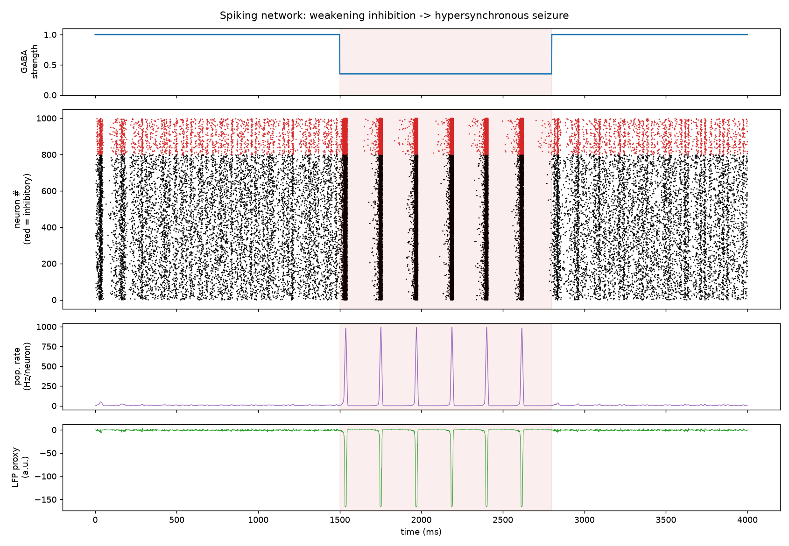
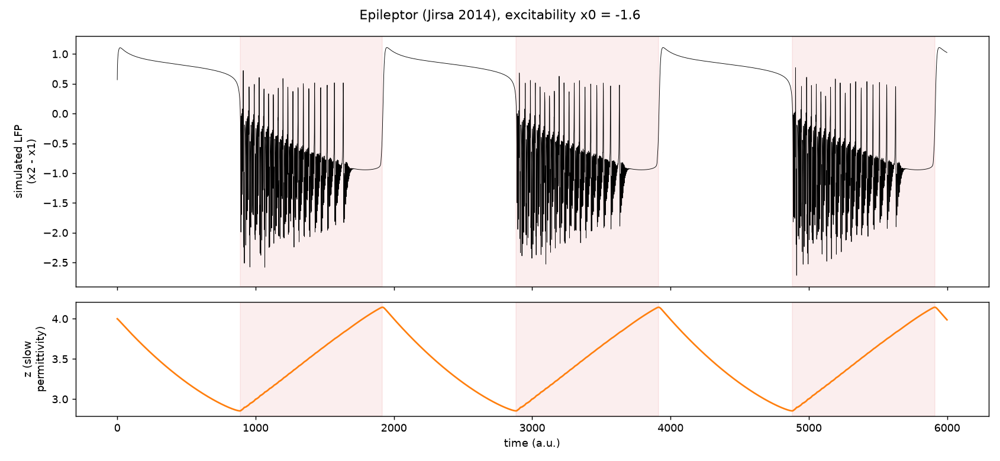
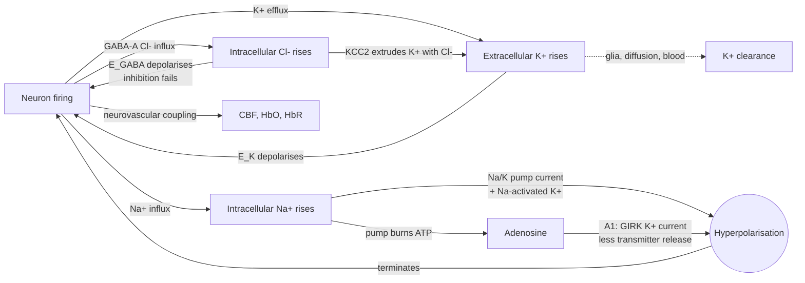
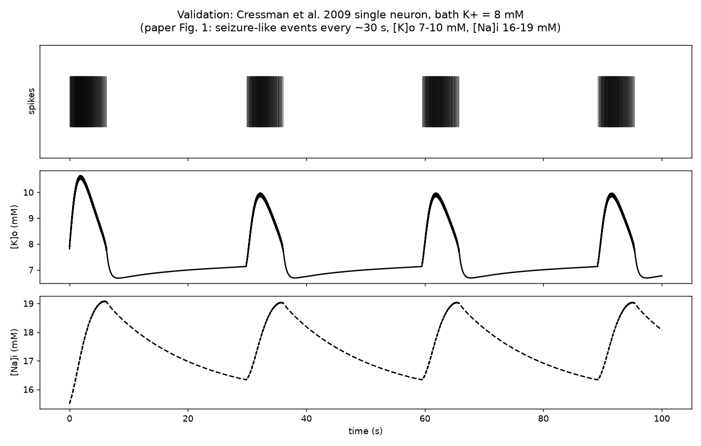
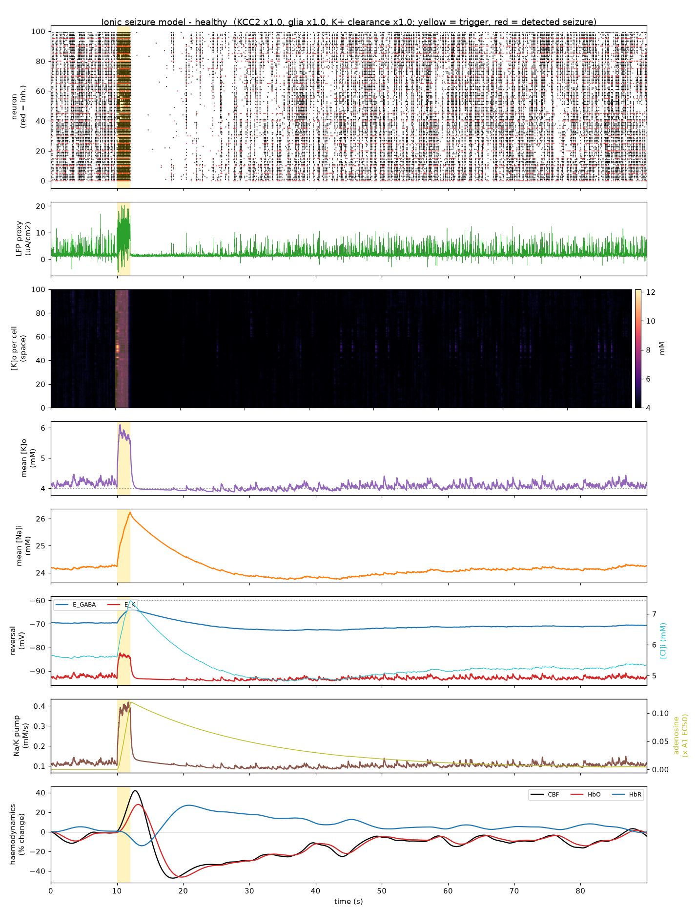
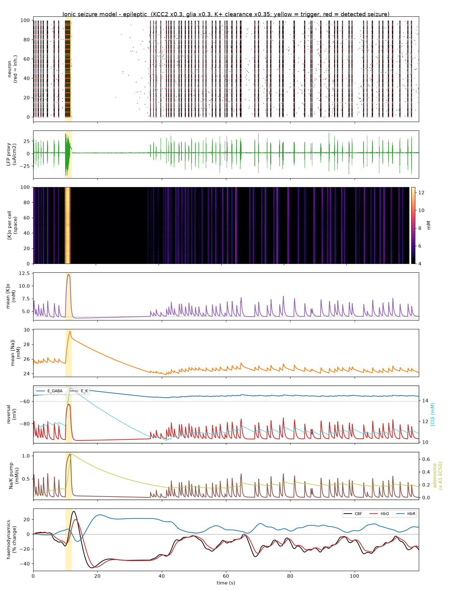

# Simulating Epileptic Seizures in Python

### From toy networks to a biophysical model with ion concentrations, glia, adenosine and blood flow

> **What this is.** Three seizure simulators of increasing realism, managed with `uv`:
>
> 1. a spiking network where inhibition fails;
> 2. the Epileptor phenomenological seizure model;
> 3. **`ionic.py`**, a biophysical network in which seizures emerge from **potassium, sodium, chloride and adenosine dynamics**. It also outputs the **blood-flow / haemoglobin signal an optical sensor (NIRS, or a Temple-style PPG device) would record**.
>
> The ionic model is **validated** against a published model (Cressman et al. 2009). It is built from mechanisms taken from the peer-reviewed literature, and every calibration step is documented below, including what went wrong and why it was changed.

*Last updated: 2026-09-27 · Python 3.13 · numpy · numba · matplotlib*

---

> **Related:** inference experiments and the TVB comparison are in [COMPARISON.md](COMPARISON.md).

## Contents

1. [Quick start](#1-quick-start)
2. [Project layout](#2-project-layout)
3. [The three models at a glance](#3-the-three-models-at-a-glance)
4. [Model 1 — Spiking network (inhibition failure)](#4-model-1--spiking-network-inhibition-failure)
5. [Model 2 — Epileptor](#5-model-2--epileptor)
6. [Model 3 — Ionic seizure model (`ionic.py`)](#6-model-3--ionic-seizure-model-ionicpy)
   - [6.1 Architecture and feedback loops](#61-architecture-and-feedback-loops)
   - [6.2 State variables](#62-state-variables)
   - [6.3 Equations](#63-equations)
   - [6.4 Parameters and their sources](#64-parameters-and-their-sources)
   - [6.5 Healthy vs epileptic tissue](#65-healthy-vs-epileptic-tissue)
   - [6.6 Numerics](#66-numerics)
7. [Validation](#7-validation)
8. [Results](#8-results)
9. [How the model maps onto real seizure biology](#9-how-the-model-maps-onto-real-seizure-biology)
10. [What an optical sensor would see (Temple relevance)](#10-what-an-optical-sensor-would-see-temple-relevance)
11. [Development log: how the model was calibrated](#11-development-log-how-the-model-was-calibrated)
12. [Limitations](#12-limitations)
13. [Roadmap](#13-roadmap)
14. [CLI reference](#14-cli-reference)
15. [Code map](#15-code-map)
16. [References](#16-references)

---

## 1. Quick start

```bash
cd epilepsy_sim
uv sync                                  # installs numpy, matplotlib, numba

# Fast, classic models (seconds)
uv run main.py                           # spiking network + Epileptor -> output/*.png
uv run main.py --model epileptor --x0 -2.2   # "healthy" Epileptor: no seizures

# Biophysical ionic model
uv run ionic.py validate                 # ~7 s    reproduce Cressman et al. 2009 Fig. 1
uv run ionic.py healthy   --t 120        # ~3 min  normal tissue
uv run ionic.py epileptic --t 300        # ~6 min  hippocampal-sclerosis-like tissue
```

All figures are written to `output/`. On Windows, close a PNG in the image viewer before re-running. If the file is locked, the script saves a timestamped copy instead.

> **Memory note:** each network run uses ~1–2 GB. Run the long scenarios one at a time on machines with limited RAM.

---

## 2. Project layout

```
epilepsy_sim/
├── main.py            # Model 1 (Izhikevich network) + Model 2 (Epileptor)
├── ionic.py           # Model 3: biophysical ion-concentration network (numba)
├── SIMULATION.md      # this document
├── README.md          # short usage notes
├── pyproject.toml     # uv project (numpy, matplotlib, numba)
├── uv.lock
└── output/
    ├── network_seizure.png      # Model 1
    ├── epileptor_seizures.png   # Model 2
    ├── ionic_validation.png     # Model 3, single-neuron validation
    ├── ionic_healthy.png        # Model 3, healthy tissue
    └── ionic_epileptic.png      # Model 3, epileptic tissue
```

Companion documents one folder up: `Epilepsy_Overview.md`, `Seizure_Neurophysiology.md`, `Temple_Technical_Dossier.md`.

---

## 3. The three models at a glance

| | Model 1: Spiking network | Model 2: Epileptor | Model 3: Ionic model |
|---|---|---|---|
| **Type** | 1,000 Izhikevich neurons | 6 ODEs, phenomenological | 100 Hodgkin-Huxley neurons with ion concentrations |
| **What causes the seizure** | GABA strength is cut by hand | Slow variable `z` crosses a threshold | Emerges from K⁺ / Cl⁻ / Na⁺ / adenosine dynamics and tissue pathology |
| **Seizure ends because** | Inhibition is restored by hand | `z` dynamics | Na⁺/K⁺ pump, Na⁺-activated K⁺ current, adenosine |
| **Biological variables** | Spikes, LFP proxy | None (abstract) | [K]o, [Na]i, [Cl]i, E_GABA, E_K, pump flux, adenosine, CBF, HbO, HbR |
| **Validated against** | Qualitative | Jirsa et al. 2014 behaviour | Cressman et al. 2009 Fig. 1 (quantitative) |
| **Runtime** | ~5 s | ~2 s | 7 s (validate) to ~6 min |
| **Best for** | Intuition about synchrony | Seizure onset/offset dynamics | Mechanisms, drug/pathology "what-ifs", sensor signals |

---

## 4. Model 1 — Spiking network (inhibition failure)

**Idea:** a healthy cortical network fires asynchronously. Weakening GABA inhibition (standing in for interneuron exhaustion or chloride loading) makes it tip into hypersynchronous firing.

- **Neurons:** Izhikevich (2003) model with 800 regular-spiking excitatory and 200 fast-spiking inhibitory neurons.

  $$\dot v = 0.04v^2 + 5v + 140 - u + I,\qquad \dot u = a(bv-u),\qquad v\ge 30\,\text{mV}\Rightarrow v\leftarrow c,\ u\leftarrow u+d$$

- **Manipulation:** GABA weights are scaled to `--inhibition` (default 0.35) between 1.5 s and 2.8 s.
- **Synchrony index:** variance of the population rate ÷ mean single-cell variance, where 0 means independent firing and 1 means lock-step.

| Phase | Synchrony |
|---|---|
| Baseline | **0.02** |
| Inhibition weakened | **0.98** |
| Recovery | **0.02** |



---

## 5. Model 2 — Epileptor

The Epileptor (Jirsa et al., *Brain* 2014) is the standard phenomenological seizure model and the engine of The Virtual Brain. It has two fast oscillators (`x1,y1`, `x2,y2`), a slow "permittivity" variable `z`, and a coupling term `g`:

$$
\begin{aligned}
\dot x_1 &= y_1 - f_1(x_1,x_2) - z + I_1, & \dot y_1 &= y_0 - 5x_1^2 - y_1\\
\dot z &= \tfrac{1}{\tau_0}\big(4(x_1-x_0) - z\big), & \dot x_2 &= -y_2 + x_2 - x_2^3 + I_2 + 2g - 0.3(z-3.5)\\
\dot y_2 &= \tfrac{1}{\tau_2}\big(-y_2 + f_2(x_2)\big), & \dot g &= -0.01\,(g - 0.1x_1)
\end{aligned}
$$

`x0` sets tissue excitability:

| `x0` | Result (6000 time units) |
|---|---|
| −1.6 | **3 seizures**, 51.6% of time ictal |
| −2.2 | **0 seizures** (healthy) |



---

## 6. Model 3 — Ionic seizure model (`ionic.py`)

### 6.1 Architecture and feedback loops

A seizure is a fight between **fast positive feedback** and **slow negative feedback**:



| Loop | Sign | Time scale | Mechanism |
|---|---|---|---|
| K⁺ accumulation → depolarisation → more firing | **+** | 0.1–5 s | Extracellular K⁺ raises E_K |
| Cl⁻ loading → depolarising GABA → less inhibition | **+** | 1–30 s | GABA-A Cl⁻ influx beats KCC2 extrusion |
| KCC2 extrudes K⁺ together with Cl⁻ | **+** | seconds | Cl⁻ recovery *adds* extracellular K⁺ |
| Na⁺ accumulation → electrogenic pump current | **−** | 1–30 s | 3 Na⁺ out / 2 K⁺ in = net outward current |
| Na⁺ accumulation → Na⁺-activated K⁺ current (Slack) | **−** | seconds | K_Na channels open as [Na]i rises |
| Pump ATP use → adenosine → A1 receptors | **−** | 5–60 s | GIRK K⁺ current + presynaptic inhibition |
| Glia + diffusion + vasculature clear K⁺ | **−** | seconds | Kir4.1 buffering, capillaries |

**Network:**

- 100 neurons on a ring: every 5th is inhibitory, so 80 excitatory (E) and 20 inhibitory (I).
- Local random wiring within ±10 cells: p = 0.6 from E cells, 0.8 from I cells.
- Each cell has its own extracellular micro-compartment. These are coupled by **lateral K⁺ diffusion**, so activity can spread spatially.
- Every neuron receives background Poisson excitation, standing in for input from the rest of the brain.

### 6.2 State variables

Per neuron *i* (all tracked continuously):

| Variable | Meaning | Unit | Typical rest |
|---|---|---|---|
| `V` | Membrane potential | mV | −70 |
| `n`, `h` | HH K⁺ activation / Na⁺ inactivation gates | – | 0.07 / 0.97 |
| `[Ca]i` | Intracellular Ca²⁺ (drives the AHP) | a.u. | ~0 |
| `[K]o` | Extracellular K⁺ around the cell | mM | 3.9–4.2 |
| `[Na]i` | Intracellular Na⁺ | mM | 23–25 |
| `[Cl]i` | Intracellular Cl⁻ | mM | 5.6 (healthy) / 11.6 (epileptic) |
| `g_e`, `g_i` | AMPA / GABA-A conductance | mS/cm² | – |
| `x` | Presynaptic vesicle resources (optional depression) | – | 1 |
| `A` | Adenosine (units of A1 half-activation) | – | ~0 |

Derived quantities:

- `[K]i = 158 − [Na]i`, a charge-conservation approximation (Cressman).
- `[Na]o = 144 − β([Na]i − 18)`.
- All reversal potentials are recomputed every step.

### 6.3 Equations

**Membrane** (the positive-outward current convention of Cressman's code):

$$
C\frac{dV}{dt} = -\big(I_{Na} + I_K + I_{Cl} + I_{AMPA} + I_{GABA} + s_p\,I_{pump}\big)
$$

**Intrinsic currents** (Cressman et al. 2009):

$$
\begin{aligned}
I_{Na} &= g_{Na}\,m_\infty^3 h\,(V-E_{Na}) + g_{NaL}(V-E_{Na})\\
I_K &= \Big(g_K n^4 + g_{AHP}\tfrac{[Ca]_i}{1+[Ca]_i} + g_{KNa}\,w_\infty([Na]_i) + g_{GIRK}(A)\Big)(V-E_K) + g_{KL}(V-E_K)\\
I_{Cl} &= g_{ClL}(V-E_{Cl})
\end{aligned}
$$

The gates follow the classical Hodgkin-Huxley rates, with $m$ at steady state, $\phi = 3$ and

$$\alpha_n = \tfrac{0.01(V+34)}{1-e^{-0.1(V+34)}},\ \beta_n = 0.125e^{-(V+44)/80},\ \alpha_h = 0.07e^{-(V+44)/20},\ \beta_h = \tfrac{1}{1+e^{-0.1(V+14)}}$$

**Reversal potentials** (Nernst, $RT/F = 26.64$ mV, Cressman's value, which corresponds to 36 °C; at 37 °C it is 26.73 mV). The GABA-A current is modelled as two parallel conductances (80% Cl⁻, 20% HCO₃⁻), so its reversal potential is the **chord-conductance average**:

$$
E_K = 26.64\ln\frac{[K]_o}{[K]_i},\quad E_{Na} = 26.64\ln\frac{[Na]_o}{[Na]_i},\quad E_{Cl} = 26.64\ln\frac{[Cl]_i}{[Cl]_o},\quad
E_{GABA} = 0.8\,E_{Cl} + 0.2\,E_{HCO_3},\qquad E_{HCO_3} = 26.64\ln\frac{[HCO_3]_i}{[HCO_3]_o} \approx -12.9\text{ mV}
$$

**Synapses** (exponential conductances, $\tau_{AMPA} = 5$ ms, $\tau_{GABA} = 8$ ms). Each current is split by ion so that it feeds the concentration equations:

$$
\begin{aligned}
I_{AMPA} &= 0.64\,g_e(V-E_{Na}) + 0.36\,g_e(V-E_K) &&\text{(reversal} \approx 0\text{ mV at rest)}\\
I_{GABA} &= 0.8\,g_i(V-E_{Cl}) + 0.2\,g_i(V-E_{HCO_3}) &&\text{(Cl}^-\text{ part loads the cell)}
\end{aligned}
$$

**Pump, glia and diffusion** (fluxes in mM/s; Cressman, corrected ModelDB version):

$$
I_{pump} = \frac{\rho}{1+e^{(25-[Na]_i)/3}}\cdot\frac{1}{1+e^{5.5-[K]_o}},\qquad
I_{glia} = \frac{s_g\,G_{glia}}{1+e^{(18-[K]_o)/2.5}},\qquad
I_{diff} = s_c\,\varepsilon([K]_o - K_{bath})
$$

**KCC2** (thermodynamically driven by the K⁺–Cl⁻ gradient; extrudes **both** ions):

$$
J_{KCC2} = s_k\,U_{KCC2}\,\ln\frac{[K]_i[Cl]_i}{[K]_o[Cl]_o}
$$

**Concentration dynamics.** Here $\gamma = 0.0445$ converts current to concentration rate, $\beta = 7$ is the intra/extracellular volume ratio, and the ÷1000 converts ms to s:

$$
\begin{aligned}
\frac{d[K]_o}{dt} &= \tfrac{1}{1000}\Big(\gamma\beta(I_K + I_{AMPA,K}) - 2\beta I_{pump} - I_{glia} - I_{diff} + \beta J_{KCC2}\Big) + D_{lat}\nabla^2[K]_o\\
\frac{d[Na]_i}{dt} &= \tfrac{1}{1000}\Big(-\gamma(I_{Na} + I_{AMPA,Na}) - 3I_{pump}\Big)\\
\frac{d[Cl]_i}{dt} &= \tfrac{1}{1000}\Big(\gamma(I_{Cl} + I_{GABA,Cl}) - J_{KCC2}\Big)
\end{aligned}
$$

**Electrogenic pump current.** Each cycle moves one net positive charge out:

$$I_{pump}^{(\mu A/cm^2)} = s_p\,\frac{I_{pump}}{\gamma}$$

**Na⁺-activated K⁺ current** (Slack channels). This is the Compte et al. 2003 curve, with its EC50 shifted from 38.7 mM to this model's resting [Na]i:

$$w_\infty = \frac{0.37}{1+(68.6/[Na]_i)^{3.5}}$$

**Adenosine.** It is produced from ATP breakdown in proportion to pump ATP use above rest, and cleared with a time constant of 20 s:

$$
\frac{dA}{dt} = \alpha_A\,\max(I_{pump} - 0.25,\,0) - \frac{A}{\tau_A},\qquad
g_{GIRK} = g_{ado}\frac{A}{1+A},\qquad \text{release} \times \frac{1}{1+A}
$$

**Neurovascular coupling** (Balloon-Windkessel, Friston et al. 2000). The drive is $u = k\ln(\text{rate}/\text{baseline})$, clipped to [0.3×, 30×]:

$$
\dot s = u - \kappa s - \gamma_f(f-1),\quad \dot f = s,\quad \tau_0\dot v = f - v^{1/\alpha},\quad
\tau_0\dot q = \frac{f\,(1-(1-E_0)^{1/f})}{E_0} - v^{1/\alpha}\frac{q}{v}
$$

The outputs are CBF = $f$, HbT ∝ $v$, HbR ∝ $q$, and HbO = (HbT − 0.4·HbR)/0.6.

### 6.4 Parameters and their sources

| Parameter | Value | Source / rationale |
|---|---|---|
| $g_{Na}, g_K, g_{AHP}$ | 100, 40, 0.01 mS/cm² | Cressman 2009 Table 1 |
| $g_{NaL}, g_{KL}, g_{ClL}$ | 0.0175, 0.05, 0.05 mS/cm² | Cressman 2009 |
| $\gamma$, $\beta$ | 0.0445, 7 | Cressman ModelDB code (corrected by the erratum) |
| $\rho$ (pump) | 1.25 mM/s | Cressman 2009 |
| $G_{glia}$ | 66.7 mM/s | Cressman 2009 |
| $\varepsilon$ (vascular clearance) | 1.33 s⁻¹ | Cressman code ($2D/\Delta x^2$) |
| $K_{bath}$ | 4 mM | Plasma K⁺ |
| $D_{lat}$ | 0.625 s⁻¹ | $D = 2.5\times10^{-6}$ cm²/s, Δx = 20 µm |
| $[Cl]_o$, $[HCO_3]_{i/o}$ | 130, 16/26 mM | Standard physiology |
| $U_{KCC2}$ | 0.4 mM/s | Gives resting [Cl]i ≈ 5–6 mM and E_GABA ≈ −70 mV |
| $g_{KNa}$ | 1.33 mS/cm², EC50 68.6 mM | Compte 2003, shifted to resting [Na]i |
| $g_{ado}$, $\alpha_A$, $\tau_A$ | 0.3 mS/cm², 0.5, 20 s | Adenosine surge and clearance (During & Spencer 1992; Boison) |
| Recurrent $g_E$ / $g_I$ totals | 1.3 / 2.6 mS/cm² | Balanced E/I, calibrated (§11) |
| Background drive | 60 Hz × 0.07 mS/cm² | Gives 4–6 Hz asynchronous baseline firing |
| Pump-current scale $s_p$ | 1.0 (default) | See §11 and §12 |
| Neurovascular gain $k$ | 0.12 | Gives a physiological CBF rise of ~+40–100% |

### 6.5 Healthy vs epileptic tissue

The two tissues share **the same neurons and wiring**. Only the pathology changes, modelled on **hippocampal sclerosis / mesial temporal lobe epilepsy**:

| Factor | Healthy | Epileptic | Biological basis |
|---|---|---|---|
| KCC2 (`--kcc2`) | ×1.0 | **×0.3** | KCC2 is downregulated in human epileptic tissue, which shifts E_GABA positive |
| Glial K⁺ buffering (`--glia`) | ×1.0 | **×0.3** | Loss of astrocytic Kir4.1 channels in sclerosis |
| Vascular K⁺ clearance (`--clear`) | ×1.0 | **×0.35** | Gliosis and a smaller extracellular space slow K⁺ removal |

Each scenario first runs a **60 s warm-up**, so it starts from its *own* resting ion concentrations. This matters because epileptic tissue already rests with elevated chloride. At t = 10–12 s, both tissues receive the **same 2 s trigger** (+400 Hz extra excitatory input).

### 6.6 Numerics

- **Exponential Euler** for voltage and gates. Each step solves $V$ exactly for the frozen conductances:

  $$V_{t+dt} = V_\infty + (V_t - V_\infty)e^{-dt\,g_{tot}}$$

  It stays stable when synaptic conductances become large during seizures; forward Euler blew up to NaN there.
- **dt = 0.02 ms.** Concentrations use forward Euler, since they are slow.
- **numba JIT** compiles the whole loop, so 100 neurons × 360 s simulated (warm-up plus run) takes about 6 minutes.
- **Recording:** population means are stored every 1 ms and the spatial [K]o map every 10 ms. All spikes are recorded.

---

## 7. Validation

Running `uv run ionic.py validate` turns off every addition (fixed Cl⁻, no pump current, no I_KNa, no adenosine) and reproduces **Cressman et al. 2009, Fig. 1**: a single neuron in 8 mM bath K⁺.

| Quantity | Cressman 2009 (paper) | This implementation |
|---|---|---|
| Seizure-like events | Periodic, every ~30 s | Periodic, every **~29.5 s** |
| [K]o range | ~6.7 → ~10.2 mM | **6.7 → 10.7 mM** |
| [Na]i range | ~16.3 → ~19 mM | **15.5 → 19.1 mM** |



This confirms that the core ion physics, including the unit conversions that the 2011 erratum corrected, is implemented correctly.

---

## 8. Results

### 8.1 Healthy tissue



`uv run ionic.py healthy --t 120`

```
[healthy] baseline: E rate 6.1 Hz | [K]o 4.18 mM | [Na]i 24.2 mM | [Cl]i 5.6 mM | E_GABA -70.7 mV
[healthy] interictal discharges: 36 (18/min) | seizures detected: 0
[healthy] trigger response: peak [K]o 6.1 mM | peak [Na]i 26.2 mM | peak [Cl]i 7.4 mM | peak E_GABA -66 mV | peak adenosine 0.12
[healthy] after trigger: silence 13.7 s* | min [K]o 3.88 mM | CBF peak +42% then min -47%
```
<sub>*Time until the 1 s-smoothed rate is back above 50% of the pre-trigger baseline, from the corrected metric. The first run printed 0.0 s because of a bug: the smoothing window still contained the trigger. Note that the pre-trigger baseline (0–10 s) is slightly more active than the later steady state, so this metric is conservative.</sub>

**Interpretation:**

- **Baseline:** asynchronous, irregular firing at ~6 Hz, as in awake cortex. There are no vertical bands in the raster.
- **Resting ions:** [Cl]i is 5.6 mM, so **E_GABA is −69.6 mV**, at or below rest, and inhibition is truly inhibitory.
- **The trigger** drives firing hard, but:
    - [K]o only reaches **6.1 mM**. Intact glia and clearance cap it.
    - [Cl]i rises only 5.6 → 7.4 mM, because working KCC2 pumps it back out.
- **After the trigger:**
    - A **13.7 s** reduced-activity period follows (near-silence for ~5 s, then gradual recovery). This is the Na⁺-pump after-hyperpolarisation, a normal response.
    - Then there's complete recovery. The small adenosine rise (0.12) clears within ~40 s.
- **The "36 discharges"** are mostly normal population fluctuations that exceed the simple detector threshold (see §12, item 8). There is no epileptiform bursting in the raster.
- **Blood flow:** a physiological functional hyperaemia (**CBF +42%**), then a transient undershoot while firing is suppressed.

### 8.2 Epileptic tissue



`uv run ionic.py epileptic --t 300`

```
[epileptic] baseline: E rate 17.3 Hz | [K]o 4.59 mM | [Na]i 25.6 mM | [Cl]i 11.6 mM | E_GABA -57.7 mV
[epileptic] interictal discharges: 163 (33/min) | seizures detected: 0
[epileptic] trigger response: peak [K]o 12.2 mM | peak [Na]i 29.8 mM | peak [Cl]i 15.2 mM | peak E_GABA -52 mV | peak adenosine 0.68
[epileptic] after trigger: silence 25.0 s | min [K]o 3.66 mM | CBF peak +31% then min -46%
```

**Interpretation, phase by phase:**

1. **Interictal state (0–10 s, and 37–300 s).**
    - *Resting ions:*
        - Resting [Cl]i is **11.6 mM**, twice the healthy value, so **E_GABA is −54.1 mV**, *above* the resting potential. GABA is now barely inhibitory. This matches measurements in resected human epileptic tissue.
        - Resting [K]o is elevated (4.6 vs 4.2 mM) because clearance is impaired.
    - *Interictal discharges:*
        - The network fires in **synchronous population bursts** (vertical bands in the raster, sharp deflections in the LFP) at **~33/min**.
        - Each burst sends local [K]o up to **7–9 mM** and nudges [Cl]i up; KCC2 slowly pumps it back out, giving the saw-tooth in the Cl⁻ trace.
        - These are the model's **interictal epileptiform discharges**, the "spikes" that neurologists look for on EEG between seizures.
2. **Ictal event (trigger at 10–12 s).**
    - *Ion changes:*
        - [K]o rises to **12.2 mM**, which is the physiological "K⁺ ceiling" measured in real seizures and **2× the healthy response**.
        - [Na]i rises to **29.8 mM** (+4 mM).
        - [Cl]i rises to **15.2 mM**, and **E_GABA reaches −48.3 mV**. Inhibition has effectively collapsed.
    - *Brakes engaged:* the pump runs flat-out (~1 mM/s), and ATP breakdown produces an **adenosine surge (0.68)**, 5.7× the healthy peak.
3. **Postictal state (12–37 s).**
    - *Silence:* the network falls **silent for 25 s**, versus 13.7 s in healthy tissue. This is **postictal depression**, driven by the lingering pump current, adenosine and Na⁺-activated K⁺ current.
    - *K⁺ undershoot:* [K]o **undershoots to 3.66 mM**, *below* baseline, because the pump keeps working after firing stops. Krishnan & Bazhenov (2011) predicted and discussed this.
    - *Blood flow:* CBF drops to **−46%**, i.e. **postictal hypoperfusion** (the model's version of what Farrell et al. measured).
4. **Recovery (37 s onward).** As adenosine clears and [Na]i returns to baseline, interictal discharges come back, first sparse and then dense. The tissue returns to its epileptic "resting" state.


<sub>E_GABA values in the printed logs above (−70.7, −66, −57.7, −52 mV) came from an earlier diagnostic that used the GHK form, which is not the formula the simulated current obeys. Recomputed with the model's actual chord form from the same [Cl]i values, they are −69.6, −63.7, −54.1 and −48.3 mV. The dynamics are unaffected; the code now records the chord form.</sub>

### 8.3 Side by side

Same neurons, same wiring, same 2 s trigger. Only KCC2, glia and K⁺ clearance differ.

| Measure | Healthy | Epileptic | Ratio / Δ | Real-world reference |
|---|---|---|---|---|
| Baseline E firing | 6.1 Hz | 17.3 Hz | ×2.8 | Hyperexcitable epileptic cortex |
| Resting [Cl]i | 5.6 mM | **11.6 mM** | ×2.1 | Elevated [Cl]i in human epileptic tissue |
| Resting E_GABA | −69.6 mV | **−54.1 mV** | +15.5 mV | Depolarised E_GABA with KCC2 loss |
| Resting [K]o | 4.18 mM | 4.59 mM | +0.4 mM | Impaired buffering |
| Interictal discharges | Not epileptiform* | **33/min** | – | IEDs on EEG |
| Peak [K]o (trigger) | 6.1 mM | **12.2 mM** | ×2.0 | Ictal K⁺ ceiling ~10–12 mM |
| Peak [Cl]i (trigger) | 7.4 mM | **15.2 mM** | ×2.1 | Ictal Cl⁻ loading |
| Peak E_GABA | −63.7 mV | **−48.3 mV** | +15.4 mV | Depolarising GABA during seizures |
| Peak [Na]i | 26.2 mM | 29.8 mM | +3.6 mM | Ictal Na⁺ loading |
| Peak adenosine | 0.12 | **0.68** | ×5.7 | Ictal adenosine surge (During & Spencer 1992) |
| Postictal silence | 13.7 s | **25 s** | ×1.8 | Postictal depression |
| Min [K]o after | 3.88 mM | **3.66 mM** | Below baseline | Postictal K⁺ undershoot |
| CBF peak → min | +42% → −47% | +31% → −46% | – | Ictal hyperperfusion → postictal hypoperfusion |

<sub>*The healthy count (18/min) comes from threshold crossings by normal fluctuations; there is no synchronous bursting in the raster.</sub>

The CBF peak is smaller in epileptic tissue because its *baseline* is already hyperactive (17 Hz, frequent discharges). The haemodynamic readout is relative to each tissue's own pre-trigger baseline.

**How to read the figures** (top to bottom):

1. Spike raster (black = excitatory, red = inhibitory).
2. LFP proxy (summed synaptic current into pyramidal cells).
3. Space–time map of [K]o.
4. Mean [K]o.
5. Mean [Na]i.
6. E_GABA and E_K, with [Cl]i on the right axis.
7. Na⁺/K⁺ pump flux, with adenosine on the right axis.
8. Blood flow (CBF), oxy-haemoglobin (HbO) and deoxy-haemoglobin (HbR).

Yellow marks the trigger; red shading marks detected seizures (≥ 5 s of sustained high activity).

---

## 9. How the model maps onto real seizure biology

Each row pairs a stage from `Seizure_Neurophysiology.md` with what the model shows:

| Real seizure physiology | In the model | Status |
|---|---|---|
| Extracellular K⁺ rises from ~3 to 8–12 mM during seizures, with a "ceiling" around 12 mM | [K]o peaks at **~12 mM** in epileptic tissue vs ~6 mM in healthy tissue | ✅ reproduced |
| Chloride loading makes GABA depolarising | Epileptic [Cl]i ~11.6 → 15 mM; E_GABA −54 → −48 mV (healthy −70 mV) | ✅ |
| KCC2 loss in epileptic tissue | `--kcc2 0.3` raises resting [Cl]i from 5.6 to 11.6 mM | ✅ |
| KCC2 recovery loads K⁺ into the extracellular space | Explicit K⁺ term in $J_{KCC2}$ | ✅ mechanism present |
| Interictal epileptiform discharges between seizures | Spontaneous population bursts with K⁺ transients to 7–9 mM | ✅ epileptic only |
| Na⁺ accumulation and pump activation during seizures | [Na]i +5 mM, pump flux ×5–8 | ✅ |
| Adenosine surge terminates seizures | Adenosine rises to 0.68 (EC50 units) after the ictal event, 5.7× the healthy peak | ✅ |
| Postictal depression | ~25 s of near-silence after the event in epileptic tissue | ✅ |
| Postictal K⁺ undershoot below baseline | [K]o falls to ~3.7 mM (baseline 4.6) | ✅ (Krishnan & Bazhenov report the same) |
| Ictal hyperperfusion, then postictal hypoperfusion | CBF surge, then a dip below baseline | ✅ qualitatively |
| Spatial spread | Lateral K⁺ diffusion; see the [K]o space–time map | ✅ mechanism present |
| **Self-sustained 30–120 s focal seizure** | Ictal event only lasts as long as the trigger at `--pump-i 1` | ⚠️ **not yet** (see §12) |
| Loss of consciousness, motor signs | Not modelled (100-cell local network) | ✗ out of scope |

---

## 10. What an optical sensor would see (Temple relevance)

The bottom panel of every network figure is the **optical readout**: relative CBF, HbO and HbR. This is what NIRS, or a multi-wavelength PPG device like Temple, measures.

**Blood flow and haemoglobin:**

- **During the event:** CBF and HbO rise and HbR falls. This is neurovascular coupling, the same ictal hyperperfusion that NIRS detects on the side of the seizure focus in ~96% of cases in the literature.
- **After the event:** CBF and HbO fall **below** baseline while neurons are silent. This is **postictal hypoperfusion**, which is clinically real and lasts tens of minutes in patients.

**Electrical vs haemodynamic signals:**

| Signal | Electrical (EEG) | Haemodynamic (optical) |
|---|---|---|
| Interictal discharges | Clear spikes | Small, often below noise |
| Ictal event | Large rhythmic discharge | Large CBF/HbO surge, delayed by seconds |
| Postictal state | Suppression | Hypoperfusion (below baseline) |

**Implication for sensor design.** An optical device sees seizures as slow haemodynamic surges with a characteristic *surge → dip* shape. It would struggle with brief interictal events. Combining it with EEG gives the full picture.

**Caveats:**

- The haemodynamic model is generic cortical coupling, not calibrated to the temple region.
- A temple-worn sensor mostly samples scalp and superficial temporal artery flow, not cortex (see `Temple_Technical_Dossier.md`).

---

## 11. Development log: how the model was calibrated

Building a realistic model meant solving a chain of problems. Each step is listed so the choices are transparent and reproducible.

| # | Symptom | Diagnosis | Fix | Evidence / source |
|---|---|---|---|---|
| 1 | Printed Cressman equations gave wrong dynamics | The paper has typographical errors in its concentration equations | Used the **ModelDB C code** (γ = 0.0445, ÷1000 ms→s, β on I_K) | Cressman et al. 2011 erratum |
| 2 | — | Validation | Reproduced Cressman Fig. 1 (period, [K]o, [Na]i) | §7 |
| 3 | Baseline firing at 245 Hz | One background AMPA event (0.15 mS/cm²) moved V by ~50 mV, because this neuron's leak conductance is tiny (0.12 mS/cm²) | Recalibrated to 60 Hz × 0.02 mS/cm², giving ~3 Hz | Cortical rates of 1–5 Hz |
| 4 | Strong network locked into permanent 100–200 Hz firing that never ends | [Na]i pinned at 32 mM (pump saturated); no termination mechanism | Added the **electrogenic pump current** and **Na⁺-activated K⁺ current** | Krishnan & Bazhenov 2011; Compte 2003 |
| 5 | Excitatory cells silent while interneurons fire | Compte's I_KNa curve assumes resting [Na]i ≈ 11 mM; this model rests at ~19.5 mM, so I_KNa was too active | Shifted EC50 38.7 → 68.6 mM (I_KNa ≈ 5% of leak at rest, as in Compte) | Compte 2003 |
| 6 | [Na]i drifting upward and firing slowly declining | Start state was not the steady state; Na⁺ equilibrates over ~1 min | Added a **60 s warm-up** before recording | – |
| 7 | Epileptic tissue did not seize | K⁺ clearance too fast: in Cressman's bifurcation analysis, events need weak glia or diffusion | Epileptic pathology now includes **glia ×0.3** and **vascular clearance ×0.35** as well as KCC2 loss | Cressman Fig. 3/7; Kir4.1 loss in sclerosis |
| 8 | NaN crash at seizure-level activity | Forward Euler unstable with large synaptic conductances | **Exponential Euler** integrator (plus a sign bug in the first version, fixed and re-validated) | – |
| 9 | Seizures never terminated (status epilepticus) | Sustained by depolarising GABA; [Na]i plateaus because the pump keeps up | Tried Tsodyks-Markram **synaptic depression** (U = 0.07, τ = 700 ms) | Krishnan & Bazhenov 2011 |
| 10 | With depression: no seizures at all, or a slow drift to a steady 30–50 Hz state | Depression caps synaptic drive; no slow brake that keeps accumulating | Depression made optional (off). Added **adenosine** as the slow brake | During & Spencer 1992 |
| 11 | Per-spike adenosine damped even baseline activity | Unphysiological: adenosine comes from ATP breakdown, which is dominated by pump activity | Adenosine production made **proportional to pump ATP use above rest** | ATP-to-adenosine metabolism |
| 12 | **Healthy vs epileptic now differ clearly**: interictal discharges, ictal event, postictal silence, K⁺ undershoot | — | Adopted as the default configuration | §8 |
| 13 | The ictal event stops with the trigger instead of self-sustaining | Pump current too strong: 30 mV post-train hyperpolarisation vs 1–10 mV measured | Added `--pump-i`. At 0.15, seizures are **self-sustained (10–20 s), self-terminating and recurring** with 30–40 s postictal silence, but healthy tissue becomes bistable (silent or seizing) | Gulledge et al. 2013 |
| 14 | Intermediate sweep (`--pump-i 0.35`) | Stopped because the machine ran low on memory | Open; see §13 | – |

---

## 12. Limitations

1. **Ictal events are not self-sustaining at the default setting.**
    - At `--pump-i 1` the triggered event ends with the trigger.
    - At `--pump-i 0.15` (calibrated to Gulledge 2013), seizures self-sustain and self-terminate, but healthy tissue loses its low-rate asynchronous state.
    - The true balance point has not been found yet.
2. **Tiny, 1-D network.** It has 100 point neurons on a ring. There are no dendrites, no layers, no thalamus, and no long-range connections, so there's no generalisation and no loss of consciousness.
3. **One neuron type per population.** Real cortex has many interneuron classes (PV, SST, VIP) with different roles at seizure onset.
4. **Simplified conservation.** `[K]i = 158 − [Na]i` and constant `[Cl]o`. There is no cell swelling and no change in extracellular volume, which is real during seizures.
5. **Energy is implicit.** There is no ATP/O₂ variable. The pump never fails, so the model can't show spreading depolarisation or energy collapse (Wei et al. 2014 model this).
6. **Haemodynamics are generic.** Balloon parameters come from fMRI and are not fitted to seizure NIRS data. There's no initial dip.
7. **The LFP is a proxy** (summed synaptic current), not a volume-conductor EEG forward model.
8. **Detector tuning.** The interictal-discharge counter uses a simple threshold. In healthy tissue, some normal population fluctuations exceed it (false positives), so compare *rates* between scenarios rather than absolute counts.
9. **Not a clinical tool.** It demonstrates mechanisms. It doesn't predict seizures in any individual.

---

## 13. Roadmap

| Priority | Item | Expected gain |
|---|---|---|
| ★★★ | Sweep `--pump-i` 0.25–0.5 × background 0.04–0.06 × recurrent E/I, one run at a time | Healthy tissue stays asynchronous while epileptic tissue has self-sustained 30–120 s seizures |
| ★★★ | Spontaneous seizure mode: long runs (30+ min) without a trigger | Seizure frequency and inter-seizure intervals |
| ★★ | Add ATP/O₂ dynamics (Wei, Ullah & Schiff 2014) and a dynamic pump capacity | Energy-limited termination and spreading depolarisation |
| ★★ | Parvalbumin vs somatostatin interneurons; interneuron depolarisation block | Realistic onset patterns (low-voltage fast vs hypersynchronous) |
| ★★ | 2-D sheet plus a volume-conductor EEG forward model | Scalp EEG, focal-to-bilateral spread |
| ★★ | Fit the Balloon model to ictal NIRS data | Quantitative optical-sensor predictions |
| ★ | Drug "knobs": benzodiazepine (GABA-A ↑), bumetanide (NKCC1), ezogabine/azetukalner (Kv7), adenosine agonists | Virtual pharmacology |
| ★ | Heart-rate / autonomic coupling (ictal tachycardia) | Full wearable signal (PPG heart rate + perfusion) |

---

## 14. CLI reference

### `main.py`

| Flag | Default | Meaning |
|---|---|---|
| `--model` | `both` | `network`, `epileptor` or `both` |
| `--inhibition` | 0.35 | Network: GABA strength during the window (1 = normal) |
| `--onset` / `--offset` | 1500 / 2800 ms | Network: when inhibition drops and returns |
| `--duration` | 4000 ms | Network: length |
| `--x0` | −1.6 | Epileptor: excitability (≈ −2.05 threshold) |
| `--noise` | 0 | Epileptor: noise on x2 |
| `--t-end` | 6000 | Epileptor: length (time units) |

### `ionic.py`

`uv run ionic.py {validate|healthy|epileptic} [flags]`

| Flag | Default | Meaning |
|---|---|---|
| `--t` | 100 (validate) / 90 | Simulated seconds after warm-up |
| `--warmup` | 60 s | Settling time before recording |
| `--dt` | 0.02 ms | Integration step |
| `--n`, `--radius` | 100, 10 | Neurons and connection radius (cells) |
| `--kcc2`, `--glia`, `--clear` | Set by scenario | Pathology multipliers (see §6.5) |
| `--kcc2-base` | 0.4 mM/s | Normal KCC2 rate |
| `--kbath` | 4 mM | Blood/bath K⁺ |
| `--g-exc`, `--g-inh` | 1.3, 2.6 mS/cm² | Total recurrent AMPA / GABA-A |
| `--g-kna` | 1.33 mS/cm² | Max Na⁺-activated K⁺ conductance |
| `--pump-i` | 1.0 | Electrogenic pump-current scale |
| `--g-ado`, `--ado-alpha`, `--ado-tau` | 0.3, 0.5, 20 s | Adenosine GIRK strength, production, clearance |
| `--std-u` | 0 (off) | Synaptic depression U (τ = 700 ms) |
| `--bg-rate`, `--bg-w` | 60 Hz, 0.07 mS/cm² | Background Poisson drive |
| `--stim-on`, `--stim-off`, `--stim-rate` | 10 s, 12 s, 400 Hz | Trigger timing and strength |
| `--d-lat` | 0.625 s⁻¹ | Lateral K⁺ diffusion |
| `--nv-gain` | 0.12 | Neurovascular coupling gain |
| `--seed` | 3 | Random seed (results are deterministic) |

**Recipes:**

```bash
# Milder pathology
uv run ionic.py epileptic --kcc2 0.5 --glia 0.6 --clear 0.6 --t 200

# "Anti-epileptic drug": stronger inhibition, as with a benzodiazepine
uv run ionic.py epileptic --g-inh 3.5 --t 200

# No adenosine brake: do events stop?
uv run ionic.py epileptic --g-ado 0 --t 200

# Calibrated pump current (self-sustained seizures, see §11 #13)
uv run ionic.py epileptic --pump-i 0.15 --bg-w 0.03 --g-exc 1.0 --g-inh 2.0 --t 200
```

---

## 15. Code map

| Function (`ionic.py`) | Role |
|---|---|
| `_simulate(...)` | numba-compiled core loop: currents, concentrations, synapses, adenosine, recording |
| `build_ring(...)` | Builds the network: E/I identities and CSR-format synapse lists |
| `balloon(...)` | Neurovascular model: rate → CBF, HbO, HbR |
| `validate(args)` | Single-neuron Cressman reproduction |
| `network(args)` | Warm-up, then the recorded run |
| `detect_seizures(...)` | ≥ 5 s episodes of 1 s-smoothed rate above max(20 Hz, 4× baseline) |
| `count_ieds(...)` | Brief population bursts outside seizures |
| `plot_network(...)` | 8-panel figure plus printed summary |

| Constant | Value | Meaning |
|---|---|---|
| `RTF` | 26.64 mV | RT/F (Cressman; 36 °C) |
| `GAMMA` | 0.0445 | Current → concentration conversion |
| `BETA` | 7 | Intra/extracellular volume ratio |
| `CL_O` | 130 mM | Extracellular Cl⁻ |
| `P_NA_AMPA` | 0.64 | Na⁺ fraction of AMPA conductance |
| `GABA_CL_FRAC` | 0.8 | Cl⁻ fraction of GABA-A conductance |
| `KNA_EC50` | 68.6 mM | I_KNa half-activation |
| `PUMP_REST` | 0.25 mM/s | Pump flux above which adenosine is produced |

---

## 16. References

**Core models**

- Cressman JR, Ullah G, Ziburkus J, Schiff SJ, Barreto E (2009). *The influence of sodium and potassium dynamics on excitability, seizures, and the stability of persistent states: I. Single neuron dynamics.* J Comput Neurosci 26:159–170. [arXiv](https://arxiv.org/abs/0806.3738) · [ModelDB code](https://github.com/ModelDBRepository/136773)
- Cressman et al. (2011). *Erratum.* J Comput Neurosci 30:781. [Springer](https://link.springer.com/article/10.1007/s10827-011-0333-0)
- Ullah G, Cressman JR, Barreto E, Schiff SJ (2009). *… II. Network and glial dynamics.* J Comput Neurosci. [arXiv](https://arxiv.org/abs/0806.3741)
- Krishnan GP, Bazhenov M (2011). *Ionic dynamics mediate spontaneous termination of seizures and postictal depression state.* J Neurosci 31:8870. [PMC](https://pmc.ncbi.nlm.nih.gov/articles/PMC3163257/)
- Jirsa VK et al. (2014). *On the nature of seizure dynamics.* Brain 137:2210 (Epileptor).
- Chizhov AV et al. (2018). *Minimal model of interictal and ictal discharges "Epileptor-2".* PLoS Comput Biol. [PMC](https://www.ncbi.nlm.nih.gov/pmc/articles/PMC6005638/)
- Izhikevich EM (2003). *Simple model of spiking neurons.* IEEE Trans Neural Netw 14:1569.

**Mechanisms**

- Compte A et al. (2003). *Cellular and network mechanisms of slow oscillatory activity.* J Neurophysiol 89:2707 (Na⁺-activated K⁺ current).
- Doyon N et al. (2016). *Chloride regulation: a dynamic equilibrium crucial for synaptic inhibition.* Neuron 89:1157.
- *Reduced efficacy of the KCC2 cotransporter promotes epileptic oscillations in a subiculum network model.* J Neurosci 36:11619 (2016). [PMC](https://pmc.ncbi.nlm.nih.gov/articles/PMC6231544/)
- *KCC2 chloride transport contributes to the termination of ictal epileptiform activity.* eNeuro (2021). [PMC](https://www.ncbi.nlm.nih.gov/pmc/articles/PMC7986536/)
- Gulledge AT et al. (2013). *A sodium-pump-mediated afterhyperpolarization in pyramidal neurons.* J Neurosci 33:13025.
- During MJ, Spencer DD (1992). *Adenosine: a potential mediator of seizure arrest and postictal refractoriness.* Ann Neurol 32:618.
- Tsodyks M, Markram H (1997). *The neural code between neocortical pyramidal neurons depends on neurotransmitter release probability.* PNAS 94:719.
- Wei Y, Ullah G, Schiff SJ (2014). *Unification of neuronal spikes, seizures, and spreading depression.* J Neurosci 34:11733.

**Haemodynamics**

- Friston KJ, Mechelli A, Turner R, Price CJ (2000). *Nonlinear responses in fMRI: the Balloon model, Volterra kernels, and other hemodynamics.* NeuroImage 12:466.
- fNIRS seizure detection and ictal hyperperfusion: [PMC12196729](https://www.ncbi.nlm.nih.gov/pmc/articles/PMC12196729/)

---

*Generated alongside `Epilepsy_Overview.md`, `Seizure_Neurophysiology.md` and `Temple_Technical_Dossier.md`. Simulation results are deterministic for a given `--seed`.*
